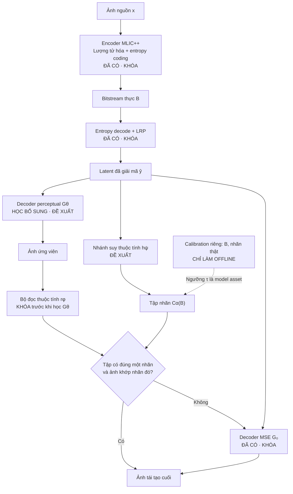
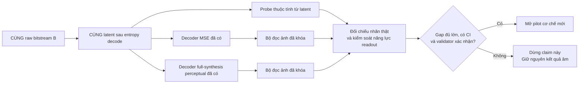

# Draft v0.1 — Giải mã perceptual có ràng buộc từ bitstream

**Trạng thái:** bản thiết kế ứng viên, chưa phải model đã cài đặt hoặc đóng góp mới được xác nhận. Theo [khảo sát nghiên cứu](../reports/MLICpp_top_venue_research_2026-11-05.md), bước thực hiện đầu tiên vẫn là diagnostic pilot. Chỉ mở huấn luyện cơ chế này nếu hiện tượng và phép đo đạt gate.

Ý tưởng: suy một tập nhãn thuộc tính từ latent đã entropy-decode. Khi tập chỉ có một nhãn, kiểm ảnh perceptual có thể hiện nhãn đó theo bộ đọc thuộc tính đã khóa hay không. Trường hợp không đủ điều kiện trả decoder distortion nền. Không gửi nhãn nguồn miễn phí cho decoder.

## 1. Pipeline khi nén và giải mã

- **B** là raw MLIC++ q2 stream trong diagnostic đầu; không thêm packet 46 byte. Nếu nghiên cứu packet ở bước khác, phải đưa toàn bộ base + coefficients vào định nghĩa B và tính đủ byte.
- **hψ** đọc latent suy từ B để dự đoán thuộc tính đã định nghĩa, ví dụ một trong bốn ký tự ở vị trí biết trước trong pilot. Không dùng filename, metadata chứa nhãn hoặc ảnh nguồn.
- **Cα(B)** được tạo bằng head đã khóa và ngưỡng calibration. Không dùng entropy scale của MLIC++ thay cho confidence về nội dung.
- **rφ** là bộ đọc dùng cho loss/kiểm tra candidate, chưa được coi là người xem. Validator đánh giá độc lập phải khác rφ hoặc có xác minh nội dung trực tiếp để phát hiện việc Gθ đánh lừa bộ đọc.
- Gate và fallback là phần đề xuất. Nếu tập rỗng/nhiều nhãn hoặc kiểm tra thất bại, trả G₀. Fallback không tự bảo đảm đúng thuộc tính; cần báo cả lỗi của nó và tỷ lệ fallback.
- Mọi quyết định decoder chỉ phụ thuộc B và model assets dùng chung. Không cần flag chọn nhánh theo ảnh từ encoder ở thiết kế này. Model size và compute của hψ, rφ và hai decoder vẫn phải được đo, không coi là miễn phí.

## 2. Thứ tự huấn luyện và hiệu chỉnh dự kiến

| Bước | Được học | Giữ cố định | Dữ liệu được dùng |
| --- | --- | --- | --- |
| Diagnostic | Probe/readout phục vụ phép đo | Encoder, entropy, các decoder hiện có | Train/development và test mới đã khóa |
| Head thuộc tính | hψ | Codec và representation đầu vào | Chỉ train có nhãn |
| Calibration | Ngưỡng τ, không cập nhật trọng số | hψ, encoder, rate và preprocessing | Calibration tách khỏi train/test |
| Decoder ứng viên | Gθ | Encoder, entropy, hψ, τ và rφ | Train; chọn cấu hình bằng development |
| Đánh giá | Không cập nhật | Toàn bộ pipeline | Test mới, validator độc lập |

Loss ứng viên ở mức khái niệm:

$$
\mathcal L_G = \lambda_d\mathcal L_{dist}(G_\theta(\hat y),x)
+\lambda_p\mathcal L_{perc}(G_\theta(\hat y),x)
+\lambda_e\mathcal L_{evidence}\big(r_\phi(G_\theta(\hat y)),C_\alpha(B)\big).
$$

Evidence loss chỉ có target duy nhất khi Cα(B) là singleton. Đây là loss mềm dự kiến, không bảo đảm hard constraint; runtime gate phải kiểm thực tế. Chưa chốt trọng số hoặc kiến trúc head trước khi diagnostic có tín hiệu. Không chọn chúng trên test vừa mở.

Ảnh nguồn x chỉ làm target của loss khi train; nhãn thật chỉ dùng để học head, calibration và tính metric. Decoder triển khai không nhận x hoặc nhãn thật. Nếu vị trí thuộc tính không cố định như pilot, vị trí phải được suy từ B hoặc truyền và tính byte; không dùng bbox ground truth miễn phí.

## 3. Diagnostic phải chạy trước

Primary là chênh lệch lỗi thuộc tính giữa hai ảnh decode cùng B; probe latent là chẩn đoán hỗ trợ. Probe tốt hơn image reader chỉ chứng minh predictive accessibility theo phép đo đã thử, chưa chứng minh information-theoretic erasure. Negative probe không chứng minh thông tin đã mất.

Theo đề xuất hiện có: trần hai GPU-giờ, dự kiến 512 family mới và mức gap có ý nghĩa 5 điểm phần trăm. Cần khóa inventory, denominator, split và timing trước launch; đây chưa là chứng nhận đủ statistical power. Bộ đọc phải có năng lực trên nguồn và được kiểm trên reconstruction development. Kết quả CNN cũ MSE 251/256 so Mean 250/256 chưa xác nhận một gap lớn.

## 4. Phần đóng góp cần chứng minh

Ứng viên là cách bảo toàn thuộc tính suy được từ bitstream trong quá trình tạo ảnh perceptual. MLIC++, semantic loss, conformal prediction, gate và fallback đều không tự là novelty. Phải so semantic loss đơn giản, confidence gate, blending, decoder nền và explicit attribute coding có tính metadata; xem comparator map trong báo cáo nghiên cứu.

Thiết kế không bảo đảm semantic correctness toàn ảnh hoặc human preference. Prediction-set coverage không bảo đảm một nhãn tùy ý trong tập đúng; guarantee cho nhóm singleton còn phụ thuộc tỷ lệ nhóm, constraint failures và các giả thiết calibration. Cần báo lỗi, chất lượng và compute trên toàn bộ ảnh, không chỉ nhóm vượt gate. Hiện chưa có calibration head, loss evidence hoặc gate mới được train/eval trên server.
