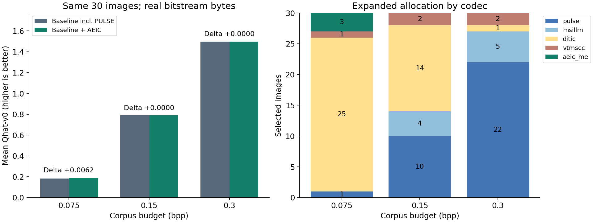
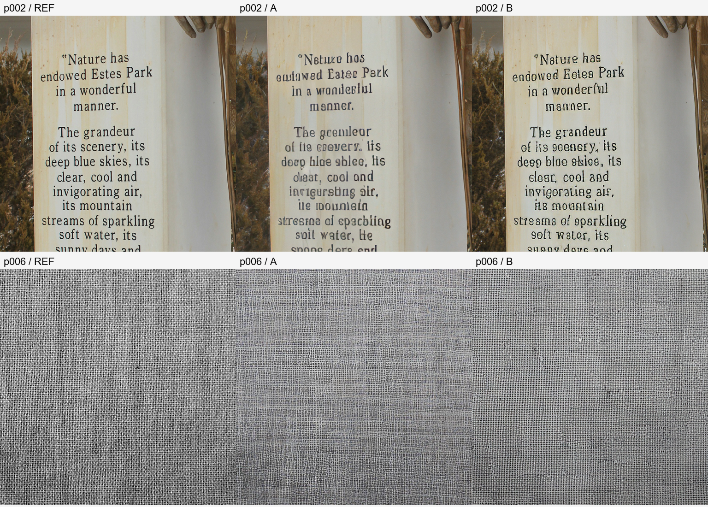

# AEIC trên toàn bộ 30 ảnh: chất lượng, chi phí và quyết định fine-tune

Ngày thực nghiệm: 20/10/2026, múi giờ Asia/Bangkok.

## Kết quả và quyết định

**Hoàn tất lúc 06:49:43: 60/60 điểm có bitstream thật, 60/60 ảnh khớp pixel khi giải mã ở tiến trình mới, scoring và phân bổ ngân sách hoàn tất. Không fine-tune AEIC ở vòng này**, vì mức cải thiện không đạt ngưỡng thực dụng đã định trước. Các tiến trình AEIC và scorer đã kết thúc.

| Ngân sách toàn tập | Q̂ mix có PULSE | Q̂ thêm AEIC | ΔQ̂ trung bình | Ảnh dùng AEIC |
|---|---:|---:|---:|---:|
| 0,075 bpp | 0,184142 | 0,190313 | **+0,006171** | 3/30, đều ME |
| 0,15 bpp | 0,789137 | 0,789137 | 0 | 0/30 |
| 0,3 bpp | 1,497811 | 1,497811 | 0 | 0/30 |

SE không được chọn ở cả ba ngân sách. Baseline gồm 780 điểm của sáu codec, bao gồm 150 điểm PULSE-L; thêm AEIC tạo tổng 840 điểm. Q̂ baseline tái lập khớp số đã lưu trong sai số 1e-6. Bitrate thực của mix mở rộng lần lượt là 0,0749355 / 0,1499080 / 0,2997301 bpp, đều không vượt ngân sách.

Nguồn số liệu: [comparison.json](../results/2026-10-20_aeic_full30/full30_20261020/comparison.json), [allocation.csv](../results/2026-10-20_aeic_full30/full30_20261020/scores/allocation.csv), [baseline_preflight.json](../results/2026-10-20_aeic_full30/full30_20261020/baseline_preflight.json). Hình có [bản SVG](../results/2026-10-20_aeic_full30/full30_20261020/quality_and_selection.svg) và [script tái tạo](../experiments/new_codecs/summarize_aeic.py).

### Lợi ích đến từ đâu?

Ở 0,075 bpp, có sáu ảnh đổi lựa chọn:

| Ảnh (prefix) | Trước → sau | Thay đổi byte | ΔQ̂ riêng ảnh |
|---|---|---:|---:|
| `2684452d` — tượng và bảng chữ | DiT-IC q4 → AEIC-ME ft2 | −25.497 | −0,84497 |
| `937476dd` — texture vải | DiT-IC q3 → AEIC-ME ft2 | −16.047 | −0,38640 |
| `d0208a1e` — thác nước | DiT-IC q2 → AEIC-ME ft2 | −3.846 | −0,10844 |
| `8426ed22` — chân dung | DiT-IC q2 → q3 | +13.920 | +0,46328 |
| `a365e654` — đường phố | DiT-IC q2 → q3 | +14.904 | +0,48898 |
| `eda6d427` — phố và xe đạp | DiT-IC q2 → q3 | +16.780 | +0,57266 |

Ba ảnh chuyển sang AEIC tiết kiệm **45.390 byte**, nhưng tổng Q̂ của chúng giảm 1,33980. Ba ảnh còn lại dùng thêm 45.604 byte và tăng tổng Q̂ 1,52492. Chênh lệch tổng là 0,18512; chia cho 30 ảnh được **+0,00617 Q̂ trung bình**. Cả tập chỉ dùng thêm 214 byte so với baseline, vẫn dưới budget.

Do đó, việc allocator chọn AEIC **không chứng minh AEIC cho ảnh đẹp hơn lựa chọn cũ**. Trong phép thử này, AEIC đóng vai trò lựa chọn ít bit để nhường ngân sách. Nguồn đầy đủ: [changed_images.csv](../results/2026-10-20_aeic_full30/full30_20261020/changed_images.csv).

### Bộ nhớ và thời gian

| Model | Bpp gộp 30 ảnh | Q̂ đơn model | Decode độc lập TB/ảnh | Tổng API decode 30 ảnh | Peak VRAM riêng tiến trình |
|---|---:|---:|---:|---:|---:|
| AEIC-SE ft2 | 0,03111 | −0,90158 | 24,26 s | 727,78 s | 7.006 MiB = 6,84 GiB |
| AEIC-ME ft2 | 0,03260 | −0,66348 | 21,90 s | 656,90 s | 7.496 MiB = 7,32 GiB |

Scorer đạt peak 4.072 MiB. Tất cả thấp hơn ngưỡng dừng riêng tiến trình 10 GiB. ME và SE chạy trên hai GPU có tải dùng chung khác nhau, nên **không suy ra ME nhanh hơn SE về mặt kiến trúc** từ bảng này. Q̂ đơn model cũng không phải so sánh ở cùng bitrate với mix.

Riêng ba ảnh AEIC-ME được chọn tại 0,075 bpp đã cần tổng **65,20 giây API decode**, chưa gồm nạp model và I/O. Đây là chi phí đáng cân nhắc cho một mức tăng Q̂ nhỏ; chưa đo thời gian toàn mix trên L4. Bộ file weights nguồn cần nạp có tổng 4,792 GB cho ME và 4,633 GB cho SE (GB thập phân), gồm cả tensor sau đó bị cắt bỏ hoặc thay thế. **Đây chưa phải kích thước gói decoder tối ưu**, cũng chưa tính dependencies. Số đo: [resource_summary.json](../results/2026-10-20_aeic_full30/full30_20261020/resource_summary.json), [weight_inventory.json](../results/2026-10-20_aeic_full30/full30_20261020/weight_inventory.json).

### Quan sát trực quan và bộ chấm A/B

Đã tạo **18 cặp crop × 3 ảnh gốc/A/B = 54 ảnh lossless**, phủ đủ sáu lựa chọn thay đổi: mỗi ảnh gồm một crop giữa và hai crop ngẫu nhiên có texture, seed cố định. Tên model không có trong trang chấm; khóa đáp án được giữ riêng. Phiếu người xem chưa được điền.

- [Mở bộ chấm HTML](../results/2026-10-20_aeic_full30/full30_20261020/blind_review/index.html): chọn A/B/ngang nhau/khó đánh giá rồi tải phiếu JSON. Mở file bằng trình duyệt trên máy; giữ nguyên thư mục `img` bên cạnh.
- [Ghi chú trực quan của AI trước khi mở khóa A/B](../results/2026-10-20_aeic_full30/full30_20261020/visual_audit/AI_NOTES_BLIND.md): đã xem toàn bộ 18 crop, không tính thành phiếu người thật.
- Ảnh trong bộ chấm đã được kiểm tra đủ file và đúng kích thước 512×512. Trình duyệt tích hợp chặn URL `file://`, nên thao tác chấm/lưu phiếu trong trình duyệt chưa được xác nhận bằng UI.

Sau khi đối chiếu khóa: các crop chữ và vải chuyển sang AEIC có những sai lệch dễ thấy; crop thác nước có chi tiết được giữ tốt hơn ở một số vị trí nhưng không nhất quán. Các ảnh được thêm bit cũng không thể hiện ưu thế rõ ở mọi crop. Đây là nhận xét định tính của AI, không phải kết quả nghiên cứu preference.

Hai hàng là p002 (chữ) và p006 (vải); ảnh gốc ở bên trái, A/B ở giữa/phải. Các crop được giữ nguyên pixel, không tăng nét hay chỉnh màu để minh họa.

### Hành động sau vòng này

1. **Giữ mix có PULSE làm phương án chính**, lưu AEIC là candidate nghiên cứu, chưa tích hợp vào decoder nộp bài.
2. **Không chạy fine-tune dài hoặc pilot fine-tune ở vòng này**: +0,00617 thấp hơn ngưỡng +0,02, chưa có bằng chứng trực quan bù lại chi phí decoder. Kết luận này chỉ áp dụng hai checkpoint ft2 và recipe tile đã thử; không kết luận mọi cấu hình AEIC đều không hữu ích.
3. Đã chuẩn bị kiểm tra khả năng fine-tune để dùng lại nếu có giả thuyết mới đủ cụ thể. Muốn mở lại hướng này cần đánh giá thêm trên held-out, cải thiện có ý nghĩa và phép đo chi phí triển khai; không dùng việc huấn luyện dài để thay thế các bằng chứng còn thiếu.

Các bước đánh giá, phân tích, crop và báo cáo đã hoàn tất. Chấm bởi người là phần còn mở nếu muốn thu thập preference; không cần chờ phiếu để thực hiện quyết định không fine-tune theo ngưỡng đã định.

## Câu hỏi thực nghiệm

AEIC-ME/SE có giúp hệ thống hiện tại phân bổ ngân sách tốt hơn ở 0,075 / 0,15 / 0,3 bpp hay không? Baseline là **mix đã tích hợp PULSE-L**, không phải mix cũ của pilot ba ảnh.

Đơn vị so sánh chính là phương án nén **cùng 30 ảnh dưới cùng ngân sách byte toàn tập**. Một ảnh có thể được nén rẻ hơn để nhường bit cho ảnh khác. Vì vậy, không so trực tiếp AEIC-ft2 ở khoảng 0,02–0,03 bpp với một codec ở 0,075 bpp rồi kết luận ai tốt hơn.

Protocol và ngưỡng quyết định được ghi trước khi scoring trong [PLAN.md](../results/2026-10-20_aeic_full30/PLAN.md). Ngưỡng sàng lọc thực dụng: tăng ít nhất 0,02 Q̂ trung bình và AEIC được chọn cho ít nhất 3/30 ảnh ở một ngân sách. Đây không phải kiểm định ý nghĩa thống kê hay ngưỡng thắng cuộc thi.

## Cấu hình và tính hợp lệ

- Hai checkpoint chính thức ME-ft2 và SE-ft2; mã tác giả pin tại [`7222c2c`](https://github.com/LuizScarlet/AEIC/tree/7222c2c85e8db7ea0b829a139313ab7f4fdea88c).
- Giữ nguyên kích thước ảnh, dùng entropy coder thật. Số byte bao gồm header AEIC 4 byte và metadata kích thước trong stream tác giả.
- `q2` trong thư mục kết quả chỉ định danh checkpoint ft2; không cùng mức bitrate/chất lượng với q2 của PULSE hoặc codec khác.
- Tắt color correction cần thống kê từ ảnh gốc. Tiến trình giải mã độc lập không được truyền đường dẫn tập ảnh gốc; so SHA256 RGB với lần giải mã reference.
- FP32, seed 0, cuDNN deterministic, tắt TF32, tắt compile, bật xformers. Latent tile 64, overlap 16, VAE tile 64. Đây là cấu hình ít VRAM khác tile mặc định tác giả; không coi kết quả này là tái lập nguyên vẹn benchmark trong paper.
- SE chạy GPU 0, ME chạy GPU 1 trên hai L40 dùng chung. Allocator 8 GiB, dừng nếu bộ nhớ riêng tiến trình đạt 10 GiB hoặc thiết bị còn dưới 1,5 GiB trống. Guard là giám sát phần mềm, không phải phân vùng GPU cứng.
- Chỉ chấm điểm sau khi cả 60 stream vượt kiểm giải mã độc lập. Q̂ baseline phải khớp kết quả mix đã lưu trong sai số 1e-6.

## Cơ chế liên quan đến kết quả

Đường giải mã trong [`AEIC_practical.py`](https://github.com/LuizScarlet/AEIC/blob/7222c2c85e8db7ea0b829a139313ab7f4fdea88c/src/AEIC_practical.py) khôi phục latent qua entropy decoder, dùng UNet một bước rồi cộng residual trong không gian latent trước khi đưa vào VAE decoder. [`base_model.py`](https://github.com/LuizScarlet/AEIC/blob/7222c2c85e8db7ea0b829a139313ab7f4fdea88c/src/base_model.py) bỏ time embedding và cross-attention của UNet, thay VAE decoder bằng bản thu hẹp, bỏ VAE encoder và gộp LoRA khi suy luận.

Các bước cắt giảm này vẫn để lại một decoder diffusion đáng kể. Tile nhỏ giúp giảm bộ nhớ nhưng có thể tăng thời gian và thay đổi output. Do đó cần đo đồng thời Q̂, ảnh trực quan, bitstream, thời gian và VRAM. Không dùng mức VRAM suy luận để dự đoán trực tiếp khả năng fine-tune: trainer còn có backward, optimizer, CLIP, DINOv3 discriminator và các mạng tính loss.

## Phạm vi diễn giải

Q̂ v0 là metric đại diện của dự án, không phải phiếu người xem. Việc thêm candidate vào allocator và đánh giá trên chính 30 ảnh này là kết quả validation nội bộ; cần held-out độc lập trước khi tuyên bố khả năng tổng quát. Pixel parity trong hai tiến trình trên cùng môi trường L40 chưa chứng minh parity trên L4 hoặc một môi trường thư viện khác.

Thời gian API trên GPU dùng chung không tương đương thời gian toàn gói decoder trong môi trường thi. Mức peak lấy từ trace NVML theo PID, chu kỳ 0,25 giây; có thể bỏ lỡ đỉnh ngắn. Không dùng counter peak của PyTorch làm peak toàn run vì VAEHook tác giả reset counter trong quá trình giải mã.

Việc chấm A/B của người xem được để trống. Nhận xét trực quan của trợ lý, nếu có, được ghi riêng và không tính thành phiếu người thật.

## Chuẩn bị fine-tune

Đã kiểm tra trainer, cấu hình và 800 ảnh DIV2K trên server. Chi tiết các điều kiện trước launch, lỗi lệch batch giữa shell/YAML, giới hạn dừng pilot và recipe một GPU nằm trong [TRAINING_READINESS.md](../results/2026-10-20_aeic_full30/TRAINING_READINESS.md). Huấn luyện chỉ được khởi động sau khi các ngưỡng chất lượng, trực quan và chi phí được đáp ứng.

## Bằng chứng và chạy lại

Server: `guess:~/clic/aeic_20261016/full30_20261020`. Bitstream và ảnh đầy đủ được giữ tại đây. Bản local gồm log, metadata, metrics, allocation, parity, trace VRAM và crop: [thư mục kết quả](../results/2026-10-20_aeic_full30/README.md).

Hash code/baseline, manifest 30 ảnh và hash ảnh nguồn: [provenance.json](../results/2026-10-20_aeic_full30/full30_20261020/provenance.json). Bản code baseline trên server là snapshot không có `.git`; những file Python liên quan được hash nội dung. Phiên bản môi trường và hashes weights có trong [bằng chứng pilot](../results/2026-10-20_aeic_pilot/README.md).

Artifact server `full30_evidence.tgz` được tải về và kiểm SHA256: `b1951ca73279a0e8ef113d73fc12bb0c3781ffd81a1fbebec954c682d0bc0368`. Contact sheet và ghi chú AI được tạo thêm tại local, sau khi tải artifact, nên không nằm trong hash tar này.
