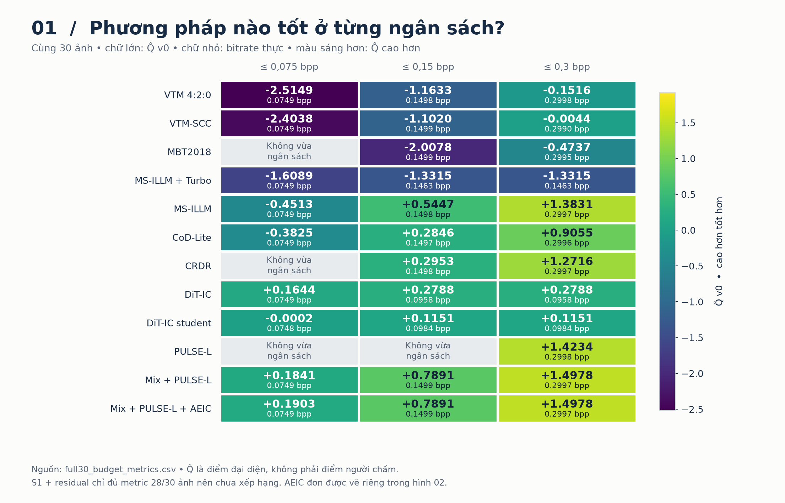
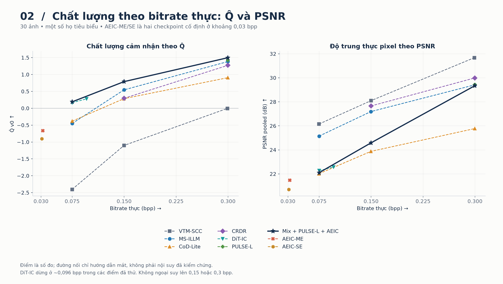
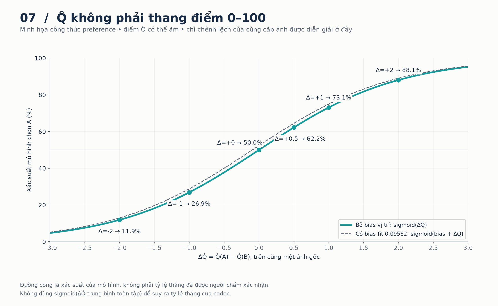
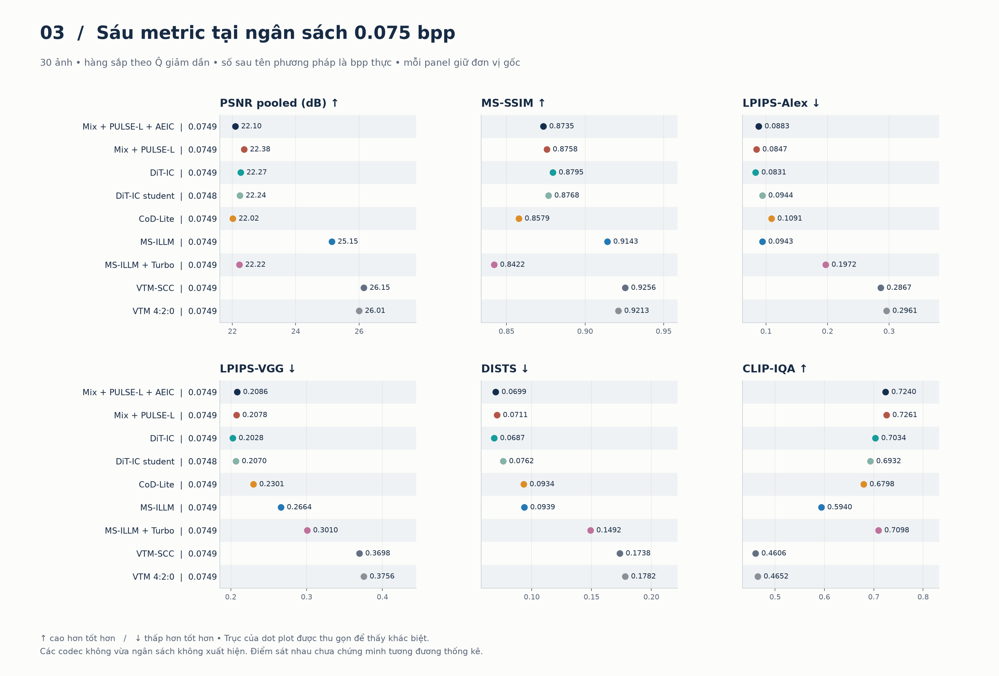
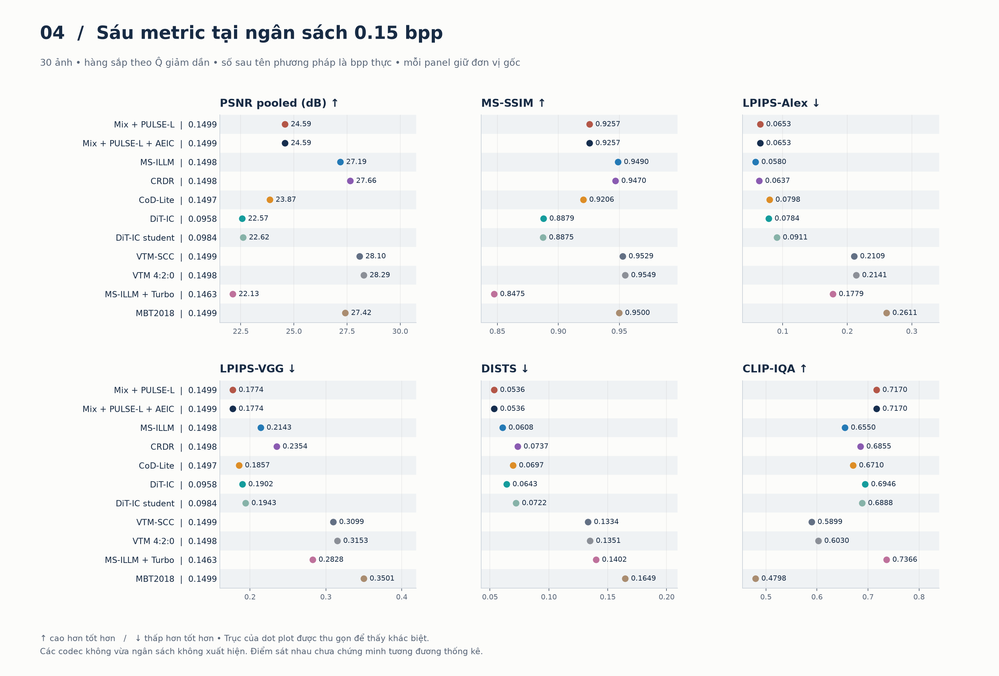
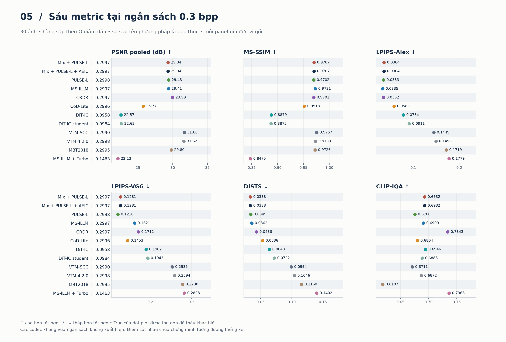
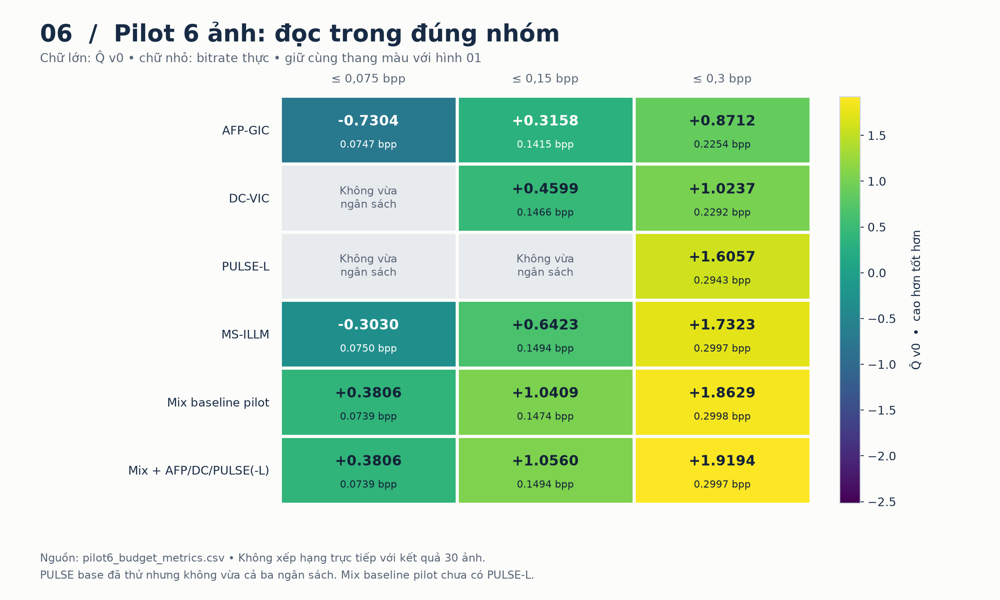

# Bảng so sánh metrics và cách đọc Q̂ — 20/10/2026

**Các bảng dùng Q̂ v0 và số đo đã lưu của repo, không chạy thêm model.** Kết quả 30 ảnh, pilot 6 ảnh và probe một ảnh được tách riêng. Bảng chi tiết gồm bitrate, PSNR, MS-SSIM, LPIPS-Alex/VGG, DISTS, CLIP-IQA và Q̂; các CSV đi kèm giữ số đầy đủ cùng đường dẫn nguồn.

## Đọc nhanh bằng đồ thị

[Mở bộ 7 đồ thị dạng PDF](figures/metrics_2026-10-20/CLIC2027_metrics_charts.pdf). Mỗi hình cũng có bản PNG và SVG trong [thư mục hình](figures/metrics_2026-10-20/). Nguồn CSV và hash được ghi trong [manifest](figures/metrics_2026-10-20/manifest.json); cách tái tạo và phạm vi kiểm tra có trong [ghi chú hình](figures/metrics_2026-10-20/figure_notes.md).

**Hình 1 — Q̂ theo ngân sách.** Đọc theo cột để so dưới cùng trần byte, đọc theo hàng để xem phương pháp thay đổi thế nào khi tăng ngân sách. Mỗi ô ghi cả Q̂ và bitrate thực. Ví dụ DiT-IC chỉ đạt khoảng 0,096 bpp trong các điểm đã thử; hai cột ngân sách cao không phải hai checkpoint mới.



**Hình 2 — Hai tiêu chí chất lượng theo bitrate thực.** Q̂ và PSNR có thể dẫn đến thứ tự khác nhau. AEIC nằm ở khoảng 0,03 bpp, vì vậy không xem nó như một điểm đã đo tại 0,075 bpp. Đường nối chỉ giúp theo dõi các điểm có sẵn, không chứng minh chất lượng giữa các điểm.



## 1. Mỗi metric đo gì?

| Metric | Đơn vị / thang đo | Chiều tốt | Ý nghĩa và giới hạn |
|---|---|---|---|
| Bitrate — bpp | Bit trên một pixel; `8 × tổng byte / tổng pixel` | Thấp hơn khi giữ chất lượng tương đương | Tính byte stream thật. Không chỉ tính entropy ước lượng. Cần đọc cùng chất lượng. |
| PSNR | dB, không phải phần trăm | ↑ | Đo sai số RGB; nhạy với lệch màu/vị trí, có thể ưu ái ảnh mịn. Bảng dùng **pooled PSNR** từ MSE gộp có trọng số pixel. |
| MS-SSIM | Thường 0–1; 1 là giống hoàn toàn theo metric | ↑ | Độ giống cấu trúc ở nhiều tỉ lệ. Không bảo đảm chữ và chi tiết ngữ nghĩa đúng. |
| LPIPS-Alex | Khoảng cách đặc trưng AlexNet; 0 là khớp | ↓ | Dùng bản Alex trong cột LPIPS của báo cáo cũ. Không phải thang phần trăm, không mặc định bị chặn ở 1. |
| LPIPS-VGG | Khoảng cách đặc trưng VGG; 0 là khớp | ↓ | Khác backbone với LPIPS-Alex; không trộn hai giá trị vào một cột. |
| DISTS | Sai khác cấu trúc/texture; gần 0 tốt hơn | ↓ | Hữu ích cho ảnh cảm nhận; vẫn có thể bỏ sót lỗi chữ hoặc texture bịa. |
| CLIP-IQA | Điểm chất lượng ảnh không cần ảnh gốc, thường 0–1 | ↑ | Ảnh trông tự nhiên có thể được điểm cao dù không trung thực với ảnh gốc. |
| **Q̂ v0** | **Tiện ích thực, không có thang 0–100 hay mốc “đạt” cố định** | ↑ | Kết hợp sáu metric để dự đoán preference theo cặp. Giá trị âm hợp lệ; không đồng nghĩa model hỏng. |
| Decode time | Giây/ảnh hoặc giây/toàn bộ tập | ↓ | Phải phân biệt API với toàn gói gồm khởi động/load/I/O, và giữ phần cứng/tải giống nhau. |
| VRAM | MiB/GiB; ghi rõ theo PID hay toàn GPU | ↓ khi chất lượng/tốc độ tương đương | Số toàn GPU có thể bao gồm job khác. Không so thẳng với số riêng tiến trình. |
| Pixel parity | Số ảnh giải mã khớp pixel / tổng số | Đủ toàn bộ | Kiểm tính tái lập, không phải điểm chất lượng. Khớp trên L40 chưa chứng minh khớp trên L4. |
| OCR CER | Tỷ lệ lỗi ký tự, có thể >1 khi nhiều ký tự chèn | ↓ | Có trong probe chữ của repo; chưa đo đồng nhất cho mọi codec. |
| FID/KID, WD3/WD5 | Các khoảng cách phân phối/đặc trưng | ↓ ở dạng khoảng cách gốc | Có công cụ trong repo nhưng chưa phủ tất cả phương pháp ở bảng chính; **không nằm trong Q̂ v0**. |

Quy ước tính ảnh của repo: PSNR từ RGB; MS-SSIM trên ảnh đầy đủ; LPIPS và DISTS theo tile 512×512, gộp theo diện tích tile, bỏ tile có cạnh nhỏ hơn 64. Bpp gộp theo pixel; MS-SSIM, LPIPS, DISTS, CLIP-IQA và Q̂ của tập là trung bình đều trên các ảnh. Nguồn: [metrics.py](../src/clic27/eval/metrics.py), [Features và transform](../experiments/qhat/qhat.py), [bake-off summary](../experiments/bakeoff/bakeoff.py).

## 2. Thang đo Q̂ đang dùng

**Q̂ khác `q0/q1/q2/q3/q4`.** Các tên `q…` là chỉ số cấu hình/checkpoint chất lượng của từng codec; không có thang chung giữa các model. Q̂ là điểm được tính từ ảnh tái tạo và các metric bên dưới.

### Công thức thực tế

Với ảnh gốc \(O\) và ảnh tái tạo \(X\), repo tính Q̂ v0 **riêng cho từng ảnh**:

```text
Q̂(O, X) =
  -0.034319 × PSNR
  +1.346040 × [-log10(max(1 - MS-SSIM, 0.000001))]
  -2.096177 × LPIPS-Alex
  -2.379560 × LPIPS-VGG
  -13.931139 × DISTS
  +1.720847 × CLIP-IQA
```

Các hệ số trên được làm tròn để trình bày; script dùng đủ precision trong [qhat_v0.json](../results/2026-10-15_new_codecs/qhat_v0.json). Trọng số `weights` đã được đổi khỏi chuẩn hóa khi xuất model; **không chia thêm cho `scale`**. Hệ số PSNR âm là kết quả fit đồng thời các đặc trưng tương quan; không diễn giải thành quy luật “PSNR càng thấp càng tốt”, hoặc lý do cố tình làm hỏng ảnh.

**Không thế trực tiếp các số trung bình trong bảng vào công thức để tái tạo Q̂ trung bình.** Phép biến đổi MS-SSIM là phi tuyến, còn PSNR trong bảng là pooled PSNR, khác trung bình PSNR từng ảnh. Script tính Q̂ từng ảnh trước rồi mới lấy trung bình.

### Chênh lệch Q̂ có nghĩa gì?

Mô hình preference lưu trong repo:

```text
P(A được chọn hơn B | cùng ảnh gốc) = sigmoid(0.095620 + Q̂(A) - Q̂(B))
sigmoid(z) = 1 / (1 + exp(-z))
```

Bias 0,095620 phản ánh thiên lệch vị trí A/B trong phép fit, **không cộng vào Q̂ riêng của codec**. Bảng dưới minh họa logistic khi bỏ bias vị trí để dễ đọc:

| ΔQ̂ = Q̂(A) − Q̂(B) trên cùng ảnh | Xác suất mô hình, giả sử bias = 0 |
|---:|---:|
| 0 | 50,0% |
| +0,25 | 56,2% |
| +0,5 | 62,2% |
| +1 | 73,1% |
| +2 | 88,1% |

Đây là **diễn giải của mô hình**, không phải xác suất đã được kiểm chứng trên CLIC 2027. Tăng 1 Q̂ làm odds dự đoán nhân khoảng \(e ≈ 2,72\) trong mô hình. Q̂ = 1 không có nghĩa chất lượng “100%”; Q̂ = 0 cũng không phải ảnh ngẫu nhiên hay mốc đạt chuẩn.

**Không lấy sigmoid của ΔQ̂ trung bình toàn tập để tuyên bố tỷ lệ thắng của codec.** Mỗi ảnh có chênh lệch khác nhau; ngay trung bình xác suất theo từng ảnh cũng chỉ là dự đoán, chưa phải phiếu người. Ví dụ AEIC làm mix tăng +0,00617 trung bình nhờ đổi cách chia bit, trong khi cả ba ảnh chuyển sang AEIC đều giảm Q̂ riêng.

**Hình 7 — Diễn giải chênh lệch Q̂ của cùng một cặp ảnh.** Đường liền bỏ bias vị trí; đường đứt dùng bias trong file fit. Trục phần trăm là xác suất của mô hình preference, không phải chuyển Q̂ thành điểm chất lượng 0–100.



### Mức tin cậy hiện có

| Kiểm tra Q̂ | Q̂ v0 | Q̂ v1 | Cách đọc |
|---|---:|---:|---|
| Số câu hỏi có features dùng để fit | 8.000 | 8.000 | Dữ liệu preference CLIC cũ; không phải 8.000 ảnh độc lập |
| Accuracy 5-fold đã lưu | 78,8% | 79,0% | Fold theo câu hỏi; chưa bảo đảm độc lập theo ảnh |
| Train 2021/2022, test 2024 | 81,2% | 83,3% | Accuracy cross-year đã lưu; không phải accuracy trên tập 2027 |
| Đặc trưng | PSNR, MS-SSIM, LPIPS-A/V, DISTS, CLIP-IQA | MS-SSIM, WD3 | **Hai thang điểm khác nhau; không so trị số v0 với v1** |
| Vai trò trong bảng này | **Dùng thống nhất** | Không dùng để xếp hạng | Giữ cùng objective với allocator hiện tại |

Cross-year score đánh giá model fit trên các năm cũ; file weights triển khai được fit lại trên đủ dữ liệu. Repo còn có kiểm tra một người chấm DiT-IC với MS-ILLM: 62/90 crop nghiêng về DiT-IC, dấu ΔQ̂ v0 phù hợp đa số phiếu ở 26/30 ảnh. Bằng chứng này chỉ thuộc cặp model/cấu hình cũ, không xác nhận AEIC hay PULSE, và không thay thế nghiên cứu nhiều người. Không gọi mức đồng ý giữa hai người là một trần toán học tuyệt đối.

Nguồn: [fit v0](../results/2026-10-06_qhat_v0/fit.json), [fit v1](../results/2026-10-09_qhat_v1/fit.json), [phiếu so DiT-IC/MS-ILLM](../results/2026-10-11_rating_ditic_msillm/summary.md).

## 3. Điều kiện của bảng so sánh

- Bảng 30 ảnh dùng cùng danh sách ảnh và tổng 86.245.376 pixel. Các ngân sách byte là 808.550 / 1.617.100 / 3.234.201.
- Mỗi phương pháp chọn một điểm đã đo cho từng ảnh để tối đa tổng Q̂ dưới **ngân sách toàn tập**. Đây không phải kết quả mọi ảnh đều đúng cùng bpp.
- VTM-SCC, MS-ILLM, CoD-Lite, DiT-IC, student và PULSE-L lấy từ snapshot tích hợp 15/10. VTM 4:2:0 và MBT lấy từ snapshot 13/10; CRDR từ 10/10; SD-Turbo refiner từ 08/10. Đó là các evaluation đã hoàn tất, **không phải so tiến độ huấn luyện ngang số bước**.
- Mix có PULSE gồm sáu họ trong snapshot tích hợp; mix + AEIC thêm hai biến thể. **Không phải mix hợp nhất toàn bộ các phương pháp lịch sử** ở bảng này.
- Pixel parity và header của tất cả codec lịch sử chưa được kiểm cùng một quy trình triển khai. Đặc biệt MS-ILLM có [audit riêng](CLIC2027_msillm_stream_audit_2026-10-15.md); bảng giữ output/metric snapshot đã đo, chưa đại diện một gói decoder cuối cùng.
- S1 + residual có point cho 30 ảnh nhưng chỉ **364 metric rows phủ 28/30 ảnh** trong artifact local. Không điền một Q̂ “toàn 30 ảnh” từ tập thiếu.
- Nhãn `Không vừa` chỉ nói về các checkpoint/điểm đã thử, không nói kiến trúc đó không thể đạt rate thấp hơn sau huấn luyện.

<!-- GENERATED_TABLES -->

### Bảng Q̂ v0 trên cùng 30 ảnh

Mỗi ô là **Q̂ / bpp thực** dưới ngân sách cột. `Không vừa` nghĩa là các điểm đã có không đủ thấp để nén toàn tập. Bitrate thấp hơn ngân sách không được nội suy thành một điểm mới.

| Phương pháp | ≤0,075 bpp | ≤0,15 bpp | ≤0,3 bpp |
|---|---:|---:|---:|
| VTM 4:2:0 | -2.5149 / 0.0749 | -1.1633 / 0.1498 | -0.1516 / 0.2998 |
| VTM-SCC 4:4:4 | -2.4038 / 0.0749 | -1.1020 / 0.1499 | -0.0044 / 0.2990 |
| DC-AE + S1 + residual VTM | Thiếu metric (28/30 ảnh) | Thiếu metric (28/30 ảnh) | Thiếu metric (28/30 ảnh) |
| MBT2018-mean | Không vừa | -2.0078 / 0.1499 | -0.4737 / 0.2995 |
| MS-ILLM + SD-Turbo refiner | -1.6089 / 0.0749 | -1.3315 / 0.1463 | -1.3315 / 0.1463 |
| MS-ILLM | -0.4513 / 0.0749 | 0.5447 / 0.1498 | 1.3831 / 0.2997 |
| CoD-Lite | -0.3825 / 0.0749 | 0.2846 / 0.1497 | 0.9055 / 0.2996 |
| CRDR | Không vừa | 0.2953 / 0.1498 | 1.2716 / 0.2997 |
| DiT-IC | 0.1644 / 0.0749 | 0.2788 / 0.0958 | 0.2788 / 0.0958 |
| DiT-IC student | -0.0002 / 0.0748 | 0.1151 / 0.0984 | 0.1151 / 0.0984 |
| PULSE-L perceptual | Không vừa | Không vừa | 1.4234 / 0.2998 |
| Mix có PULSE-L | 0.1841 / 0.0749 | 0.7891 / 0.1499 | 1.4978 / 0.2997 |
| Mix có PULSE-L + AEIC | 0.1903 / 0.0749 | 0.7891 / 0.1499 | 1.4978 / 0.2997 |

### Đầy đủ metrics — ngân sách 0.075 bpp, 30 ảnh

| Phương pháp | bpp thực | PSNR pooled ↑ | MS-SSIM ↑ | LPIPS-Alex ↓ | LPIPS-VGG ↓ | DISTS ↓ | CLIP-IQA ↑ | Q̂ v0 ↑ |
|---|---:|---:|---:|---:|---:|---:|---:|---:|
| VTM 4:2:0 | 0.07488 | 26.01 | 0.9213 | 0.2961 | 0.3756 | 0.1782 | 0.4652 | -2.5149 |
| VTM-SCC 4:4:4 | 0.07489 | 26.15 | 0.9256 | 0.2867 | 0.3698 | 0.1738 | 0.4606 | -2.4038 |
| MS-ILLM + SD-Turbo refiner | 0.07488 | 22.22 | 0.8422 | 0.1972 | 0.3010 | 0.1492 | 0.7098 | -1.6089 |
| MS-ILLM | 0.07494 | 25.15 | 0.9143 | 0.0943 | 0.2664 | 0.0939 | 0.5940 | -0.4513 |
| CoD-Lite | 0.07491 | 22.02 | 0.8579 | 0.1091 | 0.2301 | 0.0934 | 0.6798 | -0.3825 |
| DiT-IC | 0.07494 | 22.27 | 0.8795 | 0.0831 | 0.2028 | 0.0687 | 0.7034 | 0.1644 |
| DiT-IC student | 0.07478 | 22.24 | 0.8768 | 0.0944 | 0.2070 | 0.0762 | 0.6932 | -0.0002 |
| Mix có PULSE-L | 0.07492 | 22.38 | 0.8758 | 0.0847 | 0.2078 | 0.0711 | 0.7261 | 0.1841 |
| Mix có PULSE-L + AEIC | 0.07494 | 22.10 | 0.8735 | 0.0883 | 0.2086 | 0.0699 | 0.7240 | 0.1903 |

### Đầy đủ metrics — ngân sách 0.15 bpp, 30 ảnh

| Phương pháp | bpp thực | PSNR pooled ↑ | MS-SSIM ↑ | LPIPS-Alex ↓ | LPIPS-VGG ↓ | DISTS ↓ | CLIP-IQA ↑ | Q̂ v0 ↑ |
|---|---:|---:|---:|---:|---:|---:|---:|---:|
| VTM 4:2:0 | 0.14977 | 28.29 | 0.9549 | 0.2141 | 0.3153 | 0.1351 | 0.6030 | -1.1633 |
| VTM-SCC 4:4:4 | 0.14986 | 28.10 | 0.9529 | 0.2109 | 0.3099 | 0.1334 | 0.5899 | -1.1020 |
| MBT2018-mean | 0.14988 | 27.42 | 0.9500 | 0.2611 | 0.3501 | 0.1649 | 0.4798 | -2.0078 |
| MS-ILLM + SD-Turbo refiner | 0.14630 | 22.13 | 0.8475 | 0.1779 | 0.2828 | 0.1402 | 0.7366 | -1.3315 |
| MS-ILLM | 0.14979 | 27.19 | 0.9490 | 0.0580 | 0.2143 | 0.0608 | 0.6550 | 0.5447 |
| CoD-Lite | 0.14971 | 23.87 | 0.9206 | 0.0798 | 0.1857 | 0.0697 | 0.6710 | 0.2846 |
| CRDR | 0.14983 | 27.66 | 0.9470 | 0.0637 | 0.2354 | 0.0737 | 0.6855 | 0.2953 |
| DiT-IC | 0.09577 | 22.57 | 0.8879 | 0.0784 | 0.1902 | 0.0643 | 0.6946 | 0.2788 |
| DiT-IC student | 0.09843 | 22.62 | 0.8875 | 0.0911 | 0.1943 | 0.0722 | 0.6888 | 0.1151 |
| Mix có PULSE-L | 0.14991 | 24.59 | 0.9257 | 0.0653 | 0.1774 | 0.0536 | 0.7170 | 0.7891 |
| Mix có PULSE-L + AEIC | 0.14991 | 24.59 | 0.9257 | 0.0653 | 0.1774 | 0.0536 | 0.7170 | 0.7891 |

### Đầy đủ metrics — ngân sách 0.3 bpp, 30 ảnh

| Phương pháp | bpp thực | PSNR pooled ↑ | MS-SSIM ↑ | LPIPS-Alex ↓ | LPIPS-VGG ↓ | DISTS ↓ | CLIP-IQA ↑ | Q̂ v0 ↑ |
|---|---:|---:|---:|---:|---:|---:|---:|---:|
| VTM 4:2:0 | 0.29980 | 31.62 | 0.9733 | 0.1496 | 0.2594 | 0.1046 | 0.6872 | -0.1516 |
| VTM-SCC 4:4:4 | 0.29900 | 31.68 | 0.9757 | 0.1449 | 0.2535 | 0.0994 | 0.6711 | -0.0044 |
| MBT2018-mean | 0.29945 | 29.80 | 0.9726 | 0.1719 | 0.2790 | 0.1160 | 0.6187 | -0.4737 |
| MS-ILLM + SD-Turbo refiner | 0.14630 | 22.13 | 0.8475 | 0.1779 | 0.2828 | 0.1402 | 0.7366 | -1.3315 |
| MS-ILLM | 0.29967 | 29.41 | 0.9731 | 0.0335 | 0.1621 | 0.0362 | 0.6909 | 1.3831 |
| CoD-Lite | 0.29959 | 25.77 | 0.9518 | 0.0583 | 0.1453 | 0.0536 | 0.6804 | 0.9055 |
| CRDR | 0.29968 | 29.99 | 0.9701 | 0.0352 | 0.1712 | 0.0436 | 0.7343 | 1.2716 |
| DiT-IC | 0.09577 | 22.57 | 0.8879 | 0.0784 | 0.1902 | 0.0643 | 0.6946 | 0.2788 |
| DiT-IC student | 0.09843 | 22.62 | 0.8875 | 0.0911 | 0.1943 | 0.0722 | 0.6888 | 0.1151 |
| PULSE-L perceptual | 0.29977 | 29.43 | 0.9702 | 0.0353 | 0.1216 | 0.0345 | 0.6760 | 1.4234 |
| Mix có PULSE-L | 0.29973 | 29.34 | 0.9707 | 0.0364 | 0.1281 | 0.0338 | 0.6932 | 1.4978 |
| Mix có PULSE-L + AEIC | 0.29973 | 29.34 | 0.9707 | 0.0364 | 0.1281 | 0.0338 | 0.6932 | 1.4978 |

### AEIC: checkpoint cố định, chưa khớp rate với bảng chính

| Phương pháp | bpp thực | PSNR pooled ↑ | MS-SSIM ↑ | LPIPS-Alex ↓ | LPIPS-VGG ↓ | DISTS ↓ | CLIP-IQA ↑ | Q̂ v0 ↑ |
|---|---:|---:|---:|---:|---:|---:|---:|---:|
| AEIC-SE ft2 | 0.03111 | 20.71 | 0.8287 | 0.1441 | 0.2807 | 0.1097 | 0.7081 | -0.9016 |
| AEIC-ME ft2 | 0.03260 | 21.48 | 0.8434 | 0.1352 | 0.2640 | 0.0988 | 0.7087 | -0.6635 |

### Pilot 6 ảnh — chỉ so trong cùng nhóm này

AFP-GIC/DC-VIC/PULSE-L dưới đây là pilot 6 ảnh. Baseline pilot chưa có PULSE-L; khác baseline tích hợp của bảng 30 ảnh. PULSE base đã chạy 24 điểm nhưng không vừa cả ba budget, nên không có hàng allocation hợp lệ.

#### Ngân sách 0.075 bpp

| Phương pháp | bpp thực | PSNR pooled ↑ | MS-SSIM ↑ | LPIPS-Alex ↓ | LPIPS-VGG ↓ | DISTS ↓ | CLIP-IQA ↑ | Q̂ v0 ↑ |
|---|---:|---:|---:|---:|---:|---:|---:|---:|
| AFP-GIC | 0.07470 | 23.20 | 0.8956 | 0.0901 | 0.2323 | 0.1190 | 0.5922 | -0.7304 |
| MS-ILLM | 0.07496 | 23.40 | 0.9020 | 0.0883 | 0.2119 | 0.1005 | 0.5833 | -0.3030 |
| Mix baseline pilot | 0.07388 | 20.10 | 0.8324 | 0.0757 | 0.1676 | 0.0756 | 0.7221 | 0.3806 |
| Mix pilot + AFP/DC-VIC/PULSE/PULSE-L | 0.07388 | 20.10 | 0.8324 | 0.0757 | 0.1676 | 0.0756 | 0.7221 | 0.3806 |

#### Ngân sách 0.15 bpp

| Phương pháp | bpp thực | PSNR pooled ↑ | MS-SSIM ↑ | LPIPS-Alex ↓ | LPIPS-VGG ↓ | DISTS ↓ | CLIP-IQA ↑ | Q̂ v0 ↑ |
|---|---:|---:|---:|---:|---:|---:|---:|---:|
| AFP-GIC | 0.14150 | 24.30 | 0.9191 | 0.0649 | 0.1841 | 0.0860 | 0.6910 | 0.3158 |
| DC-VIC PatchGAN | 0.14657 | 24.11 | 0.9183 | 0.0653 | 0.1693 | 0.0805 | 0.6945 | 0.4599 |
| MS-ILLM | 0.14941 | 25.49 | 0.9528 | 0.0501 | 0.1742 | 0.0627 | 0.6128 | 0.6423 |
| Mix baseline pilot | 0.14738 | 21.86 | 0.8825 | 0.0563 | 0.1446 | 0.0585 | 0.7162 | 1.0409 |
| Mix pilot + AFP/DC-VIC/PULSE/PULSE-L | 0.14938 | 21.86 | 0.8825 | 0.0564 | 0.1406 | 0.0581 | 0.7135 | 1.0560 |

#### Ngân sách 0.3 bpp

| Phương pháp | bpp thực | PSNR pooled ↑ | MS-SSIM ↑ | LPIPS-Alex ↓ | LPIPS-VGG ↓ | DISTS ↓ | CLIP-IQA ↑ | Q̂ v0 ↑ |
|---|---:|---:|---:|---:|---:|---:|---:|---:|
| AFP-GIC | 0.22538 | 26.65 | 0.9594 | 0.0393 | 0.1693 | 0.0660 | 0.7165 | 0.8712 |
| DC-VIC PatchGAN | 0.22920 | 26.69 | 0.9601 | 0.0378 | 0.1505 | 0.0577 | 0.6975 | 1.0237 |
| PULSE-L pilot | 0.29426 | 27.06 | 0.9668 | 0.0309 | 0.0987 | 0.0348 | 0.6743 | 1.6057 |
| MS-ILLM | 0.29972 | 28.06 | 0.9761 | 0.0255 | 0.1283 | 0.0339 | 0.7154 | 1.7323 |
| Mix baseline pilot | 0.29979 | 27.45 | 0.9628 | 0.0385 | 0.1051 | 0.0342 | 0.7653 | 1.8629 |
| Mix pilot + AFP/DC-VIC/PULSE/PULSE-L | 0.29975 | 28.44 | 0.9734 | 0.0421 | 0.1012 | 0.0310 | 0.7204 | 1.9194 |


<!-- END_GENERATED_TABLES -->

## 4. Các probe khác đã chạy

| Phương pháp / phép thử | Tập và điều kiện | bpp thực | PSNR | LPIPS-Alex ↓ | DISTS ↓ | Q̂ v0 | Phạm vi kết luận |
|---|---|---:|---:|---:|---:|---:|---|
| Cool-Chic 5.0.1, 2.000 iterations | Một ảnh `2684452d` | 0,1114 | 29,11 | 0,109 | 0,091 | −0,41 | Không xếp chung bảng 30 ảnh |
| Cool-Chic tag CLIC2025 | Một ảnh `2684452d`, perceptive config | 0,557 | 32,67 | — | — | +1,33 | Ngoài cả ba ngân sách mục tiêu |
| S1 r4, step 200.000 | Kodak, snapshot `results/s1` | 0,0710 | 21,70 | 0,1521 | 0,1058 | — | Không có đủ features để tính Q̂ v0 |
| S1 r7, cùng snapshot | Kodak | 0,1215 | 23,29 | 0,0980 | 0,0621 | — | Khác tập với bảng chính |
| DC-AE ceiling | Kodak, latent không bị nén bởi S1 | Không có | 23,66 | 0,0905 | 0,0583 | — | Kiểm backbone; **không phải codec có bitrate thật** |
| DC-AE + residual giả định base 0,03 bpp | Probe B6 natural/screen | Xem nguồn | Theo nhóm | Theo nhóm | Theo nhóm | — | Chi phí base giả định; không trộn với true-bitstream codec |

`—` là không có số tương ứng trong bằng chứng này, không phải 0. Nguồn: [Cool-Chic 5.0.1](../results/2026-10-09_coolchic_probe/summary.md), [Cool-Chic CLIC2025](../results/2026-10-09_coolchic2025_probe/summary.md), [S1/Kodak](../results/s1/s1_eval/summary.md), [B6](../results/clic_b/b6_results/summary.md). Nhiều checkpoint/ablation distillation đã được chạy; bảng chính dùng student được đưa vào bake-off, không trộn các snapshot huấn luyện trung gian thành codec mới.

PICO, ProGIC, EGIC và PORT trong báo cáo khảo sát là các hướng đã đọc/tìm implementation; chưa có kết quả inference hợp lệ trong bộ artifact này, nên không gán metric cho chúng.

## 5. Đọc kết quả để chọn hướng tiếp theo

Ở ngân sách 0,075, DiT-IC có Q̂ tốt nhất trong các codec đơn được phân bổ gần hết ngân sách; VTM có PSNR/MS-SSIM cao hơn nhưng LPIPS/DISTS kém hơn. Đây là ví dụ rõ cho việc các metric đánh giá những thuộc tính khác nhau.

Ở 0,15, MS-ILLM đạt Q̂ 0,5447; mix có PULSE đạt 0,7891 nhờ chia byte giữa nhiều họ model. DiT-IC chỉ dùng khoảng 0,0958 bpp nên điểm ở cột này không mô tả khả năng của một checkpoint DiT-IC 0,15 bpp chưa được thử.

Ở 0,3, PULSE-L đạt Q̂ 1,4234, MS-ILLM 1,3831, CRDR 1,2716; mix đạt 1,4978. Khoảng cách này thuộc metric đại diện trên validation, chưa phải kết luận thắng theo người chấm.

Thêm AEIC tại 0,075 làm Q̂ tăng từ 0,1841 lên 0,1903 nhưng PSNR giảm 22,38 → 22,10 dB, MS-SSIM giảm 0,8758 → 0,8735, LPIPS-Alex tăng 0,0847 → 0,0883; DISTS giảm nhẹ 0,0711 → 0,0699. **Q̂ tăng không có nghĩa mọi metric đều tốt lên.** Quyết định chưa fine-tune AEIC vẫn giữ nguyên theo [báo cáo full30](CLIC2027_AEIC_full30_2026-10-20.md).

## 6. File dữ liệu và kiểm tra

- [CSV 30 ảnh, đủ metrics và nguồn mỗi hàng](../results/2026-10-20_metrics_comparison/full30_budget_metrics.csv).
- [CSV AEIC checkpoint cố định](../results/2026-10-20_metrics_comparison/aeic_fixed_metrics.csv).
- [CSV pilot 6 ảnh](../results/2026-10-20_metrics_comparison/pilot6_budget_metrics.csv).
- [Bitrate tối thiểu của các điểm đã thử](../results/2026-10-20_metrics_comparison/rate_floors.json): MBT khoảng 0,1314 bpp, CRDR 0,1184 bpp và PULSE-L 0,1921 bpp trên toàn bộ 30 ảnh; dùng để kiểm tra các ô `Không vừa`.
- [Script tổng hợp không dùng GPU](../results/2026-10-20_metrics_comparison/build_comparison.py), [hash nguồn](../results/2026-10-20_metrics_comparison/sources.sha256.json).

Hash nguồn văn bản chuẩn hóa CRLF thành LF (giữ BOM nếu có) để tái kiểm chứng trên Windows/Linux. Script ghép allocation với metric từng ảnh, tính lại Q̂ từ weights v0 và pooled PSNR, đối chiếu summary đã lưu, kiểm đủ số ảnh và không vượt ngân sách. Với AEIC không lưu MSE, MSE được suy ngược từ PSNR từng ảnh trước khi gộp. Không suy ra metric bị thiếu bằng cách nội suy giữa các model, và không chạy lại inference trong bước này.

## 7. Đồ thị chi tiết để đối chiếu

Mỗi hàng là một phương pháp, giữ cùng vị trí trong cả sáu panel và sắp theo Q̂ giảm dần. Số sau tên là **bpp thực**, vì một số checkpoint dùng ít hơn trần ngân sách. PSNR, MS-SSIM và CLIP-IQA càng cao càng tốt; LPIPS và DISTS càng thấp càng tốt. Trục ngang là giá trị gốc của từng metric, không chuẩn hóa để cộng hoặc so khoảng cách giữa các panel.

### Hình 3 — Ngân sách 0,075 bpp



Hai mix đứng đầu Q̂ nhưng không đứng đầu mọi metric. So sánh hai hàng đầu cho thấy thêm AEIC làm thay đổi cách chia bit và đánh đổi giữa các metric; không kết luận mọi ảnh đều được cải thiện.

### Hình 4 — Ngân sách 0,15 bpp



DiT-IC và student vẫn dùng dưới 0,1 bpp; các hàng của chúng không đại diện cho checkpoint khớp rate 0,15 bpp. Hai mix cho cùng kết quả vì AEIC không được chọn ở budget này.

### Hình 5 — Ngân sách 0,3 bpp



VTM-SCC nổi bật về PSNR/MS-SSIM; PULSE-L nổi bật về LPIPS-VGG trong các codec đơn ở gần budget. Các khác biệt nhỏ chỉ là số đo điểm trên tập hiện có, chưa có khoảng tin cậy để kết luận ý nghĩa thống kê.

### Hình 6 — Pilot 6 ảnh



Màu dùng cùng thang Q̂ với hình 1 nhưng **tập ảnh khác nhau**. Chỉ so các phương pháp trong cùng pilot. Nhãn `PULSE(-L)` trong mix chỉ cả PULSE base và PULSE-L trong tập ứng viên; không có nghĩa mọi họ đều được allocator chọn.
