# CLIC 2027 Image GPU Track — Báo cáo tiến độ

**Ngày cập nhật:** 15/10/2026\
**Repo:** [clic2027-image](https://github.com/KhoiTrant68/clic2027-image)\
**Mục tiêu:** xây dựng bộ nén ảnh có chất lượng cảm nhận cao ở các mức
bitrate thấp, đồng thời đáp ứng giới hạn thời gian giải mã, dung lượng
decoder và tính tái lập của môi trường CLIC 2027.

**Gợi ý đọc:** mục 1 tóm tắt quyết định; mục 5 trình bày bằng chứng thực nghiệm; mục 9–10 là hướng nghiên cứu và nội dung xin ý kiến. Mục 3 giải thích pipeline, còn Phụ lục A trình bày nền tảng MS-ILLM.

**Đọc kiến trúc model:** [Phụ lục B](#model-mechanisms) bổ sung cơ chế encode/decode, thành phần dùng khi train, sơ đồ kiến trúc và đối chiếu với code đã chạy. Nguồn là paper gốc và implementation chính thức, đọc/đối chiếu ngày 15/10/2026.

## 1. Tóm tắt dự án

**Cập nhật sau vòng tích hợp ngày 15/10:** PULSE-L đã chạy qua CLI bake-off chính với **150 điểm (30 ảnh × q0–q4)**, có header truyền thật. Mix đạt **Q̂ 1.4978 tại 0.3 bpp**, thay cho 1.4912 của vòng sàng lọc dưới đây; tại 0.15 bpp vẫn đạt 0.7891. Gói decoder PULSE-L riêng giải mã 30/30 ảnh khớp pixel trong **12.235 giây trên L40**, tính cả giải nén gói, khởi động, nạp model và ghi PNG. Gói ZIP 74.7 MB; VRAM toàn thiết bị cao nhất trong vòng tích hợp là 5,920 MiB, thấp hơn giới hạn 30 GB/GPU. Đây chưa phải benchmark toàn bộ mix hoặc trên L4. Chi tiết và giới hạn phép đo: [báo cáo tích hợp PULSE-L](CLIC2027_pulse_integration_2026-10-15.md). Các số 204 lượt và 1.4912 bên dưới mô tả vòng sàng lọc trước đó; 120 payload lặp lại đã được xác nhận giống hệt, không tính là điểm chất lượng mới.

Đến ngày 15/10/2026, dự án đã xây dựng thước đo preference Q̂ v0, đánh giá nhiều codec bằng bitstream thật, thử chưng cất decoder DiT-IC và kiểm tra một phần tính tất định. Vòng mới hoàn tất **204 lượt nén–giải nén**, gồm AFP-GIC, DC-VIC, PULSE và PULSE-L; riêng PULSE-L được đánh giá trên đủ 30 ảnh ở bốn mức chất lượng.

Kết quả mới đáng chú ý là **thêm PULSE-L vào lựa chọn theo ảnh**: Q̂ tăng từ **0.7582 lên 0.7891 ở 0.15 bpp**, và từ **1.4215 lên 1.4912 ở 0.3 bpp**. Đây là mức tăng của metric đại diện trên validation, chưa được xác nhận bằng chấm mù. Decoder PULSE-L có trung vị 57.2 ms/ảnh trên L40 trong phép đo API; chưa phải thời gian bài nộp trên L4.

Đề xuất hiện tại là giữ DiT-IC cho bitrate thấp, bổ sung PULSE-L vào hệ thống hỗn hợp và nghiên cứu cách lựa chọn codec có tính cả thời gian giải mã, chi phí nạp model và độ tin cậy của đánh giá chất lượng. Các phần tiếp theo phân biệt **kết quả đã đo**, **diễn giải** và **thí nghiệm đề xuất**.

### Đọc nhanh bằng hình — cập nhật 15/10

**Kiểm deployment mới nhất:** nhánh MS-ILLM của mix đã được kiểm bằng stream lưu trên đĩa. Cấu hình mặc định lệch pixel nhẹ giữa tiến trình; cấu hình deterministic đạt **5/5 ảnh khớp pixel**, metadata thực tăng tổng 120 byte và vẫn vừa budget. Output khác nhẹ baseline nên cần chấm lại trước khi gán điểm Q̂ cho decoder mới. Xem [báo cáo kiểm MS-ILLM](CLIC2027_msillm_stream_audit_2026-10-15.md). Các biểu đồ dưới đây vẫn mô tả bake-off trước hiệu chỉnh này.

**Chất lượng tăng bao nhiêu?** Hình trái so sánh cùng budget trên cùng 30 ảnh; hình phải tách mức tăng để thấy cải thiện nhỏ ở 0.075 bpp. Q̂ là metric đại diện, chưa phải điểm cuộc thi hoặc preference đã xác nhận bằng chấm mù.

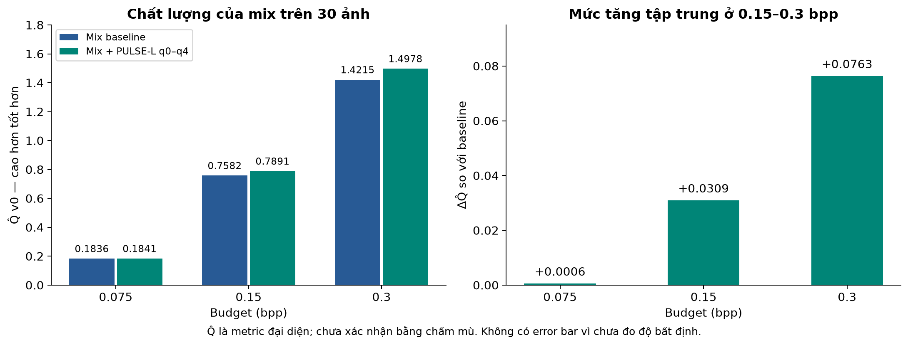

**PULSE-L đóng vai trò gì?** Tại 0.3 bpp, allocator chọn PULSE-L cho 22/30 ảnh; các codec khác vẫn đóng góp. Thanh thể hiện số ảnh, không phải tỷ trọng byte.

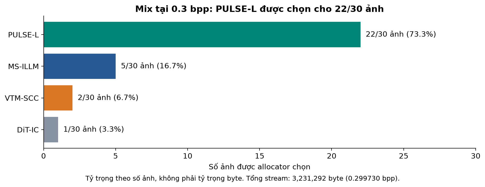

**Vì sao thời gian giảm?** Phần lớn chênh lệch đến từ ghi PNG đầu ra, trong khi 30/30 ảnh vẫn khớp pixel. VRAM dùng GB thập phân để so cùng đơn vị với hạn mức 30 GB/GPU; đây là tổng bộ nhớ thiết bị quan sát, gồm cả tiến trình khác.

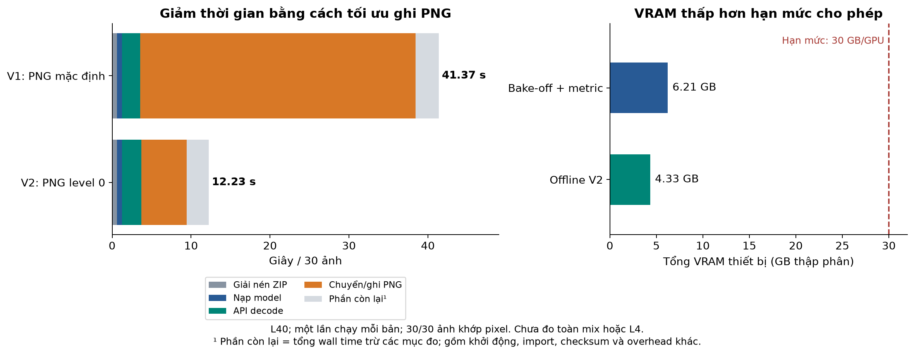

Thời gian trên chỉ đo **PULSE-L riêng trên L40**, một lượt mỗi cấu hình. Các nhánh khác chưa được đo chung trong gói decoder toàn mix. Xem [báo cáo tích hợp](CLIC2027_pulse_integration_2026-10-15.md) để đối chiếu nguồn và phạm vi đo. Hình có bản SVG và [script tái tạo từ artifact](figures/pulse_2026-10-15/make_figures.py).

**Từ bằng chứng hiện tại đến quyết định training:** ô xanh là kết quả đã đo, ô vàng là việc còn cần thực hiện.

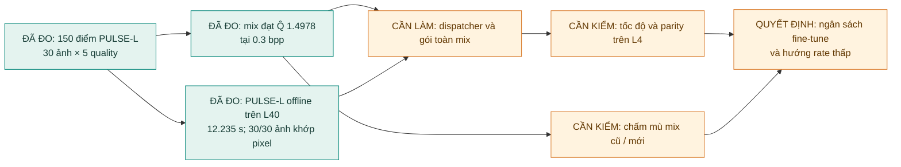

### 1.1 Vấn đề nghiên cứu

PSNR đo sai số pixel, nhưng không phải lúc nào cũng phản ánh ảnh nào được con người ưa thích hơn. Các codec học sâu có thể tạo ảnh trông tự nhiên hơn, song thường đòi hỏi decoder nặng, nhiều trọng số, và có thể gặp vấn đề tái lập bitstream khi entropy coding phụ thuộc phép toán float.

**Dự án tập trung vào bốn câu hỏi:**

1.  Codec nào cho chất lượng cảm nhận tốt nhất tại **0.075, 0.15 và 0.3
    bpp**?
2.  Có thể dùng dữ liệu preference có sẵn để xây dựng thước đo tự động
    Q̂, giảm chi phí so sánh hàng chục codec hay không?
3.  Làm thế nào kết hợp codec theo từng ảnh hoặc từng loại ảnh, thay vì
    buộc mọi ảnh dùng cùng một mô hình?
4.  Làm thế nào bảo đảm decoder chạy đủ nhanh, trong giới hạn bộ nhớ, và
    tạo kết quả nhất quán trên môi trường đánh giá?

### 1.2 Quyết định kỹ thuật hiện tại

| Tình huống | Hướng đang ưu tiên | Lý do | Mức độ chắc chắn |
| --- | --- | --- | --- |
| **0.075 bpp, ảnh tự nhiên** | DiT-IC | Bake-off và chấm mù sơ bộ ủng hộ DiT-IC so với MS-ILLM | Bằng chứng ban đầu; mẫu nhỏ |
| **0.15 bpp** | Mix DiT-IC, MS-ILLM, PULSE-L và VTM-SCC | PULSE-L được chọn cho 10/30 ảnh trong allocation mới | Q̂ trên 30 ảnh; chưa có chấm mù mix mới |
| **0.3 bpp** | Mix có PULSE-L, giữ MS-ILLM và các mode bổ sung | PULSE-L được chọn cho 20/30 ảnh; mix đạt Q̂ 1.4912 | Kết quả nội bộ; cần holdout và benchmark toàn gói |
| **Ảnh chữ, giao diện, màn hình** | VTM-SCC | Codec hướng screen content giữ cấu trúc và chữ tốt hơn trong thử nghiệm trước đó | Có tín hiệu tốt; bộ phát hiện ảnh chưa triển khai |

**Vấn đề chính:** Benchmark trên L4 thật, tính tất định giữa các máy L4(mình có thể thuê runpod để chạy evaluation nhưng cần đảm bảo kết quả chạy trên các máy L4 là giống nhau), đóng gói decoder trong giới hạn 4 GB và tích hợp các nhánh codec thành một pipeline decode hoàn chỉnh.

## 2. Mục tiêu, giả thuyết và tiêu chí thành công

### 2.1 Mục tiêu

-   Tối ưu chất lượng cảm nhận theo ngân sách bitrate của toàn bộ tập ảnh.
-   Cho phép chọn codec/operating point khác nhau theo ảnh và theo  bitrate.
-   Đo riêng chất lượng, tốc độ, bộ nhớ, kích thước artifact và độ tin cậy của decoder.

### 2.2 Giả thuyết nghiên cứu

-   **H1 --- Preference thay cho PSNR đơn lẻ:** một mô hình $\hat{Q}$ kết hợp nhiều metric sẽ dự đoán lựa chọn của người chấm tốt hơn PSNR riêng. **Giải thích**: $\hat{Q}$ là một mô hình dự đoán chất lượng; điểm số do mô hình tạo ra mới là metric dùng để đánh giá và so sánh codec.
-   **H2 --- Codec chuyên biệt theo loại ảnh:** codec diffusion/latent có thể có lợi trên ảnh tự nhiên ở bitrate rất thấp, trong khi VTM-SCC có thể phù hợp hơn cho ảnh chữ/màn hình.
-   **H3 --- Trộn theo ảnh tốt sẽ hơn một codec duy nhất:** phân bổ ngân sách byte cho codec/operating point phù hợp từng ảnh có thể tăng tổng preference dưới cùng ngân sách byte.
-   **H4 --- Decoder chưng cất là phương án có thể suy nghĩ tuy nhiên sẽ có đánh đổi:** có thể giảm thời gian giải mã với tổn thất chất lượng cảm nhận có giới hạn.
-   **H5 --- Tính tất định là điều kiện bắt buộc:** chất lượng cao không có ý nghĩa nếu entropy decode tạo latent/ảnh khác nhau giữa môi trường encode và decode.

### 2.3 Tiêu chí thành công

Luật hiện tại yêu cầu đủ ba rate, decoder không quá **4 GB**, chạy với **2 CPU, RAM 12 GB và GPU L4 24 GB**. Chất lượng được đánh giá bằng người; nhóm **25% bài có thời gian giải mã lâu nhất** không đủ điều kiện nhận giải. Decoder test phải khớp hash đã đăng ký ở validation. Có thể dùng decoder khác nhau giữa các rate, nhưng mỗi decoder phải được đăng ký trước. [Nguồn: CLIC 2027 tasks](https://clic2027.compression.cc/tasks/).

Mục tiêu kỹ thuật nội bộ là hướng tới **≤20 giây/30 ảnh trên L4**, đồng thời có báo cáo số liệu riêng cho decode và tổng time xử lý. Mốc 20 giây chưa được xác nhận là mốc đáng tin cậy, cũng không bảo đảm tránh nhóm 25% chậm nhất nhưng là con số an toàn (theo số liệu của challenge đợt trước 2025). 

Lưu ý quan trọng: Kết quả nghiên cứu chỉ được xem là sẵn sàng nộp khi qua kiểm tra bitstream, byte-accounting và chạy trọn gói trong môi trường L4.

Tài nguyên nghiên cứu hiện có là **2 GPU L40** trên server. Giới hạn được cho phép là **30 GB trên mỗi GPU**. Giới hạn này dành cho nghiên cứu trên server; không thay đổi giới hạn phần cứng bài nộp L4.

## 3. Pipeline nghiên cứu tổng thể

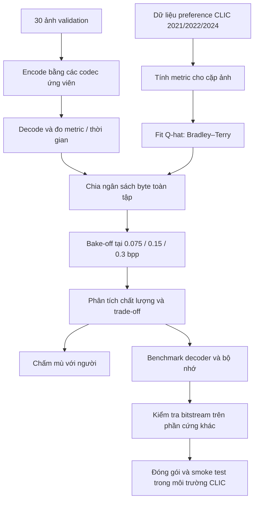

Sơ đồ này mô tả toàn bộ quy trình nghiên cứu để tìm ra một hệ thống nén ảnh phù hợp với CLIC 2027 GPU track. Nó không chỉ nhằm tìm codec có chất lượng ảnh tốt, mà còn phải đánh giá chất lượng đáng tin cậy, phân bổ bitrate, giải mã đủ nhanh, chạy ổn định trên phần cứng khác và đóng gói đúng yêu cầu cuộc thi.

Có thể chia pipeline thành 5 giai đoạn:

1. Xây dựng thước đo chất lượng $\hat{Q}$.
2. Đánh giá các codec ứng viên trên cùng tập ảnh.
3. So sánh chất lượng tại cùng ngân sách bitrate.
4. Xác nhận chất lượng chủ quan và khả năng triển khai.
5. Kiểm tra tính tái lập và đóng gói nộp bài.

### 3.1 Xây dựng thước đo và so sánh codec

#### Bước A — Dữ liệu preference CLIC 2021/2022/2024

**Mục tiêu: Thu thập dữ liệu phản ánh cách con người đánh giá chất lượng ảnh nén.**

Dữ liệu preference thường chứa các cặp ảnh được so sánh: người đánh giá chọn ảnh A tốt hơn ảnh B, hoặc dữ liệu tương đương được suy ra từ các đánh giá có sẵn. Trong nghiên cứu này, dữ liệu đến từ các năm CLIC 2021, 2022 và 2024.

**Vì sao cần nhiều năm dữ liệu?**

- Mỗi năm có thể có phân bố ảnh khác nhau: ảnh tự nhiên, cảnh vật, chân dung, ảnh có nhiều chi tiết hoặc vùng phẳng.
- Dùng nhiều năm giúp kiểm tra liệu mô hình đánh giá chất lượng có tổng quát hóa hay chỉ phù hợp với một tập ảnh cụ thể.
- Có thể dùng một số năm để huấn luyện và năm còn lại để kiểm tra khả năng dự đoán trên dữ liệu chưa thấy. Hiện tại đang dùng 2021+2022 train còn 2024 test

**Đầu ra: Tập dữ liệu các so sánh chất lượng, ví dụ:**

- Ảnh A được đánh giá tốt hơn ảnh B.
- Ảnh B được đánh giá tốt hơn ảnh C.
- Nếu có dữ liệu gốc, mỗi so sánh được liên kết với ảnh, codec, bitrate và các metric tương ứng.

**Điểm cần chú ý:**
Cần kiểm tra nguồn gốc nhãn preference, cách chia train/validation/test và nguy cơ trùng ảnh giữa các tập. Nếu nhãn đến từ nguồn khác nhau, cũng cần xem chúng có cùng quy ước đánh giá hay không.

#### Bước B — Tính metric cho cặp ảnh

**Mục tiêu: Chuyển mỗi ảnh nén thành một vector đặc trưng định lượng để mô hình $\hat{Q}$ học mối quan hệ giữa metric và preference.**

Với mỗi ảnh nén, so sánh ảnh đó với ảnh gốc và tính các metric như:

| Metric   | Ý nghĩa                                                                      |
| -------- | ---------------------------------------------------------------------------- |
| PSNR     | Đo sai số pixel; cao thường là tốt hơn.                                      |
| MS-SSIM  | Đo độ tương đồng về cấu trúc ở nhiều scale.                               |
| LPIPS    | Đo khoảng cách đặc trưng perceptual từ mạng học sâu; thấp thường là tốt hơn. |
| DISTS    | Đánh giá khác biệt về cấu trúc và kết cấu; thấp thường là tốt hơn.           |
| CLIP-IQA | Ước lượng chất lượng cảm nhận dựa trên đặc trưng học được.                   |

Các metric có thang đo và chiều tốt/xấu khác nhau. Vì vậy, trước khi fit mô hình, cần chuẩn hóa hoặc biểu diễn chúng theo cách nhất quán.

**Đầu ra:** Một vector metric cho mỗi ảnh nén, sau đó ghép thành đặc trưng so sánh cho từng cặp ảnh.

#### Bước C — Fit $\hat{Q}$: Bradley–Terry

**Mục tiêu: Học một hàm điểm số tổng hợp để dự đoán ảnh nào có khả năng được đánh giá tốt hơn.**

Mô hình Bradley–Terry thường biểu diễn xác suất ảnh $i$ được ưa thích hơn ảnh $j$ như sau:

$$
P(i \succ j)=\sigma(\beta+s_i-s_j),\qquad
\sigma(t)=\frac{1}{1+\exp(-t)}.
$$

Trong đó:

- $s_i$, $s_j$: điểm chất lượng mà mô hình gán cho hai ảnh.
- $\sigma$: hàm sigmoid.
- $P(i \succ j)$: xác suất ảnh $i$ được ưa thích hơn ảnh $j$.
- $\beta$: bias vị trí A/B trong implementation; bằng 0 thì thu về dạng Bradley–Terry đối xứng.

Trong cách triển khai dựa trên metric, điểm $s_i$ có thể được tính từ vector metric của ảnh:

$$
s_i=\hat{Q}(x_i,\hat{x}_i)
=\sum_{k=1}^{K}w_k\,T_k\!\left(\phi_k(x_i,\hat{x}_i)\right).
$$

Ở đây $x_i$ là ảnh gốc, $\hat{x}_i$ là ảnh tái tạo, $\phi_k$ là metric thứ $k$, $T_k$ là phép biến đổi metric và $w_k$ là trọng số đã fit. Bias A/B dùng khi dự đoán preference, không cộng vào utility từng ảnh của allocator.

Mô hình học tham số $\theta$ sao cho thứ tự dự đoán khớp với preference trong dữ liệu huấn luyện.

**Cách đánh giá mô hình:**

- Độ chính xác dự đoán preference trên tập chưa dùng để huấn luyện.
- Khả năng tổng quát hóa qua các năm CLIC.
- Mức độ tương quan với đánh giá của con người.

**Đầu ra:** Mô hình $\hat{Q}$ đã huấn luyện, dùng làm thước đo chất lượng trong các thí nghiệm codec.

**Điểm quan trọng:** $\hat{Q}$ không tự động trở thành một metric chuẩn chỉ vì nó được fit trên preference. Nó cần được xác thực trên dữ liệu độc lập. Nếu dữ liệu huấn luyện thiên về một loại ảnh hoặc một metric, điểm số có thể thiên lệch theo.

#### Bước D — 30 ảnh validation

**Mục tiêu:** Chọn một tập ảnh nhỏ để chạy thử nghiệm codec nhanh và có thể lặp lại nhiều lần.

Tập 30 ảnh giúp giảm chi phí tính toán khi thử nhiều cấu hình, chẳng hạn:

- Nhiều codec.
- Nhiều mức bitrate.
- Nhiều phiên bản model.
- Các phương pháp phân bổ bitrate.
- Các thay đổi ở encoder hoặc decoder.

Đây là tập validation CLIC 2027 gồm 30 ảnh, trùng tập test CLIC 2025, có ảnh tự nhiên, game và screen content. [Nguồn dữ liệu chính thức](https://clic2027.compression.cc/tasks/).

**Đầu ra:** Một tập validation cố định, được sử dụng nhất quán cho các codec so sánh.

#### Bước E — Encode bằng các codec ứng viên

**Mục tiêu: Nén cùng một tập ảnh bằng các phương pháp khác nhau để tạo ra các bitstream có thể so sánh.**

Các ứng viên trong dự án bao gồm:

- VTM / VTM-SCC: Codec đóng vai trò baseline truyền thống.
- MS-ILLM 
- MBT2018 
- CoD-Lite
- DC-AE + latent codec: Mã hóa ảnh thành latent rồi lượng tử hóa và entropy-code latent.
- DiT-IC
Khi encode, mỗi codec chuyển ảnh thành bitstream. Bitstream có thể chứa latent đã lượng tử hóa, thông tin phụ, header và dữ liệu entropy-coded.

**Điều cần kiểm soát:**
1. Dùng cùng ảnh gốc.
2. Chọn cấu hình tương ứng với mục tiêu bitrate.
3. Tính bitrate từ số byte thực tế của bitstream, không chỉ dựa trên tham số rate của model.
4. Ghi lại phiên bản code, checkpoint, cấu hình và thời gian encode.
5. Inference công bằng trên các codec.

**Đầu ra:** Bitstream của mỗi codec, cùng metadata về cấu hình, số byte và thời gian encode.

#### Bước F — Decode và đo metric + thời gian

**Mục tiêu: Đánh giá chất lượng ảnh khôi phục và chi phí tính toán thực tế.**

Mỗi bitstream được giải mã thành ảnh tái tạo $\hat{x}$. Sau đó, ảnh tái tạo được so sánh với ảnh gốc $x$.

**Các đại lượng chính:**

- $\hat{Q}$: Điểm chất lượng cảm nhận tổng hợp.
- PSNR, MS-SSIM, LPIPS, DISTS: Các metric bổ trợ giúp giải thích kết quả.
- Thời gian decode: Chi phí giải mã.
- Bộ nhớ GPU: Lượng VRAM cần thiết.
- Kích thước bitstream: Dữ liệu cần truyền hoặc lưu trữ.

Ví dụ, một codec có thể đạt $\hat{Q}$ cao nhưng cần một decoder rất lớn hoặc mất quá nhiều thời gian để tạo ảnh. Codec khác có điểm thấp hơn đôi chút nhưng nhanh và ổn định hơn.

**Vì sao đo thời gian decode ở đây?**

Tốc độ giải mã rất quan trọng. Cần phân biệt:

- Thời gian nạp model.
- Thời gian giải mã thực tế.
- Thời gian xử lý phụ trợ, chẳng hạn entropy decoding hoặc chuyển đổi tensor.
- Peak VRAM và chi phí khởi tạo.

Để so sánh công bằng, cần thống nhất phần cứng, số ảnh, batch size, warm-up và cách đo thời gian. Các phép đo hiện tại cố định cách đo trên L40; kết quả L4 phải được đo riêng.

**Đầu ra:** Ảnh tái tạo, metric chất lượng, thời gian decode và thống kê tài nguyên cho mỗi codec.

#### Bước G — Chia ngân sách byte toàn tập

Đây là bước quan trọng nhất để tránh so sánh codec không công bằng.

Mục tiêu: Phân bổ tổng số byte cho các ảnh sao cho tổng bitrate của cả tập nằm trong ngân sách quy định.

**Tại sao phải phân bổ ngân sách?**

Giả sử bạn có 10.000.000 byte (khoảng 10 MB) để lưu trữ một bộ tập hợp 100 bức ảnh. 
Bạn có hai lựa chọn:
- Chia đều: Mỗi bức ảnh nhận đúng 100.000 byte. Nhưng cách này kém hiệu quả
- Chia thông minh: Ảnh đơn giản nhận 30.000 byte, ảnh phức tạp nhận 250.000 byte.

**Tại sao "Chia đều Bitrate" lại kém hiệu quả?**

Hiệu suất biểu diễn hình ảnh tuân theo quy luật hiệu suất giảm dần (Diminishing Returns): 
- Ảnh dễ (bầu trời xanh, tường phẳng, phông nền mờ) ---> Chỉ cần lượng byte rất nhỏ để đạt chất lượng tiệm cận hoàn hảo. Nếu rót thêm byte vào đây, điểm chất lượng $\hat{Q}$ gần như không tăng thêm đáng kể. 
- Trong khi ảnh khó (văn bản, chi tiết tóc, kết cấu phức tạp, khung cảnh nhiều vật thể), nếu thiếu byte, chất lượng vỡ nát nghiêm trọng làm giảm điểm $\hat{Q}$ rất sâu. Nhưng nếu cấp thêm byte, điểm chất lượng lại gia tăng cực kỳ rõ rệt.

Một codec tối ưu toàn cục sẽ rút bớt byte từ các ảnh dễ để viện trợ cho các ảnh khó, giúp tổng điểm trung bình toàn tập nâng lên rõ rệt so với việc cào bằng.

**Cụ thể thì bước này làm gì**
Bước này giải quyết lựa chọn thứ hai để tối đa hóa chất lượng cảm nhận trung bình ($\hat{Q}$) trên toàn bộ tập dữ liệu, đảm bảo tổng dung lượng không vượt quá hằng số ngân sách $B_{\text{budget}}$. Một cách diễn đạt bài toán phân bổ bitrate là:

Bitrate trung bình toàn tập tính theo bits per pixel ($\text{bpp}_{\text{avg}}$):

$$\text{bpp}_{\text{avg}} = \frac{8 \cdot B_{\text{total}}}{\sum_{i=1}^{N} H_i W_i}$$

Để khống chế bitrate không vượt quá mức target $r$, tổng số byte tối đa cho phép toàn tập là:

$$B_{\text{budget}} = \left\lfloor \frac{r}{8} \sum_{i=1}^{N} H_i W_i \right\rfloor$$

**Bài toán Multiple-Choice Knapsack (MCKP)**

* **Vật phẩm:** $N$ bức ảnh.
* **Thực đơn Lựa chọn:** Với mỗi ảnh $i$, ta có danh sách các codec nén $j_i$ (ví dụ: $q = VTM, COD-Lite,\dots$).
* **Chi phí:** Lựa chọn $j_i$ tốn $B_{i, j_i}$ byte thực tế.
* **Giá trị thu về:** Lựa chọn $j_i$ đem lại điểm chất lượng dự đoán $\hat{Q}_{i, j_i}$.

Mục tiêu là tìm bộ chỉ số $(j_1, j_2, \dots, j_N)$ giải quyết bài toán:

$$\max \sum_{i=1}^{N} \hat{Q}_{i, j_i} \quad \text{với điều kiện} \quad \sum_{i=1}^{N} B_{i, j_i} \le B_{\text{budget}}$$

**Đầu ra:** Các bitstream hoặc cấu hình bitrate đã được chọn sao cho tổng số byte nằm trong ngân sách tương ứng.

Lưu ý quan trọng: Không phải lúc nào codec cũng có thể được cấp chính xác số byte mong muốn. Phân bổ bitrate cần dùng các điểm rate–distortion đã đo, nội suy hoặc thử nghiệm thêm, rồi kiểm tra lại bằng kích thước bitstream thực tế. (Giải thích cụ thể ở phần phục lục C)

#### Bước H — Từ $\hat{Q}$ đến bake-off tại 0.075 / 0.15 / 0.3 bpp

Trong sơ đồ, bước C tạo ra thước đo $\hat{Q}$, còn bước H sử dụng thước đo đó để so sánh codec. Đây là hai vai trò khác nhau.

**Mục tiêu của bake-off: So sánh các codec ở ba mức bitrate đại diện cho những chế độ nén khác nhau.**

| Bitrate   | Ý nghĩa trực quan                                          |
| --------- | ---------------------------------------------------------- |
| 0.075 bpp | Nén rất mạnh; chỉ có ít bit để biểu diễn ảnh.              |
| 0.15 bpp  | Mức trung gian.                                            |
| 0.3 bpp   | Ngân sách lớn hơn, thường cho phép giữ nhiều chi tiết hơn. |

Ở mỗi mức, các codec được so sánh dựa trên:

1. Tổng byte toàn tập.
2. Chất lượng theo $\hat{Q}$.
3. Các metric bổ trợ.
4. Thời gian decode và bộ nhớ.
5. Sự khác biệt giữa các nhóm nội dung ảnh.

Đo nhiều mức bitrate cho phép phân biệt một codec chỉ mạnh ở một miền rate với một codec có lợi trên toàn dải mục tiêu.

**Đầu ra:** Bảng kết quả bake-off, gồm chất lượng và chi phí của từng codec tại mỗi bitrate.

### 3.2 Phân tích sau bake-off

#### Bước I — Phân tích chất lượng và trade-off

**Mục tiêu: Xác định phương án nào tốt nhất theo mục tiêu thực tế, thay vì chỉ chọn codec có một điểm số cao nhất.**

Các phân tích cần làm:

- Rate–quality: Chất lượng thay đổi như thế nào khi bitrate tăng?
- So sánh với baseline: Codec mới có cải thiện rõ ràng so với VTM, VTM-SCC hoặc MS-ILLM không?
- Theo loại ảnh: Kết quả trên ảnh tự nhiên có khác ảnh chứa chữ hoặc screenshot không?
- Độ ổn định: Kết quả có bị chi phối bởi một vài ảnh ngoại lệ không?
- Độ phức tạp: Lợi ích chất lượng có đáng với chi phí decode và bộ nhớ không?

Có thể biểu diễn kết quả bằng đường cong rate–quality: trục ngang là bpp, trục dọc là $\hat{Q}$. Một codec tốt hơn thường có điểm cao hơn ở cùng bitrate hoặc đạt cùng chất lượng với ít bit hơn.

**Đầu ra:** Danh sách codec được ưu tiên, các điểm mạnh/yếu và giả thuyết cần kiểm tra tiếp.

#### Bước J — Blind grading với người

Mục tiêu: Xác nhận rằng cải thiện theo $\hat{Q}$ thực sự tương ứng với chất lượng cảm nhận của con người.

Trong đánh giá mù, người đánh giá xem hai ảnh tái tạo mà không được biết codec nào tạo ra ảnh nào. Họ chọn ảnh tốt hơn hoặc cho điểm theo giao thức đã định trước.

Kết quả có thể tính thành tỷ lệ thắng, kèm số lượng cặp, khoảng tin cậy và phân tích theo loại ảnh.

**Tại sao cần bước này dù đã có $\hat{Q}$?**

Vì $\hat{Q}$ chỉ là mô hình dự đoán từ dữ liệu preference. Nếu mô hình ưu tiên một loại đặc trưng không phù hợp với người xem, bake-off có thể chọn nhầm codec.

Đánh giá mù đặc biệt hữu ích khi so sánh codec truyền thống với codec sinh ảnh. Hai ảnh có thể có chất lượng cảm nhận tương tự nhưng khác độ trung thực với ảnh gốc. Do đó, cần quyết định rõ người đánh giá được hướng dẫn ưu tiên “giống ảnh gốc” hay “trông đẹp hơn”.

**Đầu ra:** Bằng chứng độc lập để xác nhận hoặc bác bỏ thứ hạng theo $\hat{Q}$.

**Lưu ý:** Kết quả từ một người đánh giá hoặc một số ít cặp ảnh chỉ nên coi là sơ bộ. Muốn có kết luận đáng tin cậy, cần nhiều người đánh giá, thứ tự hiển thị ngẫu nhiên, giao thức nhất quán và phân tích bất định.

#### Bước K — Benchmark decoder và bộ nhớ

**Mục tiêu: Xác định codec có thể chạy trong giới hạn triển khai thực tế hay không.**

Những chỉ số nên ghi nhận:

| Chỉ số                | Câu hỏi cần trả lời                           |
| --------------------- | --------------------------------------------- |
| Tổng thời gian decode | Có hoàn thành trong thời gian cho phép không? |
| Thời gian mỗi ảnh     | Chi phí trung bình là bao nhiêu?              |
| Peak VRAM             | Có vượt giới hạn GPU không?                   |
| Thời gian khởi tạo    | Nạp model có tốn đáng kể thời gian không?     |
| Độ ổn định            | Có OOM, timeout hoặc lỗi ngẫu nhiên không?    |

Cần benchmark trên phần cứng phù hợp với môi trường cuộc thi (hiện đang sử dụng phần cứng thay thế)

**Đầu ra:** Bảng benchmark và kết luận codec nào đáp ứng các giới hạn thời gian/bộ nhớ.

#### Bước L — Kiểm tra bitstream trên phần cứng khác

**Mục tiêu: Đảm bảo bitstream có thể được giải mã ổn định và cho kết quả đúng trên môi trường CLIC.**

Các phép kiểm tra nên gồm:

1. Encode trên máy A, decode trên máy B.
2. Decode cùng bitstream nhiều lần.
3. So sánh ảnh đầu ra bằng checksum hoặc kiểm tra từng pixel.
4. Kiểm tra các trường hợp biên: ảnh nhỏ, kích thước lẻ, bitrate thấp và bitstream không hợp lệ.
5. Kiểm tra tính tương thích của phiên bản thư viện, CUDA, driver và checkpoint.

Nếu decoder dùng xác suất để tạo CDF cho entropy coding, những sai khác số học nhỏ có thể làm thay đổi cách giải mã bitstream. Vì vậy, cần đặc biệt cẩn thận với các phép tính phải tái lập chính xác.

Bitwise determinism nghĩa là kết quả phải khớp chính xác từng bit khi điều kiện kiểm tra yêu cầu như vậy. Tuy nhiên, tiêu chí cuối cùng phải tuân theo giao thức và cách chấm của CLIC; không nên mặc định rằng mọi phép tính trung gian đều bắt buộc bitwise-identical nếu cuộc thi không yêu cầu điều đó.

**Đầu ra:** Bằng chứng decoder tái lập được trên môi trường mục tiêu, cùng danh sách giới hạn tương thích nếu có.

#### Bước M — Đóng gói và smoke test trong môi trường CLIC

Tạo artifact decoder độc lập, bao gồm executable/script, dependency cần thiết và đúng trọng số. Chạy từ thư mục sạch, offline, chỉ với stream đầu vào; kiểm đúng số ảnh, tên file, kích thước, màu và định dạng. Đo tổng wall time kể cả unpack/load/I/O, RAM và VRAM, rồi kiểm giới hạn dung lượng của từng gói đăng ký.

Mode ID, quality index và mọi thông tin decoder cần biết phải có trong dữ liệu được truyền hoặc định nghĩa rõ trong format. Khả năng chạy từng codec riêng trong bake-off chưa chứng minh khả năng chạy cả mix. Sau khi gói đạt kiểm tra, lưu hash và môi trường để đối chiếu lần chạy sau; việc gửi bài chính thức là bước riêng.

### 3.3 Quan hệ phụ thuộc giữa các bước

Có thể nhìn toàn bộ quy trình như ba nhánh kết hợp ở giai đoạn quyết định codec:

- Nhánh chất lượng: Dữ liệu preference → Metric → Fit $\hat{Q}$

- Nhánh codec: Ảnh validation → Encode → Decode → Đo chất lượng và chi phí

- Nhánh ngân sách: Phân bổ byte → Cùng tổng bitrate → Bake-off

**Chọn ứng viên** : Phân tích trade-off → Đánh giá mù → Benchmark → Kiểm tra tính tái lập → Smoke test

**Ba nhánh giải quyết ba câu hỏi khác nhau:**
- Chất lượng: Làm thế nào đo được ảnh nào tốt hơn?
- Công bằng: Làm thế nào so sánh codec khi tổng ngân sách byte giống nhau?
- Khả năng triển khai: Codec có chạy đúng, đủ nhanh và ổn định trong môi trường đích không?

Một codec chỉ thực sự là ứng viên tốt khi đáp ứng cả ba nhóm yêu cầu.

### 3.4 Phạm vi kết luận của từng thí nghiệm

| Thí nghiệm                    | Có thể hỗ trợ kết luận                                                | Không đủ để kết luận                                 |
| ----------------------------- | --------------------------------------------------------------------- | ---------------------------------------------------- |
| Validation $\hat{Q}$ | Dự đoán preference tốt trên dữ liệu kiểm tra hay không    | $\hat{Q}$ luôn đúng với mọi loại ảnh        |
| Bake-off                      | Codec nào tốt hơn trong tập ảnh, bitrate và cấu hình đã thử           | Codec đó chắc chắn tốt nhất trên test chính thức     |
| Đánh giá mù                   | Người đánh giá thích ảnh của codec nào hơn trong các model đã dùng | Ai cũng thích như vậy                  |
| Benchmark                     | Thời gian và bộ nhớ trong môi trường đo                               | Hiệu năng tương tự trên mọi GPU                      |
| Smoke test                    | Artifact chạy được trong các trường hợp thử                           | Artifact chắc chắn vượt qua toàn bộ hệ thống chấm    |

## 4. Các mô hình và codec đang sử dụng

### 4.1 Q̂ — thước đo preference tự động

**Vai trò:** Q̂ không phải codec nén ảnh. Nó là mô hình xếp hạng dùng để
sàng lọc codec và phân bổ ngân sách byte theo chất lượng cảm nhận dự
đoán.

**Cách làm:**
1. Lấy dữ liệu đánh giá theo cặp từ CLIC 2021, 2022 và 2024.
2. Tính các đặc trưng chất lượng như PSNR, MS-SSIM, LPIPS, DISTS và các metric liên quan cho các ảnh trong cặp.
3. Fit mô hình preference Bradley--Terry để ước lượng xác suất một ảnh được ưa thích hơn ảnh kia.
4. Đánh giá trên phần dữ liệu giữ lại test so với baseline.
5. Dùng Q̂ v0 trong bake-off để đánh giá và tối ưu phân bổ byte.

**Ý nghĩa:** Q̂ cho phép đánh giá hàng loạt ứng viên nhanh hơn việc con
người phải chấm mọi cặp. Tuy nhiên, Q̂ chỉ là proxy; không thay thế đánh
giá người thật và có thể khái quát kém sang ảnh hoặc codec mới.

### 4.2 MS-ILLM — codec học sâu làm base ở bitrate trung bình/cao

**Paper:** *Improving Statistical Fidelity for Neural Image Compression
with Implicit Local Likelihood Models* (ICML 2023).\
Paper: https://arxiv.org/abs/2301.11189

**Vai trò trong dự án:** ứng viên codec dùng làm base mạnh ở 0.15 và 0.3 bpp, đồng thời là baseline quan trọng để so sánh với DiT-IC ở 0.075 bpp.

**Kiến trúc và cơ chế của model:**
Paper kết hợp kiến trúc nén ảnh Mean-Scale Hyperprior với một bộ phân biệt mới gọi là ILLM (Implicit Local Likelihood Model).

Phần giải thích chi tiết về rate–distortion–perception, VQ-VAE, discriminator và loss được đặt ở Phụ lục A để tách nền tảng phương pháp khỏi báo cáo kết quả của dự án.

**Tại sao giữ lại:** kết quả bake-off được báo cáo cho thấy MS-ILLM có Q̂
v0 tốt hơn nhiều codec cổ điển ở 0.15 và 0.3 bpp; tốc độ được ghi nhận
khoảng 0.7--0.8 giây/ảnh trên L40. Chưa có kết luận về tốc độ L4 hoặc độ
tương thích hoàn chỉnh với môi trường CLIC.

**Rủi ro:** cần xác minh giấy phép code và pretrained weights, cũng như
tính tất định của mọi thành phần entropy coding phụ thuộc số thực.

### 4.3 DiT-IC — hướng diffusion/latent cho bitrate thấp

**Paper gốc:** Junqi Shi và cộng sự, *DiT-IC: Aligned Diffusion Transformer for Efficient Image Compression*, CVPR 2026. [Bản proceedings](https://openaccess.thecvf.com/content/CVPR2026/html/Shi_DiT-IC_Aligned_Diffusion_Transformer_for_Efficient_Image_Compression_CVPR_2026_paper.html). Xem [B.3](#model-ditic) về ba cơ chế alignment và sự khác biệt với student nội bộ.

**Thành phần được ghi trong repo:** SANA-600M, DC-AE và codec latent
theo hướng ELIC/entropy coding.\
Tham khảo nền tảng: [SANA](https://arxiv.org/abs/2410.10629),
[DC-AE](https://arxiv.org/abs/2410.10733).

**Vai trò:** ứng viên ưu tiên cho ảnh tự nhiên ở 0.075 bpp. Trong
bake-off nội bộ ngày 13/10, DiT-IC đạt Q̂ v0 +0.164 so với −0.451 của
MS-ILLM ở rate này.

**Vì sao có thể hiệu quả:** ở bitrate rất thấp, mục tiêu không chỉ là
giữ từng pixel mà còn tái tạo nội dung có vẻ tự nhiên. Mô hình
sinh/decoder latent có thể tạo cấu trúc thị giác hợp lý với ít bit hơn,
nhưng lợi thế này cần được kiểm tra bằng preference người thật và các
nhóm ảnh khác nhau.

**Giới hạn quan sát được:** DiT-IC kém hơn trên ảnh chữ/màn hình trong
phép chấm mù sơ bộ; operating point đang có chỉ tới khoảng 0.096--0.10
bpp. Vì vậy, không thể coi DiT-IC là codec duy nhất cho toàn bộ dải
bitrate.

**Rủi ro kỹ thuật:** decoder nặng; nhiều bộ trọng số q2/q3/q4 làm tăng
dung lượng; tốc độ hiện đo trên L40 chứ chưa xác nhận trên L4; cần bảo
đảm pipeline decoder chạy được bằng các dependency có trong môi trường
đích.

### 4.4 DiT-IC chưng cất — phương án tăng tốc

**Mục tiêu:** giảm chi phí giải mã DC-AE bằng cách huấn luyện student
bắt chước đầu ra decoder teacher.

**Cách làm được báo cáo:**

- Teacher là decoder DC-AE đã gộp LoRA từ checkpoint DiT-IC q3.
- Student giảm một nửa số kênh ở ba tầng ResBlock độ phân giải cao; phần đầu sao chép từ teacher và đóng băng.
- Dữ liệu gồm latent từ 800 ảnh DIV2K train. Student học đầu ra teacher, không trực tiếp học ảnh gốc.
- Đợt đầu dùng L1 + LPIPS trong 20.000 bước; đợt tiếp thêm PatchGAN với trọng số 0.1. Các bảng snapshot ghi mốc bước riêng của từng stage, không suy tổng số update chỉ từ tên `snap_30000`.

Trainer hiện có chỉ phục vụ phần decoder này; chưa phải trainer rate–distortion hoàn chỉnh cho toàn codec. File student khoảng 24 MB chứa phần trọng số cần thay, không phải toàn bộ decoder chạy độc lập.

**Kết quả nội bộ q3:** Q̂ v0 của teacher +0.157, student −0.012; chênh
lệch khoảng −0.17 Q̂ (xấp xỉ −29 Elo theo quy đổi nội bộ). Thời gian
DC-AE trên L40 giảm từ 12.9 giây xuống 7.3 giây cho 30 ảnh ở phép đo
riêng; toàn decoder được báo cáo khoảng 17--18 giây với teacher và
khoảng 11 giây với student.

**Ý nghĩa:** chưng cất tạo phương án dự phòng nếu teacher không đạt tốc
độ trên L4. Đây là trade-off chất lượng/tốc độ, không phải cải thiện
chất lượng. Cần benchmark lại trên L4 thật và kiểm tra checkpoint được
lưu trữ, dung lượng tổng và tính nhất quán.

### 4.5 VTM 4:2:0 và VTM-SCC — baseline cổ điển / ảnh chữ

-   **VTM 4:2:0:** baseline VVC thông thường, giúp định vị hiệu quả của
    codec học sâu so với codec truyền thống.
-   **VTM-SCC:** hướng screen-content coding, phù hợp để thử nghiệm trên
    ảnh có chữ, giao diện hoặc vùng phẳng.
-   Các kết quả ban đầu trong kế hoạch cho thấy VVC-SCC vượt VTM 4:2:0
    khoảng 1.1--3.3 dB trên ảnh màn hình ở phép đo PSNR cũ; đây là bằng
    chứng thuộc thí nghiệm đó, không phải kết quả bake-off Q̂ ngày 13/10.

**Vai trò dự kiến:** giữ làm baseline và làm mode chuyên biệt. Cần phát
triển bộ phát hiện ảnh chữ/màn hình hoặc bộ chọn mode, rồi đo xem lựa
chọn đó có cải thiện tổng preference dưới cùng ngân sách byte không.

### 4.6 Các ứng viên khác

| Ứng viên | Mục đích trong nghiên cứu | Kết quả/ quyết định theo ghi chú hiện có |
| --- | --- | --- |
| **CoD-Lite** | Codec học sâu cạnh tranh, tốc độ nhanh | Q̂ v0 −0.382 ở 0.075 bpp; khoảng 0.15 s/ảnh; kém MS-ILLM ở 0.15/0.3 theo bake-off |
| **MBT2018-mean** | Baseline learned compression cổ điển | Q̂ khoảng −2.0 tại 0.15 bpp; loại khỏi lựa chọn chính |
| **S1: DC-AE + S1 + residual VTM** | Kiểm tra hướng latent codec đa rate kết hợp residual | Kém MS-ILLM khoảng 1--2.3 Q̂ trong phép so sánh được ghi nhận; loại khỏi hướng chính |
| **SD-Turbo refiner** | Kiểm tra khả năng hậu xử lý/refinement | Không vượt MS-ILLM trong thử nghiệm nội bộ; dừng |
| **COOL-CHIC** | Codec tọa độ/implicit representation, tham khảo đối thủ | Theo ghi chú nội bộ, kém MS-ILLM khoảng 0.4--0.6 Q̂ và encode chậm; tạm dừng |
| **CRDR** | Ứng viên learned codec khác | Kém MS-ILLM theo Q̂ v0 và khoảng 5 s/ảnh giải mã trong phép đo ghi nhận; loại khỏi lựa chọn chính |

Các kết luận loại/giữ chỉ áp dụng cho cấu hình, checkpoint, bitrate và
tập ảnh đã thử; không chứng minh các phương pháp đó kém trong mọi điều
kiện.

### 4.7 PULSE-L — ứng viên decoder nhẹ mới

**Phân biệt phiên bản:** PULSE base khoảng 5.2 kMAC/pixel, PULSE-L perceptual khoảng 20 kMAC/pixel theo [bảng model chính thức](https://github.com/microsoft/GenCodec/blob/main/PULSE/README.md). Không gán độ phức tạp hay tốc độ CPU của base cho checkpoint L mà repo đang dùng. Xem [B.4](#model-pulse) về pixel renderer, CDF số nguyên và Meta Prior.

PULSE kết hợp xử lý đặc trưng ở độ phân giải thấp, pixel renderer và entropy path có thành phần số nguyên. Bản phát hành có checkpoint perceptual base/L và nhiều mức q. Dự án đã thử cả hai, sau đó chọn PULSE-L để đánh giá đầy đủ vì vùng rate và khả năng bổ sung cho mix phù hợp hơn. [Implementation chính thức](https://github.com/microsoft/GenCodec/tree/main/PULSE).

Vai trò hiện tại của PULSE-L là bổ sung cho các codec đã có, chưa thay chúng ở mọi rate. Các con số chất lượng và tốc độ do dự án đo được trình bày tại mục 5.8–5.10; không dùng benchmark phần cứng của tác giả thay cho benchmark L40/L4 của dự án. Entropy số nguyên là đặc tính đáng quan tâm, nhưng parity của toàn pipeline vẫn cần kiểm thực tế.

### 4.8 Bản đồ cơ chế của các model đã chạy

| Model / nhóm | Khác biệt cần hiểu | Phần đọc chi tiết |
|---|---|---|
| MS-ILLM | Discriminator tạo tín hiệu học cục bộ; không nằm trong decoder triển khai | Phụ lục A và [B.2](#model-msillm) |
| DiT-IC; student nội bộ | Diffusion một bước trong latent; student của repo chỉ thay DC-AE decoder | [B.3](#model-ditic) |
| PULSE / PULSE-L | Decoder bất đối xứng; tách điều khiển entropy khỏi dựng ảnh | [B.4](#model-pulse) |
| CoD-Lite | Mã hóa condition bằng VQ; dựng ảnh trực tiếp bằng diffusion convolution | [B.5](#model-codlite) |
| DC-VIC / AFP-GIC | Dự đoán prior từ thông tin đã truyền; không có ảnh gốc ở decoder | [B.6–B.7](#model-dcvic) |
| CRDR | Điều khiển bitrate và realism riêng | [B.8](#model-crdr) |
| Cool-Chic | Tối ưu riêng cho mỗi ảnh; phải truyền cả tham số mạng | [B.9](#model-coolchic) |
| MBT2018-mean | Mean-scale hyperprior; phân biệt với bản autoregressive đầy đủ | [B.10](#model-mbt) |
| VTM / VTM-SCC | Dự đoán khối và residual; công cụ riêng cho screen content | [B.11](#model-vtm) |
| S1 / SD-Turbo refiner | Hai pipeline thí nghiệm của repo; không coi là paper codec mới | [B.12](#model-internal) |

## 5. Thiết kế thí nghiệm và ý nghĩa

### 5.1 Thí nghiệm A — xây dựng và kiểm định Q̂

**Câu hỏi:** Q̂ có dự đoán preference của người tốt hơn các metric đơn lẻ
không?

**Thiết kế:** lấy dữ liệu pairwise CLIC 2021/2022/2024, tính metric cho
từng phương án trong cặp, fit Bradley--Terry và đánh giá trên dữ liệu
giữ lại/ngoài năm huấn luyện.

| Kết quả được báo cáo | Ý nghĩa | Giới hạn |
| --- | --- | --- |
| **Q̂ v0: cross-year accuracy 0.812** | Train trên 2021t/2021v/2022t, test 2024t | Không phải accuracy trên ảnh nén CLIC 2027 |
| **Trên 2024t: PSNR 0.705; Q̂ v0 cross-year 0.812** | So trên cùng miền test, Q̂ có tín hiệu tốt hơn PSNR đơn lẻ | Cần kiểm lại split theo ảnh và leakage |
| **Trên 8.000 cặp: Q̂ v0 5-fold CV 0.788; PSNR 0.625** | Kết quả gộp khác với phép kiểm tra cross-year | Không trộn hai protocol thành một con số |
| **Q̂ v1: cross-year 0.833** | Accuracy cao hơn chưa đủ để chọn khi ranking ở miền rate thấp không phù hợp | Tiếp tục dùng v0 cho bảng codec hiện tại; v1 chỉ làm phân tích độ nhạy. Nguyên nhân không chọn v1: Trong bài toán nén ảnh, việc duy trì thứ tự xếp hạng (ranking) ở miền bitrate thấp (low rate regime) cực kỳ quan trọng (nơi ảnh dễ bị nhòe/artefact nặng). $\hat{Q}\text{ v1}$ tuy nâng accuracy tổng thể nhưng lại làm sai lệch thứ tự xếp hạng ở dải bitrate thấp này.  |

Nguồn: [Q̂ v0](D:/AwesomeCV/ratflow-codec/results/2026-10-06_qhat_v0/summary.md) và [Q̂ v1](D:/AwesomeCV/ratflow-codec/results/2026-10-09_qhat_v1/summary.md). Các cặp cùng ảnh có thể phụ thuộc nhau; accuracy cross-year không loại bỏ mọi dạng domain shift. Tỉ lệ đồng ý giữa hai người là chỉ báo độ nhiễu, không phải một trần toán học tuyệt đối của mọi mô hình dự đoán.

**Ý nghĩa khoa học:** thí nghiệm kiểm tra khả năng dùng dữ liệu
preference lịch sử để xây dựng surrogate metric cho quá trình nghiên
cứu.\
**Việc tiếp theo:** tái lập split, kiểm tra rò rỉ dữ liệu, báo cáo
confidence interval và calibration; đánh giá trên nhiều người chấm.

### 5.2 Thí nghiệm B — bake-off nhiều codec trên 30 ảnh

**Câu hỏi:** codec nào có chất lượng cảm nhận tốt nhất tại các rate mục
tiêu, khi ngân sách byte của cả tập bị giới hạn?

**Thiết kế được ghi:** 30 ảnh validation, các mức 0.075/0.15/0.3 bpp,
encode/decode bằng nhiều codec; phân bổ ngân sách byte toàn tập theo Q̂
v0. Kết quả trong `results/2026-10-13_bakeoff_v0`.

| Ứng viên | 0.075 bpp | 0.15 bpp | 0.3 bpp |
| --- | --- | --- | --- |
| **VTM 4:2:0** | −2.515 | −1.163 | −0.152 |
| **VTM-SCC** | −2.404 | −1.102 | −0.004 |
| **MS-ILLM** | −0.451 | +0.545 | +1.383 |
| **CoD-Lite** | −0.382 | +0.285 | +0.906 |
| **DiT-IC** | +0.164 | Chưa có operating point phù hợp tới 0.15 | --- |
| **DiT-IC chưng cất** | −0.000 | --- | --- |
| **Trộn theo ảnh** | **+0.184** | **+0.758** | **+1.421** |

*Lưu ý:* đây là Q̂ v0 nội bộ; ô "---" nghĩa là không có kết quả được báo
cáo cho cấu hình đó, không có nghĩa là điểm bằng 0.

**Ý nghĩa:** kết quả ủng hộ một hệ thống hỗn hợp thay vì codec duy nhất.
Ở 0.075 bpp, DiT-IC có lợi thế trên ảnh tự nhiên; ở 0.15/0.3 bpp,
MS-ILLM bổ sung operating point hữu ích. Tuy nhiên, 30 ảnh là tập nhỏ và
Q̂ có thể sai; cần mở rộng mẫu và xác nhận bằng người.

### 5.3 Thí nghiệm C — chấm mù DiT-IC so với MS-ILLM

**Câu hỏi:** lợi thế Q̂ của DiT-IC có xuất hiện trong đánh giá trực quan
của con người không?

**Thiết kế được báo cáo:** 90 cặp crop 512×512 ở 0.075 bpp; một người
chấm; thêm 10 cặp lặp lại có đảo bên để kiểm tra độ nhất quán.

| Kết quả | Giá trị |
| --- | --- |
| **DiT-IC được chọn** | 62/90 = 68.9% |
| **Preference trên ảnh tự nhiên** | 55/75 = 73.3% |
| **DiT-IC được chọn ở ảnh chữ/màn hình** | 4/12 |
| **Độ nhất quán của 10 cặp lặp** | 7/10 |
| **Q̂ v0 khớp đa số lựa chọn của ba crop/ảnh** | 26/30 ảnh, cùng một người chấm |

Nguồn: [protocol và kết quả chấm mù](D:/AwesomeCV/ratflow-codec/results/2026-10-11_rating_ditic_msillm/summary.md). Các operating point được chọn từ allocation Q̂ v0 ở 0.075 bpp; cùng budget toàn tập không có nghĩa từng cặp ảnh có cùng bpp.

**Ý nghĩa:** đây là bằng chứng độc lập tương đối với Q̂ rằng DiT-IC có
lợi trên ảnh tự nhiên ở rate thấp, đồng thời chỉ ra thất bại có cấu trúc
trên ảnh chữ/màn hình.\
**Giới hạn:** một người chấm không đại diện cho phân bố preference; cặp
crop có thể không độc lập; khoảng tin cậy và cách lấy mẫu cần được rà
soát.\
**Bước tiếp theo:** thêm 2--3 người chấm hoặc nhiều hơn, cân bằng loại
ảnh, ngẫu nhiên hóa thứ tự trái/phải, ghi lại bất đồng và độ nhất quán
liên-chấm.

### 5.4 Thí nghiệm D — chưng cất decoder DiT-IC

**Câu hỏi:** có thể tăng tốc decoder mà không làm mất quá nhiều chất
lượng cảm nhận?

**Thiết kế:** teacher--student; student giảm kênh ở các tầng decoder độ
phân giải cao; huấn luyện bắt chước output teacher bằng L1 + LPIPS, sau
đó thêm GAN loss.

| Cấu hình q | Teacher Q̂ v0 | Student Q̂ v0 | Student − teacher |
| --- | --- | --- | --- |
| **q2** | −0.450 | −0.584 | −0.13 |
| **q3** | +0.157 | −0.012 | −0.17 |
| **q4** | +0.272 | +0.115 | −0.16 |

**Ý nghĩa:** chưng cất giảm độ phức tạp và tăng tốc, nhưng làm giảm Q̂ ở
cả ba operating point. Quyết định dùng teacher hay student phải dựa trên
tốc độ L4 thật, không phải L40.\

### 5.5 Thí nghiệm E — benchmark tốc độ

**Câu hỏi:** toàn bộ đường giải mã có nằm trong giới hạn thời gian
không?

| Phép đo trên L40 được báo cáo | Thời gian |
| --- | --- |
| **DiT-IC teacher, toàn decoder** | 17.5 s / 30 ảnh |
| **DiT-IC student, toàn decoder** | 11.4 s / 30 ảnh |
| **Nạp mạng** | Khoảng 18 s, đo riêng |
| **MS-ILLM** | 0.7--0.8 s/ảnh |
| **CoD-Lite** | Khoảng 0.15 s/ảnh |

Các phép đo trên không cùng điều kiện đo ở mọi hàng, vì vậy không nên
xếp hạng tốc độ chính xác nếu thiếu log và quy trình chuẩn hóa. Đặc
biệt, L40 không phải L4.

**Ý nghĩa:** tốc độ là ràng buộc thiết kế chứ không phải chỉ số phụ.
Benchmark cần báo cả cold start, warm decode, thời gian encode nếu luật
yêu cầu, thời gian giải mã toàn bộ tập, peak GPU memory, RAM và số CPU.

### 5.6 Thí nghiệm F — tính tất định của entropy coding

**Câu hỏi:** cùng một bitstream có tạo ra cùng latent/ảnh trên phần cứng
khác nhau không?

| Thiết lập | Kết quả nội bộ được ghi |
| --- | --- |
| **CPU ↔ GPU, fp32** | Lệch đáng kể, ảnh hỏng |
| **CPU ↔ GPU, fp64** | Khớp từng bit, nhưng entropy decode khoảng 1.5 s/ảnh |
| **GPU 0 ↔ GPU 1 cùng máy L40, fp32** | Khớp từng bit |
| **L40, tiến trình mới trên cùng máy, môi trường dựng theo devkit** | 0 index/symbol lệch trên 30 ảnh q3; chưa phải hai máy độc lập |

Nguồn: [kiểm entropy sáu ảnh](D:/AwesomeCV/ratflow-codec/results/2026-10-12_ditic_determinism/summary.md) và [kit chạy trên L40](D:/AwesomeCV/ratflow-codec/results/2026-10-13_l4_kit_l40/summary.md). Kết quả fp64 chỉ áp dụng cho cấu hình đã đo; chưa chứng minh an toàn trên mọi thiết bị. Khớp index/symbol entropy, khớp bitstream và khớp pixel PNG là ba phép kiểm khác nhau.

**Ý nghĩa:** các phép toán floating point có thể khác nhau giữa phần
cứng/precision và làm xác suất hoặc symbol entropy decode lệch, dẫn đến
giải mã sai. Mạng số nguyên và CDF số nguyên có thể cải thiện tính tất
định, nhưng phải kiểm tra toàn bộ đường đi của từng codec.

**Bước tiếp theo:** encode trên máy L4 A, decode trên máy L4 B; so sánh
checksum của latent và ảnh đầu ra, kích thước ảnh, số file, log lỗi và
version môi trường. Nếu không đạt, cân nhắc entropy coding số nguyên
hoặc cố định một đường giải mã tương thích.

### 5.7 Thí nghiệm G — so sánh ảnh màn hình và baseline cổ điển

Các phép thử ban đầu ghi nhận VVC-SCC tốt hơn VTM 4:2:0 khoảng 1.1--3.3
dB trên ảnh màn hình; DC-AE có thể làm hỏng chữ nhỏ (CER được ghi là
0.58 trong một phép đo trước). Đây là lý do thiết kế mode chuyên biệt
cho screen content.

**Ý nghĩa:** đánh giá trung bình toàn tập có thể che giấu thất bại trên
một nhóm ảnh. Cần báo cáo metric theo nhóm: ảnh tự nhiên, chữ/màn hình,
texture, ảnh có cạnh mảnh; sau đó đánh giá bộ chọn mode bằng confusion
matrix, precision/recall và preference cuối cùng.

### 5.8 Thí nghiệm H — sàng lọc model mới trên sáu ảnh

**Câu hỏi:** model mới công khai có tăng chất lượng hoặc tốc độ hữu ích so với các codec hiện có không?

Pilot cố định trước sáu ảnh: ba ảnh tự nhiên (`02809272`, `0369d229`, `07b9f93f`), texture (`937476dd`), hai ảnh screen (`bb7344a2`, `ebfd571f`). Chạy nguyên kích thước, lưu bitstream thật, đọc lại bitstream để decode, kiểm kích thước ảnh và chấm bằng metric chung của repo. Bộ sáu ảnh chỉ dùng sàng lọc, không đại diện đủ phân phối validation.

| Ứng viên | Số điểm | Q̂ @ 0.075 | Q̂ @ 0.15 | Q̂ @ 0.3 | Trung vị decode/ảnh |
|---|---:|---:|---:|---:|---:|
| AFP-GIC, q0/1/4 | 18 | -0.7304 | 0.3158 | 0.8712 | 7.00 s |
| DC-VIC PatchGAN, q0/1/4 | 18 | Không vừa | 0.4599 | 1.0237 | 9.49 s |
| PULSE perceptual, q0/2/4/7 | 24 | Không vừa | Không vừa | Không vừa | 51.3 ms |
| PULSE-L perceptual, q0/2/4/7 | 24 | Không vừa | Không vừa | 1.6057 | 63.0 ms |
| MS-ILLM trên cùng sáu ảnh | Baseline đã có | -0.3030 | 0.6423 | 1.7323 | Không đo lại |
| Mix baseline trên cùng sáu ảnh | Baseline đã có | 0.3806 | 1.0409 | 1.8629 | Chưa đo toàn mix |
| Mix thêm cả bốn model | Allocation mới | 0.3806 | 1.0560 | 1.9194 | Chưa đo toàn mix |

“Không vừa” nghĩa là ngay tổ hợp điểm ít byte nhất đang có cũng vượt ngân sách, không phải lỗi chạy hoặc điểm bằng 0. Q̂ tối ưu dưới budget không yêu cầu dùng hết budget; AFP/DC-VIC chưa có đủ điểm cao để tận dụng toàn bộ 0.3. Không so trực tiếp bảng sáu ảnh với bảng 30 ảnh.

AFP/DC-VIC được chạy trên Torch 2.11.0+cu128, CompressAI 1.2.8; PULSE dùng Torch 2.6.0+cu124. Do khác runtime và chưa tối ưu cùng điều kiện, thời gian trên chỉ để sàng lọc. Các phép thử không được gọi là tái lập đầy đủ kết quả paper.

**Quyết định:** chưa mở rộng AFP/DC-VIC vì chất lượng pilot chưa vượt baseline và decoder chậm; PULSE base có vùng rate chưa phù hợp. PULSE-L có lợi thế tốc độ và khả năng bổ sung cho mix, nên được chọn chạy đủ 30 ảnh. [Bảng pilot gốc](D:/AwesomeCV/ratflow-codec/results/2026-10-15_new_codecs/pilot_scores/summary.csv).

### 5.9 Thí nghiệm I — PULSE-L trên đủ 30 ảnh

Chạy q0/1/2/4, tổng cộng **120 điểm**. So sánh cùng bộ ảnh, cùng Q̂ v0, cùng allocator và cùng ngân sách byte với baseline. Mix mở rộng trong bảng này chỉ thêm **PULSE-L**, không thêm AFP/DC-VIC/PULSE base vì chúng mới được chấm trên sáu ảnh.

| Ứng viên | 0.075 bpp | 0.15 bpp | 0.3 bpp |
|---|---:|---:|---:|
| DiT-IC hiện có | 0.1644 | 0.2788* | 0.2788* |
| MS-ILLM | -0.4513 | 0.5447 | 1.3831 |
| PULSE-L perceptual | Không vừa budget | Không vừa budget | 1.4030 |
| Mix baseline | 0.1836 | 0.7582 | 1.4215 |
| **Mix baseline + PULSE-L** | **0.1841** | **0.7891** | **1.4912** |
| **Chênh lệch mix mới − cũ** | **+0.0006** | **+0.0309** | **+0.0697** |

*DiT-IC dùng các điểm hiện có và chỉ tiêu thụ khoảng 0.0958 bpp, dù budget lớn hơn. Đây không phải checkpoint DiT-IC mới đạt 0.15/0.3 bpp.*

| Budget | DiT-IC | MS-ILLM | PULSE-L | VTM-SCC | Bpp thực của mix mới |
|---|---:|---:|---:|---:|---:|
| 0.075 | 28 | 0 | 1 | 1 | 0.074915 |
| 0.15 | 14 | 4 | 10 | 2 | 0.149904 |
| 0.3 | 1 | 7 | 20 | 2 | 0.299591 |

Số trong bốn cột codec là số ảnh được allocator chọn. Đây là chọn theo điểm đã encode/chấm, chưa phải một bộ phân loại nội dung học được. Ở encoder có ảnh gốc để tính metric và chọn mode; decoder chỉ nhận bitstream và metadata cần thiết.

PULSE-L q0 trên cả tập đã tốn **0.1921 bpp**, nên checkpoint hiện tại chưa dùng độc lập được ở 0.075/0.15. Lợi ích ở 0.075 chỉ +0.0006 Q̂, chưa đáng thêm một họ decoder chỉ vì điểm số này. Ở 0.15/0.3, việc PULSE-L được chọn cho nhiều ảnh là cơ sở để tiếp tục kiểm tra bằng người và benchmark triển khai.

**Giới hạn:** allocation tối ưu trên cùng proxy đang được dùng để báo cáo; chưa có holdout mới, bootstrap CI hoặc chấm mù mix mới. Byte từng stream đã được tính, nhưng metadata chọn codec chung và kích thước/tải toàn bộ decoder chưa được đo trong một gói submission. Không diễn giải ΔQ̂ thành phần trăm tăng chất lượng hay phần trăm thắng người chấm.

Nguồn: [summary 30 ảnh](D:/AwesomeCV/ratflow-codec/results/2026-10-15_new_codecs/full_scores/summary.csv), [allocation](D:/AwesomeCV/ratflow-codec/results/2026-10-15_new_codecs/full_scores/allocation.csv), [metric từng điểm](D:/AwesomeCV/ratflow-codec/results/2026-10-15_new_codecs/full_scores/metrics.csv).

### 5.10 Thí nghiệm J — tốc độ, VRAM và decode độc lập của PULSE-L

| Đại lượng | Kết quả | Phạm vi |
|---|---:|---|
| Trung vị decode | 57.2 ms/ảnh | 120 điểm trên L40, hai CPU thread |
| Khoảng decode | 30.8–121.4 ms/ảnh | API decode, chưa gồm I/O và load |
| Tổng decode PULSE-L riêng tại 0.3 | 1.762 s/30 ảnh | Tổng các điểm được chọn, không phải wall time bài nộp |
| Nạp model | 0.730 s | Run full trên Torch 2.6 |
| Đỉnh tổng VRAM quan sát | 4,304 MiB | Có cả dịch vụ đang dùng GPU |
| Decode từ tiến trình mới | 3/3 ảnh khớp pixel | Cùng server L40; decoder không dùng ảnh gốc |

Phép đo tốc độ trong run full xảy ra sau encode trong cùng tiến trình, không phải cold-start. Khi kiểm lại ba stream trong tiến trình mới, thời gian decode lần lượt khoảng 402/131/110 ms. Không cộng cơ học thời gian từ các protocol khác nhau để tuyên bố đạt tốc độ bài thi.

Đỉnh VRAM các run pilot lần lượt là AFP-GIC 11,264 MiB, DC-VIC 7,718 MiB, PULSE 3,130 MiB và PULSE-L 4,140 MiB. Tất cả giữ guard nửa thiết bị, chặt hơn mức 30 GB/GPU mới được cho phép. Guard theo dõi tổng bộ nhớ và dừng job của mình trước ngưỡng, nhưng không phải phân vùng GPU cứng.

Nguồn: [manifest](D:/AwesomeCV/ratflow-codec/results/2026-10-15_new_codecs/manifest.json) và [kiểm decode từ tiến trình mới](D:/AwesomeCV/ratflow-codec/results/2026-10-15_new_codecs/fresh_decode/checks.json). Ba phép kiểm này chưa chứng minh parity CPU↔GPU hoặc L40↔L4. Tổng vòng mới có 204 điểm encode/decode hợp lệ và ba phép kiểm bổ sung; chưa train checkpoint mới.

## 6. Kết quả tổng hợp và cách diễn giải

### 6.1 Các phát hiện hiện tại

1.  **Trộn theo ảnh có triển vọng:** Q̂ v0 của phương án trộn được báo
    cáo cao nhất tại cả ba rate.
2.  **DiT-IC có tín hiệu tốt ở bitrate thấp:** bake-off và chấm mù đều
    ủng hộ trên ảnh tự nhiên.
3.  **MS-ILLM vẫn là base quan trọng:** ở 0.15/0.3 bpp, đây là thành
    phần mạnh trong phương án hiện tại.
4.  **Một codec không phù hợp mọi ảnh:** VTM-SCC có vai trò tiềm năng
    cho ảnh chữ/màn hình.
5.  **Chưng cất tạo đánh đổi rõ ràng:** student nhanh hơn nhưng Q̂ thấp
    hơn teacher.
6.  **Tính tất định và đóng gói là blockers:** chưa được xác nhận trên
    hai máy L4 độc lập và môi trường submission.
7.  **PULSE-L bổ sung được cho mix:** ΔQ̂ là +0.0309/+0.0697 ở 0.15/0.3 trên 30 ảnh; decoder nhẹ là lý do tiếp tục đầu tư, nhưng chưa có bằng chứng người chấm cho mix mới.
8.  **Model mới không tự động tốt hơn:** AFP-GIC/DC-VIC chưa vượt baseline trong pilot; PULSE base chưa đáp ứng budget. Sàng lọc bằng byte thật giúp tránh dành train dài cho cấu hình chưa phù hợp.

### 6.2 Những điều chưa thể kết luận

-   Chưa thể nói hệ thống sẽ thắng hoặc đạt thứ hạng cụ thể tại CLIC
    2027.
-   Chưa thể kết luận thời gian decode đạt mục tiêu trên L4 từ benchmark
    L40.
-   Chưa thể coi Q̂ là thước đo thay thế hoàn toàn cho người chấm.
-   Chưa thể coi các nhánh codec đã được tích hợp chỉ vì mỗi ứng viên
    chạy được riêng trong bake-off.
-   Chưa thể xem giới hạn 4 GB là đạt khi tổng trọng số q2/q3/q4 và các
    codec khác chưa được kiểm kê trong artifact cuối.

## 7. Pipeline phần mềm và tái lập thí nghiệm

Repo tổ chức pipeline GPU trong `experiments/pipeline.py`. Pipeline có
các stage chính:

-   `check`: kiểm tra GPU, Internet và package.
-   `data`, `cache`: tùy chọn tải dữ liệu DIV2K và cache latent.
-   `s1`, `s1_eval`: train/evaluate hướng S1 cũ.
-   `parity`: kiểm tra parity giữa implementation và dependency tham
    khảo.
-   `qhat`: fit Q̂ từ dữ liệu preference.
-   `bakeoff`: chạy các ứng viên trên 30 ảnh và phân bổ byte theo Q̂.
-   `pack`: gom summary và artifact vào file kết quả.

Pipeline có `state.json` để bỏ qua stage đã hoàn thành khi chạy lại, và
đóng gói kết quả thành `results.zip`. Repo cũng có module metric chung
(`src/clic27/eval/metrics.py`), entropy coding (`src/clic27/entropy/`),
mô hình (`src/clic27/nn/`) và test CPU.

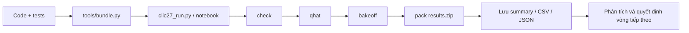

Để báo cáo kết quả có thể tái lập, mỗi run nên lưu: commit SHA, phiên
bản Q̂ và file model, danh sách ảnh, cấu hình bitrate, lệnh chạy,
checkpoint, phiên bản Python/PyTorch/CUDA, tên GPU, thời gian nạp/giải
mã, peak memory, checksum bitstream và ảnh đầu ra.

Vòng 15/10 dùng script riêng trong `experiments/new_codecs`, chưa tích hợp vào CLI bake-off chính. Đã lưu revision của code tác giả, hash trọng số, JSON mỗi điểm, trace VRAM, metric và allocation tại `results/2026-10-15_new_codecs`. Model, ảnh tái tạo và stream lớn còn trên server tại `/mnt/home/guess03/clic/research_20261015`. Không coi file student hoặc thư mục checkpoint riêng là gói decoder hoàn chỉnh.

Các script đã qua kiểm tra cú pháp và guard bộ nhớ; bằng chứng chức năng là round-trip thực cùng kiểm decode độc lập. Khi đổi code/checkpoint/config phải tạo tên run mới, không resume vào thư mục kết quả cũ. Cần thêm kiểm toàn gói offline và phục hồi artifact trước khi khóa bài nộp.

## 8. Rủi ro, giới hạn và kế hoạch giảm thiểu

| Rủi ro | Mức | Hành động giảm thiểu |
| --- | --- | --- |
| **Decoder/mix quá chậm trên L4** | Cao | Đo cold-start và tổng wall time từng họ; so teacher/student/PULSE-L, không mặc định MS-ILLM nhanh hơn |
| **Bitstream khác nhau giữa máy** | Cao | Kiểm tra L4↔L4; cố định environment; thay entropy path bằng phép toán số nguyên khi cần |
| **Tổng decoder vượt 4 GB** | Cao | Chia sẻ trọng số giữa q-level, lưu delta hoặc giảm số mức; đo tổng artifact cuối |
| **Allocator tối ưu proxy nhưng người không thích hơn** | Trung bình--cao | Chấm mù toàn tập và theo nhóm; nếu phát triển bộ chọn nhanh thì đo sai số so với lựa chọn từ RD đã biết |
| **Q̂ khái quát kém** | Trung bình--cao | Thêm người chấm, mở rộng ảnh, kiểm tra calibration và confidence interval |
| **Không tích hợp được các codec vào một decoder** | Cao | Định nghĩa format/header và mode ID; kiểm thử end-to-end từ bitstream đến ảnh |
| **Thiếu artifact hoặc mất checkpoint** | Cao | Sao lưu checkpoint, latent và streams; kiểm tra khôi phục từ bản sao |
| **Giấy phép pretrained weights không phù hợp** | Trung bình--cao | Rà soát code, weights, model card và điều khoản cuộc thi trước khi nộp |

## 9. Hướng nghiên cứu và kế hoạch tiếp theo

### 9.1 Các phương pháp mới và bài CLIC cũ

| Nguồn chính thức | Hướng tiếp cận | Trạng thái và quyết định |
|---|---|---|
| [PULSE](https://github.com/microsoft/GenCodec/tree/main/PULSE) | Decoder nhẹ, variable-rate, entropy số nguyên | Đã thử base/L; ưu tiên tích hợp L và nghiên cứu vùng rate thấp |
| [AFP-GIC](https://github.com/yifeipet/AFP_GIC) | Kết hợp prior sinh ảnh, một checkpoint nhiều rate | Pilot chưa vượt baseline; chưa mở train dài |
| [DC-VIC](https://github.com/iwa-shi/DC_VIC) | Khai thác codebook sinh ảnh bằng dual conditioning | Đã thử PatchGAN; giữ làm tham khảo phương pháp |
| [PICO](https://github.com/apple-aiml-research/ml-pico) | Tối ưu cảm nhận người xem cùng hiệu năng triển khai | Đã rà repo: viewer/ảnh kết quả, chưa tìm được runtime và weights để chạy trên tập của dự án |
| [ProGIC](https://arxiv.org/abs/2603.02897) | Progressive RVQ và backbone nhẹ | Có paper; chưa xác minh được checkpoint chạy được |
| [AEIC](https://github.com/LuizScarlet/AEIC) | Ultra-low bitrate với shallow encoder | Có repo; chưa thử, cần kiểm chi phí decoder trước |
| [PORT — CLIC 2025](https://www.jdl.link/doc/2011/20251221_232_32_18.PORT%20Perception-Oriented%20Image%20Compression.pdf) | Decoder nhanh, loss semantic/patch và phân bổ theo ROI | Tìm được paper của PKUSZ-AliMerlin; chưa tìm checkpoint công khai để thử |
| [Cool-Chic — tag CLIC 2025](https://github.com/Orange-OpenSource/Cool-Chic/releases) | Tối ưu từng ảnh, decoder C nhẹ | Đã có phép thử trong repo ngày 09/10; chưa chạy lại trong vòng mới |

Cool-Chic CLIC2025 trên ảnh `2684452d` mất khoảng 1 giờ 39 phút encode, đạt Q̂ v0 1.33 tại 0.557 bpp; MS-ILLM cùng ảnh đạt 1.46 tại 0.267 bpp. Đây là bằng chứng trên một ảnh và cấu hình cụ thể, đủ để chưa ưu tiên quét hàng loạt, không đủ để loại mọi cấu hình Cool-Chic. Nếu thử tiếp, giới hạn ở screen/texture và lambda phù hợp 0.075–0.3. [Kết quả Cool-Chic cũ](D:/AwesomeCV/ratflow-codec/results/2026-10-09_coolchic2025_probe/summary.md).

Tìm được paper không đồng nghĩa có thể reproduce. Các mục “chưa tìm checkpoint” phản ánh phạm vi tìm kiếm hiện tại, không khẳng định checkpoint không tồn tại. Việc đánh giá trên bộ dữ liệu CLIC cũng không tự chứng minh một model là bài dự thi CLIC.

### 9.2 Hướng A — lựa chọn codec có tính chi phí triển khai

**Giả thuyết:** lựa chọn theo từng ảnh có thể đạt chất lượng tốt hơn tại cùng ngân sách byte và thời gian nếu tính cả chi phí nạp từng họ decoder. Bằng chứng khởi đầu là PULSE-L được chọn trên 10/30 và 20/30 ảnh ở hai budget cao.

Giữ các lựa chọn $j_i$ ở mục 3 và bổ sung ràng buộc thời gian:

$$
\sum_{i=1}^{N}t_{i,j_i}+\sum_{c\in\mathcal C}a_c\ell_c
\leq T_{\max}.
$$

Trong đó $t_{i,j_i}$ là thời gian decode ảnh, $\ell_c$ là chi phí nạp codec $c$, và $a_c$ bằng 1 khi có ít nhất một ảnh dùng codec đó. Đây là mô hình xấp xỉ để chọn phương án; quyết định cuối vẫn phải đo wall time của gói thật, kể cả I/O và khởi động. Có thể bổ sung hình phạt độ bất định chất lượng sau khi có dữ liệu calibration độc lập.

**Ablation:** A0 chỉ tối ưu byte; A1 thêm thời gian decode; A2 thêm chi phí load dùng chung; A3 thêm độ bất định của Q̂ nếu đủ dữ liệu. Giữ nguyên checkpoint, tập ảnh và tập điểm RD. Báo đường Pareto chất lượng–thời gian, kích thước decoder và preference người thật.

**Tính mới cần kiểm chứng:** routing và knapsack đã có từ trước. Đóng góp tiềm năng nằm ở cách phối hợp chi phí dùng chung, sai số của surrogate và điều kiện triển khai; chưa đủ cơ sở gọi đây là phương pháp mới trước khi rà related work và có ablation.

### 9.3 Hướng B — PULSE-L ở rate thấp với distillation theo độ tin cậy

**Giả thuyết:** fine-tune codec nhanh tới vùng 0.075/0.15, kết hợp teacher cho texture và loss trung thực ảnh gốc cho chữ/mặt, có thể giữ chất lượng tốt mà tránh decoder sinh ảnh nặng.

Bắt đầu từ PULSE-L đã chạy được, fine-tune RD cùng gain/rate conditioning và entropy model phù hợp. Không ngoại suy q âm rồi xem đó là operating point hợp lệ. Teacher nên cung cấp mục tiêu trong image space; latent của DiT-IC và PULSE không tương thích mặc định. Nếu dùng projection giữa latent thì projection đó phải được thiết kế, train và tính vào chi phí.

| Nhánh | Thay đổi duy nhất | Câu hỏi kiểm tra |
|---|---|---|
| B0 | Fine-tune RD từ PULSE-L | Có đạt rate thấp bằng stream thật và giữ decoder nhanh không? |
| B1 | B0 + distillation đồng đều | Teacher có giúp hơn fine-tune RD đơn thuần không? |
| B2 | B1 + trọng số theo vùng/độ tin cậy | Có giảm lỗi chữ/mặt mà giữ lợi ích texture không? |

So cùng số update, dữ liệu, crop và seed trong pilot; đo GPU-giờ riêng vì chi phí mỗi bước khác nhau. Cache teacher offline nếu giúp giữ giới hạn 30 GB/GPU. Smoke 200–500 bước trước, rồi tối đa 6 GPU-giờ/nhánh cho vòng sàng lọc. Đây là ngân sách đề xuất, chưa phải các run đã khởi chạy. Dùng nhiều seed khi xác nhận finalist.

ROI và điều khiển hallucination đã có trong [PORT](https://www.jdl.link/doc/2011/20251221_232_32_18.PORT%20Perception-Oriented%20Image%20Compression.pdf), [Conditional Hallucinations](https://arxiv.org/abs/2410.19493) và [Region-Adaptive Generative Compression](https://arxiv.org/abs/2604.01122). Vì vậy, thêm ROI mask chưa đủ là đóng góp mới. Cần kiểm chứng cụ thể lợi ích của độ tin cậy teacher khi chuyển chất lượng xuống decoder nhanh, đặc biệt ở bitrate thấp.

### 9.4 Hướng C — refinement theo vùng với byte thật

**Giả thuyết:** dành residual/refinement cho vùng bị sai có ý nghĩa với người xem sẽ hiệu quả hơn phân bổ đồng đều. Ưu tiên encoder-side refinement để hạn chế tăng chi phí decoder; mọi mask, vị trí patch, gain hoặc latent sửa phải truyền và tính byte.

Ablation gồm không refinement, refinement đồng đều và refinement theo vùng dưới cùng ngân sách byte và encode time. Chỉ giữ nhánh khi có lợi trên holdout/chấm mù và không phá tất định. Adaptive residual/ROI không mới tự thân; đóng góp cần ở tiêu chí chọn vùng và mức cải thiện rate–quality–time. Nhánh này đứng sau A/B để tránh phân tán tài nguyên.

### 9.5 Lộ trình thực hiện và điều kiện chuyển giai đoạn

Các khoảng ngày dưới đây là **mục tiêu nội bộ**, không phải deadline cuộc thi. Việc có máy L4 là một phụ thuộc thực tế cần được bố trí riêng.

| Giai đoạn | Công việc | Sản phẩm và cổng quyết định |
|---|---|---|
| 16–18/10 | Tích hợp PULSE-L vào bake-off; khóa manifest baseline; lưu checkpoint/stream và thử phục hồi | Chạy lại bảng 30 ảnh; không ghi đè kết quả cũ; kiểm đủ byte/header/mode |
| 19–23/10 | Đóng gói decoder offline, profile load/decode/I/O/RAM; chuẩn bị hoặc chạy L4 A/B khi có máy | Report tổng wall time, kích thước artifact; tách entropy parity và PNG parity |
| 19–27/10 | Chấm mù mix mới với mix cũ, thêm 2–3 người; tạo dev/holdout độc lập | Preference theo ảnh/nhóm; bootstrap theo ảnh, không coi crop là mẫu độc lập |
| 24–31/10 | Thử A0/A1/A2; smoke B0/B1/B2 dưới 30 GB/GPU | Đường Pareto, actual-rate, chi phí GPU-giờ; chọn tối đa hai nhánh để mở rộng |
| Tháng 11 | Train finalist trên train/dev; kiểm lại holdout và gói triển khai | Chỉ mở train dài khi chất lượng, tốc độ và khả năng decode có bằng chứng |

Chấm mù cần ngẫu nhiên hóa trái/phải, thêm cặp lặp, có ảnh gốc, kết hợp xem toàn ảnh và crop. Tách một phân tích tập trung vào ảnh đổi codec để chẩn đoán với phân tích trên toàn tập để ước lượng lợi ích tổng thể; không chỉ báo nhóm ảnh có lợi. Kiểm split Q̂ theo ảnh/nguồn codec và giữ validation chính thức ngoài training.

Không cần chờ L4 để làm mọi pilot có giới hạn trên L40. Tuy nhiên, không mở rộng train dài hoặc khóa bài nộp chỉ dựa vào tốc độ L40. Nếu phương án chất lượng cao không đáp ứng triển khai, chọn điểm Pareto tốt hơn thay vì mặc định dùng student. Kiểm kê trọng số theo từng gói decoder/rate, rà giấy phép và chạy end-to-end offline trước khi đăng ký validation.

## 10. Các vấn đề xin ý kiến người hướng dẫn

1. **Đóng góp trọng tâm:** ưu tiên bài toán lựa chọn codec có chi phí load/thời gian (A), hay ưu tiên một codec nhanh mới ở bitrate thấp (B)? Đề xuất: A tạo kết quả hệ thống sớm; B là nhánh nghiên cứu sâu.
2. **Bằng chứng chất lượng:** cần bao nhiêu người chấm và bao nhiêu ảnh holdout để quyết định mở train dài? Đề xuất khởi đầu thêm 2–3 người, phân tầng nội dung và báo bất định theo ảnh.
3. **Trade-off tốc độ:** có chấp nhận giảm một phần Q̂ để giảm cold-start và dung lượng decoder không? Quyết định nên dựa trên đường Pareto và kết quả L4, không đặt một mức mất chất lượng tùy ý.
4. **Nguồn lực:** bố trí thời gian trên hai máy L4 độc lập để kiểm deployment và parity; nghiên cứu chính tiếp tục trên 2 L40, tối đa 30 GB/GPU.
5. **Mức độ mới:** phần nào đủ để phát triển thành đóng góp nghiên cứu ngoài một hệ thống dự thi tốt? Cần rà prior art cho routing, teacher confidence và adaptive residual trước khi chốt tuyên bố novelty.

## 11. Kết luận và tài liệu đối chiếu

Dự án đã có bằng chứng ủng hộ hệ thống nhiều codec: DiT-IC có tín hiệu tốt ở rate thấp; MS-ILLM và PULSE-L bổ sung ở rate cao hơn; VTM-SCC giữ vai trò trên một số nội dung screen. Kết quả mới nhất nâng Q̂ mix lên 0.7891/1.4912 tại 0.15/0.3 bpp, nhưng chưa xác nhận bằng người. Ưu tiên tiếp theo là tích hợp PULSE-L, chấm mù và đo gói decoder thật, đồng thời sàng lọc có giới hạn các giả thuyết A/B trên server.

### 11.1 Bằng chứng trong repo

| Nội dung | Artifact |
|---|---|
| Q̂ v0 và protocol cross-year/CV | [Summary Q̂ v0](D:/AwesomeCV/ratflow-codec/results/2026-10-06_qhat_v0/summary.md) |
| Q̂ v1 | [Summary Q̂ v1](D:/AwesomeCV/ratflow-codec/results/2026-10-09_qhat_v1/summary.md) |
| Baseline trước vòng model mới | [Bake-off 13/10](D:/AwesomeCV/ratflow-codec/results/2026-10-13_bakeoff_v0/summary.md) |
| Chấm mù một người | [Rating 11/10](D:/AwesomeCV/ratflow-codec/results/2026-10-11_rating_ditic_msillm/summary.md) |
| Chưng cất q3 | [Snapshot GAN 30k](D:/AwesomeCV/ratflow-codec/results/2026-10-11_ditic_distill/stage2_gan01/snap_30000/summary.md) |
| Entropy determinism | [Kiểm tra 12/10](D:/AwesomeCV/ratflow-codec/results/2026-10-12_ditic_determinism/summary.md) |
| Kit trong stack theo devkit, phần cứng L40 | [Kit 13/10](D:/AwesomeCV/ratflow-codec/results/2026-10-13_l4_kit_l40/summary.md) |
| Model mới, checksum, VRAM, số điểm | [Manifest 15/10](D:/AwesomeCV/ratflow-codec/results/2026-10-15_new_codecs/manifest.json) |
| Bảng cập nhật 30 ảnh | [Summary CSV](D:/AwesomeCV/ratflow-codec/results/2026-10-15_new_codecs/full_scores/summary.csv) |
| Nghiên cứu và pilot chi tiết | [Report model mới](D:/AwesomeCV/ratflow-codec/reports/CLIC2027_new_models_2026-10-15.md) |
| Kế hoạch toàn chiến dịch | [Plan v3](<D:/AwesomeCV/ratflow-codec/plans/Plan CLIC 2027 v3 - execution 2026-10-15.md>) |

Các bảng cập nhật lấy từ artifact đã lưu đến ngày 15/10/2026. Các thí nghiệm A/B/C trong kế hoạch chưa được thực hiện; số liệu của chúng không nằm trong các bảng kết quả hiện tại.

### 11.2 Nguồn bên ngoài

- [Repo dự án](https://github.com/KhoiTrant68/clic2027-image).
- [Luật và tập dữ liệu CLIC 2027](https://clic2027.compression.cc/tasks/).
- [MS-ILLM — ICML 2023, PMLR](https://proceedings.mlr.press/v202/muckley23a.html); [paper đầy đủ](https://proceedings.mlr.press/v202/muckley23a/muckley23a.pdf).
- [DiT-IC — implementation chính thức](https://github.com/Eric-qi/DiT-IC), [SANA](https://arxiv.org/abs/2410.10629), [DC-AE](https://arxiv.org/abs/2410.10733).
- [PULSE — code/checkpoint/training](https://github.com/microsoft/GenCodec/tree/main/PULSE).
- [MBT2018](https://arxiv.org/abs/1809.02736).
- Các nguồn AFP-GIC, DC-VIC, PICO, ProGIC, AEIC, PORT và Cool-Chic được liên kết tại mục 9.1; prior art liên quan ROI/hallucination tại mục 9.3.

## Phụ lục A. Nền tảng và phương pháp MS-ILLM

Phụ lục này giữ phần giải thích phương pháp của bản báo cáo ban đầu, đã chuẩn hóa ký hiệu và bố cục. Đây là mô tả **phương pháp của tác giả MS-ILLM**, không phải kiến trúc mới do dự án đề xuất hoặc một lần training dự án đã thực hiện. Tham chiếu: [paper MS-ILLM, mục 3–4.5](https://proceedings.mlr.press/v202/muckley23a/muckley23a.pdf).

### A.1 Rate, distortion và statistical fidelity

Nén ảnh cần cân bằng số bit với mức độ giữ lại thông tin thị giác. Với ảnh gốc $x$ và ảnh tái tạo $\hat{x}$, ba khái niệm cần phân biệt là:

- **Rate $R$:** lượng thông tin để biểu diễn ảnh; bpp thực tính từ số bit của stream chia số pixel.
- **Distortion $D$:** sai khác với chính ảnh gốc. Ví dụ MSE trên $M$ giá trị pixel/kênh là $D(x,\hat{x})=M^{-1}\sum_{m=1}^{M}(x_m-\hat{x}_m)^2$.
- **Statistical fidelity:** mức độ gần nhau giữa phân phối ảnh tái tạo $P_{\hat X}$ và phân phối ảnh thật $P_X$.

Ảnh có texture tự nhiên chưa chắc có các chi tiết khớp ảnh gốc. Ngược lại, tối ưu sai số pixel có thể tạo ảnh mượt, ít texture. Vì vậy cần đánh giá cả độ trung thực với ảnh gốc và chất lượng cảm nhận, nhất là khi ảnh chứa chữ hoặc khuôn mặt.

Một cách biểu diễn bài toán lý thuyết là:

$$
R(\tau,\delta)=\min_{P_{\hat X\mid X}} I(X;\hat X)
\quad\text{với}\quad
\mathbb E[\rho(X,\hat X)]\leq\tau,\qquad
d(P_{\hat X},P_X)\leq\delta.
$$

$\rho$ là hàm distortion, $d$ là độ khác biệt phân phối, $\tau$ và $\delta$ là các ngưỡng. Đây là mô tả lý thuyết; rate ước lượng lúc train và số byte stream thực lúc đánh giá không phải cùng một phép đo.

Trong training neural codec, có thể diễn đạt mục tiêu tổng quát bằng:

$$
\mathcal L_{\mathrm{codec}}=
\lambda_R R+\lambda_D D+\lambda_G\mathcal L_{\mathrm{adv}}.
$$

Các trọng số điều khiển trade-off. Tín hiệu đối kháng là cách học gián tiếp để cải thiện thống kê ảnh; không phải phép tính trực tiếp một divergence đầy đủ giữa hai phân phối, cũng không bảo đảm mọi chi tiết sinh ra đều đúng.

### A.2 Mean-Scale Hyperprior làm nhiệm vụ nén

Encoder chuyển ảnh $x$ thành latent $y$; lượng tử hóa tạo latent rời rạc $\hat y$. Hyperprior cung cấp thông tin để dự đoán trung bình và scale của phân phối latent, từ đó entropy coder tạo bitstream. Decoder tái tạo ảnh từ latent đã giải mã.

Nếu phân phối xác suất dự đoán phù hợp hơn với latent, entropy coding có thể dùng ít bit hơn. ILLM không thay thế đường nén này: nó bổ sung tín hiệu huấn luyện để cải thiện ảnh đầu ra. Khi triển khai, discriminator và bộ tạo nhãn dùng trong training không mặc nhiên phải đi cùng decoder.

### A.3 VQ-VAE tạo nhãn cục bộ

VQ-VAE có codebook gồm $C$ vector $\{m_1,\ldots,m_C\}$. Tại vị trí không gian $(u,v)$, encoder tạo đặc trưng $e^{(u,v)}$ và chọn code gần nhất:

$$
c^*(u,v)=\arg\min_{c\in\{1,\ldots,C\}}
\left\|e^{(u,v)}-m_c\right\|_2^2.
$$

Các chỉ số codebook tạo thành bản đồ nhãn $u(x)$ của ảnh thật. Chúng là nhãn đặc trưng được học, không phải các lớp ngữ nghĩa do người gán như “mèo”, “cây” hay “chữ”. Trong thiết lập mặc định được mô tả ở bản báo cáo, crop $256\times256$ tạo bản đồ $32\times32$, với codebook 1024 vector.

### A.4 Discriminator U-Net và hai hàm loss

Discriminator $D_\phi$ dự đoán $C+1$ lớp ở mỗi vị trí: $C$ lớp codebook và một lớp fake. Với ảnh thật, mục tiêu là nhãn cục bộ $u(x)$; với ảnh tái tạo, mục tiêu của discriminator là bản đồ fake $b_0$. Dùng biểu diễn one-hot, có thể viết gọn:

$$
\mathcal L_D=
-\mathbb E_x\!\left[\langle u(x),\log D_\phi(x)\rangle\right]
-\mathbb E_x\!\left[\langle b_0,\log D_\phi(\hat x)\rangle\right].
$$

Phần codec đóng vai trò generator, muốn ảnh tái tạo được dự đoán theo nhãn cục bộ của ảnh gốc:

$$
\mathcal L_G=
-\mathbb E_x\!\left[\langle u(x),\log D_\phi(\hat x)\rangle\right].
$$

Tích vô hướng ở đây gộp theo lớp và các vị trí không gian; công thức nhằm giải thích mục tiêu, không ấn định cách chuẩn hóa tổng/trung bình của implementation. $\mathcal L_G$ cung cấp thành phần đối kháng trong loss codec, không thay thế mọi thành phần rate và distortion.

U-Net kết hợp ngữ cảnh nhiều độ phân giải với thông tin không gian qua skip connections. Biến thể trong MS-ILLM dùng các residual block, LeakyReLU và đầu ra phù hợp độ phân giải bản đồ nhãn; bản thiết kế được mô tả không dùng normalization ở các lớp convolution của discriminator.

Điểm khác với discriminator nhị phân là yêu cầu dự đoán cấu trúc nhãn cục bộ được đưa vào loss. Nhãn VQ-VAE hướng tín hiệu học về các vùng đặc trưng, song vẫn không bảo đảm chi tiết ảnh tái tạo đúng tuyệt đối với ảnh gốc.

### A.5 Hai giai đoạn training

Giai đoạn đầu huấn luyện encoder, entropy model và decoder theo mục tiêu nén, chưa dùng discriminator. Giai đoạn sau fine-tune phần decoder với tín hiệu đối kháng. Các thông số dưới đây là **recipe của paper**, không phải log một run MS-ILLM mới của dự án.

| Tham số | Pretraining | Fine-tuning đối kháng |
|---|---|---|
| Số bước pretraining | 1.000.000 | Không suy từ số bước pretraining |
| Learning rate codec/generator | Peak $3\times10^{-4}$ | $1\times10^{-4}$ |
| Learning rate discriminator | Không dùng | $4\times10^{-4}$ |
| Optimizer | AdamW | AdamW |
| Warmup pretraining | 10.000 bước | Không suy cùng lịch từ giai đoạn đầu |
| Weight decay | $5\times10^{-5}$ | $5\times10^{-5}$ |

Khi reproduce hoặc fine-tune trong dự án, cần đối chiếu config, checkpoint và thành phần thực sự được cập nhật, thay vì chỉ sao chép vài hyperparameter trong bảng.

### A.6 Liên hệ với hướng nghiên cứu hiện tại

MS-ILLM cho thấy việc thiết kế tín hiệu đối kháng cục bộ có thể quan trọng bên cạnh kiến trúc entropy. Điều dự án cần kiểm tra tiếp là liệu cách học chất lượng này hoặc distillation từ teacher có chuyển được sang decoder nhanh ở bitrate thấp mà vẫn giữ chữ/mặt hay không. Phụ lục cung cấp nền tảng cho câu hỏi đó; bằng chứng hiện tại của dự án vẫn là các phép đo và giới hạn tại mục 5, không phải một phương pháp training mới đã được xác nhận.

## Phụ lục B. Cơ chế và kiến trúc các model — đọc paper, đối chiếu implementation

Phạm vi gồm các codec đã chạy trong repo và SANA/DC-AE/SD-Turbo làm nền tảng. Các ứng viên mới chỉ liệt kê ở mục 9.1 chưa được xem như implementation đã kiểm chứng. Sơ đồ dưới đây do báo cáo diễn giải ở mức luồng dữ liệu; không thay thế sơ đồ lớp đầy đủ của tác giả. Nhãn **Theo paper**, **Trong repo** và **Hàm ý** giúp phân biệt nguồn kiến thức với bằng chứng nội bộ.

### B.1 Cách đọc một neural codec

Đặt $x$ là ảnh, $y=g_a(x)$ là latent chính, $\hat y=Q(y)$ là latent đã lượng tử hóa. Với hyperprior, $z=h_a(y)$ cung cấp thông tin phụ để dự đoán phân phối của $\hat y$. Rate ước lượng thường có dạng:

$$
R_{\mathrm{est}}=-\log_2 p(\hat z)-\log_2 p(\hat y\mid\hat z),
\qquad \hat x=g_s(\hat y).
$$

Entropy model quyết định cách biến symbol thành bit; synthesis transform quyết định cách biến latent đã giải mã thành ảnh. Đó là hai vai trò khác nhau. Mean-scale hyperprior mô hình hóa cả trung bình và độ phân tán; context model có thể bổ sung phụ thuộc giữa các symbol. [Minnen, Ballé và Toderici, NeurIPS 2018, mục 2–3](https://arxiv.org/pdf/1809.02736).

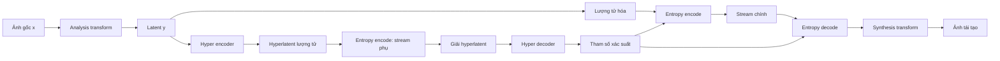

**Đối chiếu triển khai:** trong report, bpp thực luôn phải tính từ file truyền: payload + kích thước/quality + mode + framing cần thiết. Discriminator, teacher hoặc nhãn sinh từ ảnh gốc chỉ dùng khi train không tự động trở thành dữ liệu decoder được phép sử dụng. Với output số thực, cần tách ba kiểm tra: đọc được entropy stream, khớp latent/symbol và khớp pixel PNG.

### B.2 MS-ILLM — học thống kê cục bộ, giữ đường nén mean-scale hyperprior

**Theo paper.** Muckley và cộng sự, *Improving Statistical Fidelity for Neural Image Compression with Implicit Local Likelihood Models*, ICML 2023. VQ-VAE biến ảnh thật thành bản đồ nhãn codebook. Discriminator U-Net dự đoán nhãn cục bộ hoặc fake; codec học tái tạo ảnh có cấu trúc nhãn phù hợp. Đây là cách đưa tín hiệu thống kê cục bộ vào training. Đường nén vẫn là encoder → latent/hyperlatent → entropy coding → decoder. VQ-VAE tạo nhãn và discriminator không cần chạy khi giải mã ảnh. [Paper, mục 4.1–4.5](https://proceedings.mlr.press/v202/muckley23a/muckley23a.pdf).

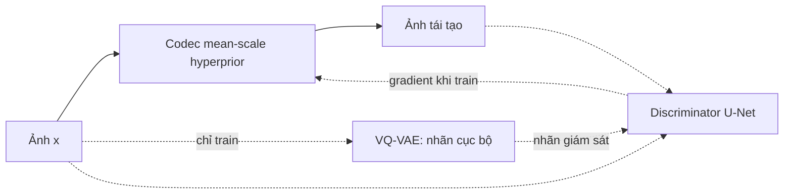

**Trong repo.** `_msillm_load` nạp checkpoint public q1–q5. Encoder/decoder ảnh chạy GPU, phần entropy sử dụng cách phân bố tensor do NeuralCompression quy định. Kiểm mới lưu cả hai payload cùng kích thước ảnh/padding: header 28 byte, không còn chỉ cộng giả định 4 byte. Bật deterministic đạt parity 5/5 ảnh giữa tiến trình; đây là kiểm triển khai nội bộ, không phải kết quả trong paper. [Code bake-off](../experiments/bakeoff/bakeoff.py), [kiểm stream](CLIC2027_msillm_stream_audit_2026-10-15.md).

**Hàm ý:** nếu distill MS-ILLM sang decoder khác, tín hiệu teacher có thể lấy ở image/feature space; không được giả định latent hoặc entropy format tương thích. Phụ lục A trình bày kỹ hơn loss của ILLM.

### B.3 DiT-IC — ba alignment để đưa DiT về nhiệm vụ nén ảnh

**Theo paper.** DiT-IC làm việc ở latent giảm kích thước không gian 32 lần. Ba cơ chế chính: variance-guided flow điều chỉnh mức tái tạo theo uncertainty; self-distillation dùng biểu diễn của encoder đóng băng làm đích cho latent tái tạo; latent-conditioned guidance thay điều kiện văn bản bằng embedding dự đoán từ latent. Training dùng alignment và rate–distortion, sau đó thêm đối kháng; LoRA thích nghi DiT và decoder. Khi inference không cần prompt văn bản. [Shi và cộng sự, CVPR 2026, mục 3.1–3.4](https://arxiv.org/html/2603.13162v1#S3).

**Hai nền tảng.** DC-AE nén không gian sâu bằng residual autoencoding: shortcut space-to-channel giúp mạng học phần dư thay vì tự học toàn bộ phép giảm resolution; training nhiều giai đoạn xử lý khó khăn ở ảnh lớn. SANA kết hợp autoencoder nén sâu với linear-attention DiT và FFN có locality. DC-AE một mình chưa tạo file nén entropy, còn SANA gốc là hệ sinh ảnh. [DC-AE, mục 3](https://arxiv.org/html/2410.10733v1); [SANA, mục 3](https://arxiv.org/html/2410.10629v1).

**Trong repo — luồng decoder thực tế:**

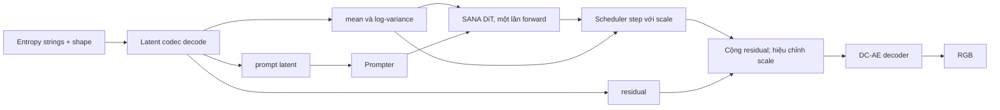

Sơ đồ bám hàm `decompress` trong `_DITIC_SCRIPT`: entropy path giữ precision riêng; phần DiT/prompter/DC-AE dùng dtype cấu hình, cùng crop latent, bucket và RMSNorm tối ưu. Đây là bản triển khai đã điều chỉnh cho benchmark, không phải chép nguyên mọi chi tiết paper. [Code repo](../experiments/bakeoff/bakeoff.py), [implementation tác giả](https://github.com/Eric-qi/DiT-IC).

**Phân biệt hai loại distillation:** self-distillation trong paper phục vụ tái tạo một bước của DiT-IC. Thí nghiệm `ditics` của chúng ta thay các tầng DC-AE độ phân giải cao bằng student hẹp hơn và học output teacher. Nó không phải tái lập nguyên recipe self-distillation của paper, cũng không thay toàn bộ DiT bằng mạng nhỏ.

### B.4 PULSE / PULSE-L — ít tính toán ở decoder, kiểm soát riêng đường entropy

**Theo paper.** Encoder dùng patch embedding stride 16 và depthwise-convolution blocks. Hyperlatent ở độ phân giải 1/64. Latent chính chia checkerboard không gian–kênh, giải qua hai lượt thay vì quét tuần tự từng pixel. Decoder xử lý đặc trưng thấp resolution, rồi AdaLN điều chế MLP renderer trên lưới 1/4; PixelShuffle dựng patch RGB. Linear CDF predictor số nguyên chọn bảng xác suất; Meta Prior truyền chỉ số bank để thích nghi phân phối hyperlatent. Training perceptual đi từ LPIPS sang GAN và loss ROI chữ/mặt. [Jia và cộng sự, PULSE, arXiv 2026, mục 2–5](https://arxiv.org/html/2609.18602v1).

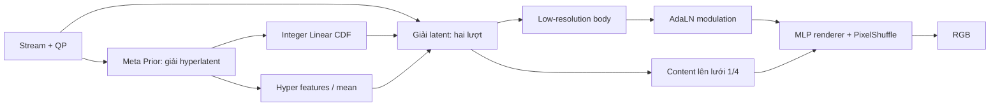

**Theo release.** Base và L cùng họ kiến trúc nhưng khác dung lượng; L perceptual khoảng 20 kMAC/pixel, base khoảng 5.2. Một model hỗ trợ q0–q7. Bundle gồm cấu hình, trọng số float và entropy-control integer; bitstream không chứa toàn bộ mạng. Tác giả chỉ bảo đảm tính tất định cho entropy-control trên nền tảng hỗ trợ, không hứa mọi pixel float giống nhau. [README chính thức, Models / Compress and decompress](https://github.com/microsoft/GenCodec/blob/main/PULSE/README.md).

**Trong repo.** Bundle L đã chạy 150 điểm q0–q4 và kiểm decoder độc lập. Header `PL` bốn byte của repo bọc payload tác giả; file thật được tính byte. Benchmark 12.235 giây bao gồm khởi động, giải nén gói, nạp model và ghi PNG trên L40. Không dùng số CPU/base trong paper để thay cho phép đo này.

**Hàm ý:** đây là nền tảng phù hợp để nghiên cứu decoder nhanh. “Thêm ROI chữ/mặt” tự nó chưa phải đóng góp mới vì paper đã làm; hướng distillation theo độ tin cậy cần ablation riêng và kiểm phạm vi prior art.

### B.5 CoD-Lite — condition nén giàu thông tin thay cho backbone sinh ảnh lớn

**Theo paper.** Encoder–decoder convolution tạo condition qua vector quantization; chỉ số codebook được mã hóa độ dài cố định. Condition dẫn dắt diffusion convolution một bước trong pixel space. Backbone thay attention bằng depthwise convolution và channel attention, đầu MLP dựng pixel. Pretraining hướng compression cung cấp điều kiện giàu thông tin; fine-tune cố định timestep/noise, dùng reconstruction/perceptual loss, DMD từ teacher CoD và GAN. Teacher/discriminator chỉ phục vụ training. [Jia và cộng sự, ICML 2026](https://proceedings.mlr.press/v306/jia26i.html); [paper, mục 5](https://arxiv.org/html/2604.12525v1#S5).

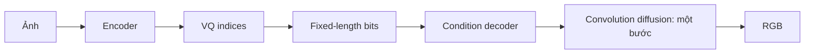

**Trong repo.** `points_codlite` gọi `compress`, dựng condition bằng `decompress`, rồi `inference` với tensor khởi đầu bằng không. Config/checkpoint gắn với từng operating point; không xem một checkpoint bất kỳ là model variable-rate liên tục. Ảnh được pad theo bội số 64 rồi crop về kích thước gốc. [Code bake-off](../experiments/bakeoff/bakeoff.py), [release CoD-Lite](https://github.com/microsoft/GenCodec/tree/main/CoD_Lite).

**Hàm ý:** paper cho thấy một hướng giảm tải bằng condition tốt và distillation, nhưng lợi ích FID trên tập của tác giả không chứng minh lợi ích Q̂/preference trên validation của ta. Việc giữ CoD-Lite trong bảng là để đối chiếu phương án này, không vì nhãn “real-time” tự động đáp ứng bài thi.

### B.6 DC-VIC — dự đoán token và sửa feature của VQGAN

**Theo paper.** Compression encoder dựa trên residual/attention nhận ảnh, đặc trưng VQGAN và hai điều kiện. Hyperprior cùng channel autoregressive model mã hóa latent. Ở decoder, token estimator gồm CNN/Swin dự đoán index codebook; nhánh SFT tạo đặc trưng điều chế các tầng của VQGAN decoder đóng băng. $\beta_{rate}$ điều khiển tổng rate, $\beta_{vq}$ điều khiển độ chính xác dự đoán token, từ đó cân bằng thông tin cho token và sửa feature. Training qua lấy mẫu điều kiện, chọn cặp điều kiện rồi fine-tune. [Iwai, Miyazaki và Omachi, IEEE Access 2024, mục III, hình 2–6; DOI](https://doi.org/10.1109/ACCESS.2024.3522238), [bản toàn văn tác giả](https://www.researchgate.net/publication/387411891_Dual-Conditioned_Training_to_Exploit_Pre-trained_Codebook-based_Generative_Model_in_Image_Compression).

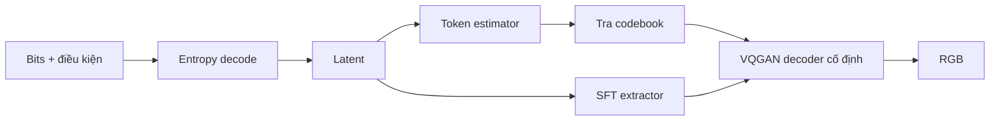

**Trong repo.** Đã chạy checkpoint **PatchGAN**, không phải OASIS. API quality 0–4 chọn cấu hình đã được release; không hiểu q là số bit/pixel cố định. Các tensor entropy cũ được chuyển tên cho stack CompressAI hiện tại rồi strict-load. Pilot 18 điểm hợp lệ chỉ hỗ trợ nhận xét về cấu hình này. [Release chính thức](https://github.com/iwa-shi/DC_VIC), [ghi nhận thử nghiệm](CLIC2027_new_models_2026-10-15.md).

**Hàm ý:** prior giúp tái tạo texture, nhưng dự đoán sai token vẫn có thể tạo chi tiết sai; SFT có vai trò sửa theo thông tin đã truyền. Decoder cần cả bộ dự đoán và VQGAN, nên phải đo tổng load/runtime thay vì chỉ đếm số bước sinh ảnh.

### B.7 AFP-GIC — chuyển prior hợp nhất từ AdaCode sang codec

**Theo paper.** AdaCode đóng băng hợp nhất nhiều codebook bằng trọng số theo nội dung. Prior Feature Adapter đưa đặc trưng đó vào encoder. Decoder không nhận prior gốc: Prior Estimator fully-convolutional dự đoán prior tương ứng từ latent đã giải mã và biến điều khiển; SFT điều chế decoder AdaCode đóng băng. Loss alignment giúp prior dự đoán gần prior từ ảnh gốc. Vì vậy thông tin vẫn phải đi qua bottleneck entropy; không có đường truyền prior “miễn phí”. [Pei, Liu và Ling, *Adaptive Fused Prior Transfer for Controllable Generative Image Compression*, bản arXiv v2 năm 2026, mục III, bảng I–II](https://arxiv.org/html/2605.16817v2#S3).

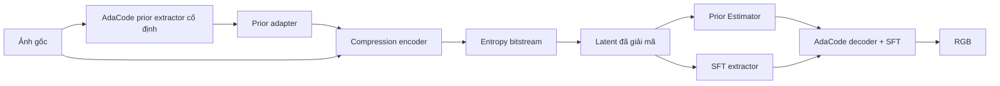

**Trong repo.** Chạy `afp_gic_release.pth.tar` qua runtime public; model có nhiều q nhưng pilot chỉ đo q0/1/4. Smoke load thiếu entropy parameters bị loại; bảng kết quả dùng strict-load. Prior ở đây là prior dựng ảnh, cần phân biệt với entropy prior tính xác suất symbol. [Release](https://github.com/yifeipet/AFP_GIC), [probe hiện có](../experiments/new_codecs/probe.py).

**Hàm ý:** ý tưởng đáng học là supervision bất đối xứng: encoder nhìn ảnh gốc, decoder học dự đoán từ bit đã nhận. Pilot của chúng ta chưa cho thấy lợi ích đủ để mở train dài; kết quả đó không phủ định kiến trúc trên mọi tập dữ liệu.

### B.8 CRDR — một model, hai nút điều khiển

**Theo paper.** CRDR dùng encoder kiểu ELIC, entropy model theo kênh và generator có beta-conditioning. Interpolation Channel Attention điều chỉnh theo q; $\beta$ được Fourier-encode rồi đưa qua MLP vào residual blocks để đổi realism. HRRGAN dùng reconstruction ở rate cao hơn làm đối chiếu cho generator, giảm áp lực so trực tiếp mọi reconstruction với ảnh gốc. Discriminator chỉ dùng khi train. [Iwai, Miyazaki và Omachi, WACV 2024, mục 3, hình 2–4](https://arxiv.org/html/2405.16817v1#S3).

**Luồng:** `ảnh + q → encoder → entropy stream → latent → generator(latent, q, beta) → RGB`. q làm thay đổi representation và rate; beta đổi cách tái tạo từ representation. Vì vậy tăng beta không tự động tăng lượng thông tin đúng về ảnh gốc.

**Trong repo.** Một ảnh/q được nén một lần rồi thử nhiều beta. Phần hyperprior/context chạy CPU theo setup tác giả. Cần truyền hoặc cố định rõ beta trong gói decoder cuối; nó không được suy ra nhờ ảnh gốc. [Code `points_crdr`](../experiments/bakeoff/bakeoff.py), [implementation tác giả](https://github.com/iwa-shi/CRDR).

**Hàm ý:** cơ chế nhiều rate/realism giúp giảm số checkpoint cần đóng gói. Tuy nhiên, quyết định sử dụng vẫn phải dựa trên chất lượng và thời gian đo được, không chỉ số checkpoint ít hơn.

### B.9 Cool-Chic — encode bằng tối ưu riêng cho từng ảnh

**Theo paper gốc.** Cool-Chic tối ưu latent phân cấp nhiều resolution cùng mạng synthesis nhỏ và probability model cho từng ảnh. Latent được đưa về cùng resolution để dựng RGB; entropy model dùng ngữ cảnh nhân quả. Bitstream phải mang cả latent lẫn tham số mạng đã lượng tử hóa. Decoder nhẹ vì chi phí tối ưu chuyển sang encoder. [Ladune và cộng sự, ICCV 2023, mục 2.1–2.4](https://arxiv.org/pdf/2212.05458).

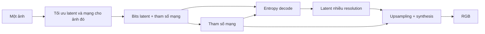

**Trong repo.** Checkout được pin ở tag `clic2025`, có decoder C/AVX2; không phải cấu hình MLP nhỏ nhất của paper 2023 hoặc bản 5.x hiện hành. Run dùng lựa chọn perceptual/Wasserstein theo config và tối ưu per-image. Do kiến trúc, entropy và recipe đã thay đổi qua các phiên bản, không gán số parameter/MAC của paper gốc cho binary CLIC 2025. [Tag đã chọn](https://github.com/Orange-OpenSource/Cool-Chic/tree/clic2025), [wrapper](../experiments/bakeoff/bakeoff.py).

**Hàm ý:** thích hợp để thử có chọn lọc trên ảnh mà encoder có thể dành nhiều thời gian. Khi đánh giá phải tính byte tham số mạng; “decoder ít tham số” không có nghĩa mọi ảnh chỉ tốn byte latent.

### B.10 MBT2018-mean — phân biệt bản mean-scale và bản autoregressive

**Theo paper và thư viện.** Paper Minnen–Ballé–Toderici kết hợp hierarchical prior và autoregressive context để dự đoán Gaussian cho latent. Trong CompressAI, `MeanScaleHyperprior` chỉ dự đoán mean/scale từ hyperprior; `JointAutoregressiveHierarchicalPriors` bổ sung context. Hai lớp không phải cùng một decoder. [Paper NeurIPS 2018](https://arxiv.org/pdf/1809.02736); [tài liệu model CompressAI](https://interdigitalinc.github.io/CompressAI/models.html#meanscalehyperprior).

**Trong repo.** Candidate `mbt` gọi `mbt2018_mean`, qualities 1–4, metric MSE. Đường đi là analysis/synthesis CNN với hyperprior, không phải baseline raster-autoregressive đầy đủ. Vì thế kết luận tốc độ hoặc chất lượng của phép chạy này chỉ áp dụng cho bản mean-scale. [Hàm `points_mbt`](../experiments/bakeoff/bakeoff.py).

**Hàm ý:** đây là mốc tham chiếu hữu ích để tách lợi ích của generative decoder khỏi khả năng mã hóa latent thông thường. Không diễn giải kết quả kém theo Q̂ thành thất bại của cả dòng entropy model MBT.

### B.11 VTM / VTM-SCC — codec khối, không có neural teacher

**Theo tài liệu chuẩn.** VVC kết hợp chia khối, dự đoán, biến đổi/lượng tử residual, entropy coding và lọc vòng lặp. Với ảnh tĩnh dùng cấu hình intra. Screen-content tools khai thác vùng phẳng, màu lặp và cấu trúc lặp: IBC lấy tham chiếu trong cùng ảnh; palette dùng bảng màu; transform skip/BDPCM phục vụ residual phù hợp. [Bross và cộng sự, *Overview of the VVC Standard and its Applications*, TCSVT 2021](https://doi.org/10.1109/TCSVT.2021.3101953).

**Trong repo.** Nhánh `vtm420` dùng YUV 4:2:0 10-bit; `vtmscc` dùng 4:4:4, thử bật IBC/PLT/BDPCM/transform-skip và ghi flags thực vào point. Wrapper có cơ chế fallback nếu binary từ chối tổ hợp flags; vì vậy không mặc định mọi point đều dùng đủ công cụ SCC. [Chuyển màu và lệnh VTM](../experiments/clic_b/b6_vtm_residual.py), [wrapper bake-off](../experiments/bakeoff/bakeoff.py).

**Hàm ý:** cạnh chữ và vùng màu phẳng là lý do hợp lý để giữ mode này trong mix; cần kiểm từng lựa chọn bằng dữ liệu, không coi mọi ảnh screen đều nên dùng VTM.

### B.12 S1 và SD-Turbo refiner — đâu là thành phần paper, đâu là thiết kế nội bộ?

**S1 trong repo.** DC-AE tạo latent 32 kênh ở resolution 1/32. `LatentCodec` dùng ResBlock cho analysis/synthesis, gain theo rate, hyperprior và subtractive dither. Hyper-synthesis cùng các quyết định CDF dùng đường integer; reconstruction transform vẫn float. Loss hiện có là rate cộng MSE latent, không trực tiếp tối ưu preference ảnh. Khi ghép residual VTM, phải cộng byte cả base và residual. Đây là thiết kế nội bộ đọc từ [latent_codec.py](../src/clic27/codec/latent_codec.py) và [trainer S1](../experiments/s1/train_s1.py), không gán thành một paper S1 công khai.

**SD-Turbo theo paper nền tảng.** Adversarial Diffusion Distillation kết hợp teacher diffusion và adversarial loss để huấn luyện student sinh ảnh với ít bước. Mục tiêu là tăng tốc generation; bản thân phương pháp này không cung cấp bitstream codec. [Sauer và cộng sự, *Adversarial Diffusion Distillation*, bản arXiv 2023, mục 3](https://arxiv.org/html/2311.17042v1).

**Refiner trong repo.** Pipeline lấy reconstruction MS-ILLM làm đầu vào SD-Turbo img2img. Đây là hậu xử lý do repo ghép, không phải codec SD-Turbo của tác giả paper. Nó tăng chi phí decoder và có thể đổi chi tiết dù không truyền thêm thông tin ảnh. Vì vậy cần chấm chất lượng, tính trọng số/runtime và xác định seed/control để tái lập.

### B.13 Từ kiến trúc đến các thí nghiệm cần làm

Các kết luận sau là **suy luận thiết kế cho repo**, chưa phải kết quả thực nghiệm mới:

| Câu hỏi | Bài học từ kiến trúc | Kiểm chứng cụ thể |
|---|---|---|
| Vì sao một bước vẫn có thể chậm? | Backbone, entropy CPU, load model và ghi ảnh đều có chi phí | Benchmark toàn gói; tách load / entropy / synthesis / I/O |
| Có nên distill latent giữa các model? | Representation và bitstream không tự tương thích | Bắt đầu từ image-space teacher; nếu dùng latent, phải học và kiểm projection |
| Làm sao giữ chữ/mặt? | Prior sinh có thể bù texture nhưng tạo chi tiết sai | Chấm mù theo nhóm ảnh, kiểm text/face; so uniform và confidence-weighted distillation |
| Làm sao giảm số model trong gói? | Variable-rate giảm nhu cầu checkpoint riêng nhưng không bảo đảm đủ dải rate | Kiểm byte thật ở rate thấp và chất lượng tại cùng budget |
| Khi nào gọi decoder tái lập được? | CDF đúng và PNG đúng là hai phép kiểm khác nhau | So symbol/latent, rồi pixel trên tiến trình và thiết bị đích |

**Ghi chú đọc nguồn:** các phần mô tả phương pháp dựa trên thân bài, hình kiến trúc và mục training, không chỉ abstract. DiT-IC và CoD-Lite được đối chiếu với proceedings; PULSE ghi rõ là preprint 2026; AFP-GIC tham chiếu chính xác bản v2 đã đọc. Với DC-VIC, đọc bản toàn văn tác giả và đối chiếu metadata với [danh mục của nhóm Tohoku](https://www.iic.ecei.tohoku.ac.jp/~machi/paper/paper-e.html). Công cụ `paper-search` không trả kết quả trong lần truy vấn này; tra cứu được hoàn tất qua nguồn paper/proceedings và repo chính thức. Không bổ sung tuyên bố SOTA, xếp hạng hoặc tốc độ mới nếu chưa có phép đo tương ứng của dự án.

Lưu ý này phản ánh tính **thực tế kỹ thuật** trong xử lý tín hiệu và nén dữ liệu: các codec nén ảnh/video không phải là một "vòi nước" có thể vặn mở chính xác đến từng bit dung lượng theo ý muốn, mà vận hành dựa trên các quy luật rời rạc và thống kê.

---

## Phụ lục C. Tại sao Codec không thể xuất ra chính xác số byte mong muốn?

* **Tham số điều phối rời rạc (Discrete Parameters):** Hầu hết các codec điều khiển dung lượng thông qua các tham số rời rạc, như bước lượng hóa $QP$ (Quantization Parameter trong HEVC/VVC) hoặc nấc chất lượng $q \in [1, 100]$ (trong JPEG). Bạn không thể chọn một $QP = 22.473$ nếu codec chỉ nhận số nguyên.
* **Bản chất biến đổi của Mã hóa Entropy (Entropy Coding):** Các bộ mã hóa entropy (như CABAC hay Arithmetic Coding) nén dữ liệu dựa trên xác suất xuất hiện của các ký hiệu. Dung lượng bitstream thực tế phụ thuộc hoàn toàn vào cấu trúc chi tiết của từng bức ảnh, khiến việc tính toán chính xác số byte trước khi nén thực sự là bất khả thi.
* **Chi phí cố định (Overhead / Side Information):** Mỗi bitstream đều chứa phần đầu (file header), bảng lượng hóa, metadata, hoặc thông tin phụ cho bộ giải mã. Những thành phần này chiếm dung lượng rời rạc và không giảm tuyến tính khi bạn hạ thấp chất lượng ảnh.

---

### 1. Phương pháp phân bổ Bitrate thực tế

Để đưa tổng dung lượng toàn tập về sát ngân sách $B_{\text{budget}}$, quy trình kỹ thuật được thực hiện theo 3 bước:

#### Bước 1: Đo đạc các điểm Rate–Distortion (R-D) mốc

Cho từng bức ảnh $i$, tiến hành nén thử nghiệm ở một tập hợp các nấc chất lượng cố định (ví dụ $q \in \{10, 20, 30, \dots, 100\}$).

Ghi nhận các cặp giá trị thực tế:

$$(R_{i, j}, D_{i, j}) = (\text{Số byte thực tế}, \text{Điểm quality } \hat{Q})$$

#### Bước 2: Xây dựng đường cong R-D và Nội suy (Interpolation)

* **Nội suy (Interpolation):** Vẽ đường cong Rate–Distortion nối các điểm mốc $(R, D)$. Nếu ngân sách tối ưu cho ảnh $i$ rơi vào khoảng giữa hai nấc $q = 30$ và $q = 40$, ta dùng nội suy (tuyến tính hoặc spline) để ước lượng nấc chất lượng trung gian hoặc tỷ lệ hòa trộn thích hợp.
* **Thử nghiệm bổ sung (Fine-tuning / Binary Search):** Với các codec cho phép tinh chỉnh tham số mịn hơn (hoặc chỉnh hệ số Lagrange $\lambda$ trong nén neural), thuật toán sẽ thực hiện **tìm kiếm nhị phân (Binary Search)** xung quanh vùng dự đoán để tìm ra tham số tiệm cận nhất với số byte mục tiêu.

#### Bước 3: Giải bài toán Tối ưu hóa (Knapsack / DP)

Sử dụng các điểm R-D (cả điểm đo thực tế và điểm nội suy) đưa vào thuật toán Quy hoạch động (Dynamic Programming) để chọn ra cấu hình nấc nén $j_i$ cho từng ảnh sao cho tổng $\sum \hat{Q}_i$ lớn nhất.

---

### 2. Tại sao bắt buộc phải "Kiểm tra lại bằng kích thước bitstream thực tế"?

Nội suy chỉ là phép **ước lượng toán học**, không phải kết quả nén thật.

1. **Tránh nguy cơ Disqualification:** Trong các cuộc thi như CLIC, ngân sách $B_{\text{budget}}$ là ranh giới cứng. Nếu tổng dung lượng thực tế vượt ngân sách dù chỉ **1 byte** do sai số nội suy, bài thi sẽ bị tính là phạm quy.
2. **Tránh lãng phí Ngân sách:** Nếu tổng dung lượng thực tế nhỏ hơn nhiều so với ngân sách cho phép, bạn đang bỏ phí dung lượng mà đáng lẽ có thể dùng để nâng cao chất lượng $\hat{Q}$ cho các ảnh khó.
3. **Tính toán đúng Side Information:** Việc xuất bitstream hoàn chỉnh và đóng gói thành file thực tế là cách duy nhất để đo chính xác 100% dung lượng bao gồm cả header, metadata và side information.