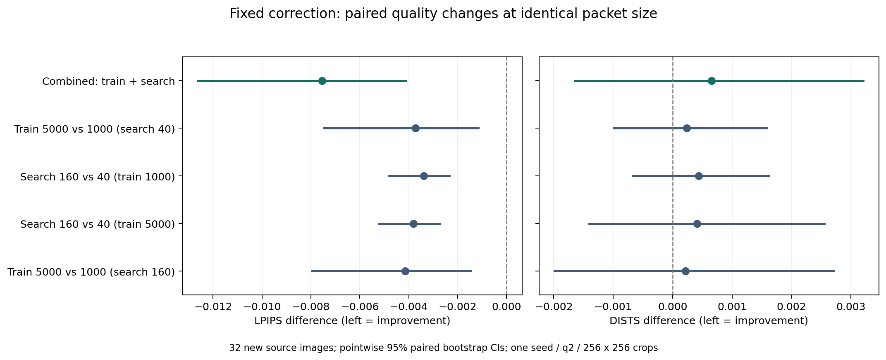

# MLIC++ fixed correction: cải thiện và so sánh ở cùng byte

**Đã hoàn tất train → infer → eval trên L40 ngày 05/11/2026**, theo [protocol khóa trước](../plans/MLICpp_fixed_improvement_2026-11-05.md). Run mất **766,34 giây**, test trên 32 nguồn mới, **160/160 đầu ra giải mã bằng tiến trình mới khớp pixel**. Checkpoint và bitstream đã tải về, kiểm SHA-256.

**Kết quả chính:** học 5.000 bước và tìm hệ số 160 bước giảm LPIPS **8,63%** so fixed cũ ở cùng từng packet byte. Tuy nhiên, DISTS trung bình tăng 0,46% với CI chứa 0, PSNR giảm 0,0602 dB. Đây là một điểm đánh đổi có LPIPS tốt hơn, **chưa phải cải thiện đồng thời các metric, chứng minh không suy giảm DISTS hoặc đóng góp khoa học mới**.

## 1. Thay đổi và đối chứng

Ma trận 2 × 2 giữ kiến trúc fixed 38.240 tham số, rank 8, grid 2 × 2, quantizer step 1/64, amplitude 0,25 và packet **46 byte**. Hai yếu tố là số bước huấn luyện head và số bước tìm hệ số tại encoder; backbone, entropy và synthesis nền đóng băng.

Train 5.000 bước học lại từ cùng khởi tạo, seed 9041, dữ liệu và thứ tự batch; không resume checkpoint 1.000 vì file cũ không có optimizer state. Adam LR 1e−4, betas (0,9; 0,99), batch 4, loss `10 MSE + LPIPS-Alex + 0,1 edge_rational` giữ nguyên. **Loss tại 41 mốc log trong prefix 1.000 bước khớp chính xác** run cũ; template và manifest train/validation cũng khớp.

Encoder giữ thuật toán Adam LR 0,03, proposal/zero candidate và chọn best sau hard quantization. Snapshot tại 40/160 trên cùng trajectory. Smoke đã đối chiếu snapshot ngắn với `choose` gốc, kiểm packet thật và đạt 10/10 fresh pixel matches. Tăng search tăng compute encoder; kiến trúc decoder không đổi. Các checkpoint là model assets cố định của từng cấu hình, không chọn decoder miễn phí theo từng ảnh.

## 2. Dữ liệu

Train gồm 320 crop từ 160 nguồn DIV2K cũ. Test gồm **32 nguồn mới** theo permutation seed 1984, chỉ số `[322:354]`, một crop 256 × 256/nguồn. Đã kiểm không trùng toàn bộ 322 nguồn dùng ở các pilot/smoke trước; CRC/SHA, crop trong cache và template đều qua audit. Chưa kiểm dữ liệu pretrain của tác giả MLIC++.

Không chọn loss/LR/số bước bằng test cũ hoặc mới. Báo đủ bốn cấu hình; không tiếp tục tune theo test vừa mở. Bộ ảnh này khác pilot conditional/fixed trước nên **không so trực tiếp hai giá trị trung bình khác tập**. [Source audit](../results/2026-11-05_mlicpp_fixed_improvement/source_audit.json).

## 3. So sánh từ bitstream thật

PSNR gộp từ MSE, các metric khác lấy trung bình theo ảnh. Search time chỉ đo vòng tìm hệ số sau proposal/initial scoring, trên cache; **không phải tổng encode hoặc decode latency**.

| Bước học / tìm hệ số | Actual bpp ↓ | PSNR ↑ | LPIPS ↓ | DISTS ↓ | Search s/crop |
| --- | ---: | ---: | ---: | ---: | ---: |
| Base, không packet | 0,148270 | **30,4415** | 0,102630 | 0,147424 | — |
| 1.000 / 40 — mốc cũ | 0,153885 | 30,3512 | 0,087330 | **0,141894** | 1,565 |
| 1.000 / 160 | 0,153885 | 30,3136 | 0,083939 | 0,142333 | 6,237 |
| 5.000 / 40 | 0,153885 | 30,3399 | 0,083598 | 0,142131 | 1,471 |
| 5.000 / 160 | 0,153885 | 30,2910 | **0,079793** | 0,142546 | 5,939 |

Base ít byte hơn, chỉ là tham chiếu. **0,153885 bpp là rate thực đo, không gắn nhãn đạt trần 0,15 bpp.** Số liệu crop không phải kết quả full-resolution hoặc chứng nhận điều kiện challenge.

| Contrast | Δ LPIPS | CI 95% ghép cặp | Δ DISTS | CI 95% ghép cặp |
| --- | ---: | --- | ---: | --- |
| 5.000/160 − 1.000/40, primary | −0,007537 | [−0,012623; −0,004123] | +0,000651 | [−0,001641; +0,003208] |
| Chỉ học lâu hơn, search 40 | −0,003732 | [−0,007470; −0,001154] | +0,000237 | [−0,000993; +0,001578] |
| Chỉ search lâu hơn, train 1.000 | −0,003391 | [−0,004814; −0,002342] | +0,000438 | [−0,000668; +0,001620] |

Bootstrap 10.000 lần theo nguồn ảnh, seed 9041; CI pointwise thăm dò, chưa điều chỉnh nhiều contrast. LPIPS giảm ở cả hai can thiệp; mọi CI DISTS trong bảng đều chứa 0. **Không phát hiện khác biệt DISTS rõ không có nghĩa chứng minh tương đương hoặc không suy giảm**; chưa khóa một non-inferiority margin.



[Summary CSV](../results/2026-11-05_mlicpp_fixed_improvement/summary.csv), [metric từng ảnh](../results/2026-11-05_mlicpp_fixed_improvement/test_metrics.json), [toàn bộ CI và prefix check](../results/2026-11-05_mlicpp_fixed_improvement/analysis.json).

## 4. Diễn giải và lựa chọn

- **5.000/40** giảm LPIPS **4,27%** so mốc mà không tăng số bước encoder hay kiến trúc decoder; DISTS trung bình tăng nhẹ, chưa phân biệt rõ. Giữ làm ứng viên kỹ thuật khi cần hạn chế compute.
- **5.000/160** đạt LPIPS thấp nhất, nhưng vòng search mất khoảng **3,79 lần** thời gian mốc trong lần đo này. Giữ như điểm ưu tiên LPIPS, không nhận là winner trên mọi mục tiêu.
- **1.000/40** vẫn có DISTS trung bình tốt nhất trong bốn packet configurations. Chưa có lý do bỏ nó khỏi tập đối chứng.

Acceptance đặt trước được đáp ứng ở phần LPIPS; DISTS còn bất định. Không nâng thành kết luận “quality tổng thể tốt hơn” hoặc “an toàn về fidelity”. Giữ các điểm trade-off để đánh giá tiếp, không chốt model nộp challenge chỉ từ LPIPS.

Audit hệ số bổ sung cho thấy cả hai checkpoint đổi stream/output ở 32/32 ảnh khi search lâu hơn. Với checkpoint 5.000, tỷ lệ coefficient chạm ±127 tăng từ **7,03% lên 45,61%**; checkpoint 1.000 tăng từ 1,07% lên 53,81%. Đây là quan sát hậu nghiệm về giới hạn range, **chưa chứng minh** nó gây đánh đổi DISTS hoặc mở range sẽ tốt hơn. Không sửa quantizer theo test này. [Coefficient audit](../results/2026-11-05_mlicpp_fixed_improvement/coefficient_audit.json).

## 5. Tái lập và giới hạn

Server output:

```text
/home/jovyan/clic2027-artifacts/mlicpp/innovation-20261105/
  div2k-q2-fixed-train1000-5000-search40-160-new32/
```

Huấn luyện head 5.000 bước mất **246,35 giây** trên cache; không gồm huấn luyện backbone từ đầu. Runtime: Torch 2.0.1+cu118, CompressAI 1.2.0b3, NumPy 1.26.4, L40 GPU 0, FP32 deterministic, TF32 tắt, guard VRAM, cuDNN v7/NVRTC. Dependency snapshots và code thực chạy trong `source_archive`, phiên bản tại `runtime.json`.

Checkpoint tải về tại `results/2026-11-05_mlicpp_fixed_improvement/{reference_fixed,fixed}/last.pt`; kiểm theo [SHA manifest](../results/2026-11-05_mlicpp_fixed_improvement/checkpoints.sha256). Vẫn cần MLIC++ và synthesis nền trong config để giải mã; checkpoint head không phải gói codec đầy đủ. [Fresh decode](../results/2026-11-05_mlicpp_fixed_improvement/fresh.json).

```bash
# Chạy mới trên server, output chưa tồn tại
CUDA_VISIBLE_DEVICES=0 bash experiments/mlicpp/run_fixed_improvement.sh \
  --stage run --config experiments/mlicpp/fixed_improvement_q2.json \
  --out /home/jovyan/clic2027-artifacts/mlicpp/innovation-20261105/new-fixed-run

# Phân tích evidence đã tải, không cần GPU
python experiments/mlicpp/analyze_fixed_improvement.py \
  --root results/2026-11-05_mlicpp_fixed_improvement
```

Một seed, một q2, 32 crop, template gắn với độ phân giải crop; chưa full-resolution, nhiều rate, baseline base-more-bits tối ưu, L4, Q̂ hoặc human evaluation. LPIPS có trong loss nên gain cần được đối chiếu với các phép đo độc lập. Tăng train/search là tối ưu kỹ thuật đã biết, chưa tạo novelty cho CVPR/ICCV/ECCV/WACV. Các số liệu và phân tích được tạo với hỗ trợ AI, không thay thế đánh giá độc lập từ người xem hoặc peer review.
