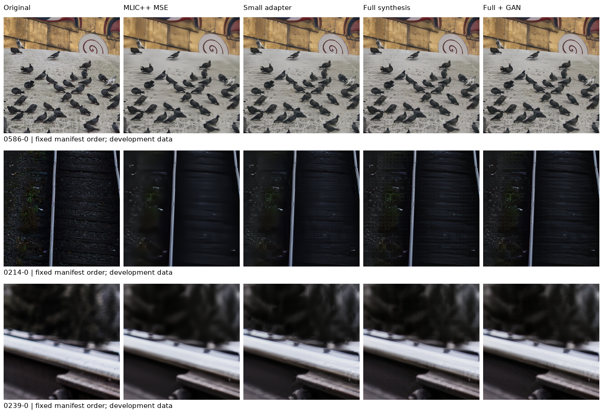

# MLIC++: nâng cấp toàn synthesis và hướng phát triển cho CLIC

**Đã huấn luyện và kiểm xong hai decoder full-synthesis.** Nhánh không GAN cải thiện đồng thời LPIPS, DISTS, PSNR và sai số biên so với adapter nhỏ trên 32 crop development, ở cùng stream/byte. Đây là nền perceptual mới đáng tiếp tục; chưa là một đóng góp kiến trúc mới hoặc bằng chứng đạt top challenge.

**Lựa chọn sau pilot:** lấy nhánh `reconstruction` làm baseline nghiên cứu tiếp theo. GAN ở công thức đã thử chưa có lợi ích đủ rõ so với nhánh không GAN. Phần **mã hóa hiệu chỉnh có điều kiện theo latent đã giải mã** sau đó đã được cài đặt và chạy [pilot trên 32 nguồn mới](MLICpp_innovation_pilot_2026-11-05.md): conditional không vượt fixed control, nên chưa giữ được claim về lợi ích conditioning hoặc novelty. [Thiết kế và đối chiếu tài liệu](../plans/MLICpp_perceptual_contender_2026-11-05.md).

## 1. Model thực sự đã thay đổi gì?

- Thay vì chỉ học adapter 34.113 tham số trước một đoạn synthesis đóng băng, mở học **toàn bộ `g_s`: 12.033.612 tham số**, khởi tạo từ MLIC++ MSE legacy q2.
- Giữ nguyên encoder, hyperprior, entropy/context model và các stream q2. Cache là latent lấy từ **giải mã entropy thật**, không phải latent liên tục trước lượng tử hóa.
- Nhánh `reconstruction` học bằng pixel + LPIPS + edge; nhánh `gan` có cùng generator và thêm conditional discriminator khi train. Discriminator không tham gia giải mã.
- Hai nhánh thay trọng số trong **cùng kiến trúc synthesis gốc**, không thêm block inference. Số phép toán theo kiến trúc không tăng so với synthesis gốc; chưa đo latency L4 hoặc gói submission hoàn chỉnh.

Đây là fine-tuning decoder perceptual đầy đủ, không phải thay entropy model. Không gọi conditional GAN là cơ chế mới của dự án. Tên `reconstruction` ở đây gồm cả LPIPS, không phải MSE-only.

## 2. Thiết kế và dữ liệu

| Mục | Thiết lập |
| --- | --- |
| Codec | MLIC++ legacy q2, λ = 0,0035; upstream `4aa9d2a512eb9db382172058e6c278fb0d376e17` |
| Train | 160 ảnh DIV2K, hai crop 256²/ảnh: 320 mẫu, như pilot adapter |
| Đánh giá | 32 validation crop cũ; **development đã dùng trước**, không phải test mới |
| Test | Không đọc test cũ hoặc 30 ảnh CLIC trong pipeline này |
| Generator | Cùng khởi tạo, data order, seed 1984, 1.000 bước, batch 4, Adam LR 1e−5, betas (0,9; 0,99) |
| Reconstruction objective | `10 MSE + LPIPS-Alex + 0,1 edge_rational`, cùng trọng số loss của pilot adapter |
| GAN objective | Conditional PatchGAN, hinge D loss; G weight 0,01, warmup 100 bước rồi tăng tuyến tính 100 bước; D LR 1e−4 |
| Checkpoint | Bước cuối cố định, không chọn checkpoint theo metric development |
| Tài nguyên | L40 GPU 0, FP32 deterministic, TF32 tắt, cuDNN v7/NVRTC; guard VRAM có sẵn |

So GAN với reconstruction-only chỉ thay adversarial training. So với adapter cũ còn thay phạm vi tham số học và LR từ 1e−4 sang 1e−5; vì vậy, không quy toàn bộ gain cho riêng số tham số hoặc một yếu tố duy nhất.

## 3. Kết quả cùng actual byte

Mọi nhánh đạt **0,24371338 bpp thực** trên chính 32 crop này. Không gắn nhãn kết quả là 0,15 bpp hoặc kết quả full-resolution CLIC.

| Decoder | PSNR gộp ↑ | LPIPS-Alex ↓ | DISTS ↓ | MS-SSIM ↑ | RGB edge error ↓ |
| --- | ---: | ---: | ---: | ---: | ---: |
| MSE gốc | 29,2913 | 0,199571 | 0,205994 | 0,958394 | 0,023413 |
| Adapter Mean cũ | 28,3095 | 0,116629 | 0,157003 | 0,946093 | 0,027293 |
| **Full synthesis, reconstruction** | **28,6912** | **0,093221** | 0,140027 | 0,949569 | **0,025882** |
| Full synthesis + GAN | 28,6609 | 0,094838 | **0,139270** | **0,950493** | 0,025989 |

Nhánh reconstruction so với adapter Mean:

- **LPIPS giảm 20,07%**; chênh −0,023408, CI 95% [−0,030588; −0,016396].
- **DISTS giảm 10,81%**; chênh −0,016976, CI [−0,027805; −0,005536].
- **PSNR tăng 0,3817 dB**; sai số biên giảm khoảng 5,17%.

So với MSE gốc, reconstruction vẫn là một đánh đổi perceptual: LPIPS/DISTS tốt hơn nhưng PSNR và edge error kém hơn. Không tuyên bố vượt MSE ở mọi tiêu chí.

GAN so với reconstruction: LPIPS tăng 0,001617, CI [0,000270; 0,002985]; DISTS giảm trung bình 0,000757 nhưng CI [−0,003168; +0,001528] còn chứa 0. PSNR giảm khoảng 0,0303 dB, edge error tăng nhẹ. **Chưa xác nhận lợi ích của GAN với công thức/budget này.** Không suy rộng rằng mọi GAN perceptual training đều không hiệu quả; cũng không lấy DISTS trung bình thấp nhất để chốt GAN thắng.

CI dùng bootstrap ghép cặp theo ảnh 10.000 lần, seed 1984; mang tính thăm dò, không hiệu chỉnh nhiều phép so sánh. Development reuse và một seed giới hạn suy luận khái quát. Không có human evaluation.

## 4. Hình so sánh và kiểm giải mã

Ba ảnh dưới lấy **theo thứ tự đầu tiên của manifest**, không chọn theo metric; cột lần lượt là nguồn, MSE, adapter nhỏ, full reconstruction và full GAN. Đây là ví dụ minh họa, chưa phải đánh giá preference mù.

Smoke hai bước/nhánh đã qua GAN gradients và 8/8 fresh pixel hashes. Run chính: **128/128 đầu ra** của bốn nhánh khớp pixel hash khi giải mã từ stream bằng tiến trình mới, không đọc ảnh nguồn. 352 latent cache train/validation đều được kiểm tái tạo MSE khớp cache cũ.

Pipeline chính hoàn tất trong **313,60 giây**, khoảng 5 phút 14 giây, nhanh hơn ETA ban đầu nhờ cache. Đây là thời gian pipeline crop trên L40, không phải benchmark L4/full-resolution. PyTorch allocated đỉnh khi train khoảng 906 MiB ở reconstruction và 979 MiB ở GAN; không phải toàn bộ VRAM tiến trình hoặc phép đo submission.

## 5. Hướng model cần kiểm tiếp

**Đường thực dụng cho challenge:** full-synthesis perceptual decoder → encoder-only latent TTO với entropy conditioning đúng → chọn candidates theo byte thực → kiểm full-resolution và L4. TTO là kỹ thuật đã có tiền lệ; nó có thể giúp chất lượng mà không tăng computation decoder, nhưng không tự làm contribution paper.

**Ứng viên contribution:** decoder tự dựng các hướng hiệu chỉnh `U(ŷ)` từ base latent; encoder tìm và truyền một vector hệ số nhỏ `ĉ`; decoder áp `f′ = f + U(ŷ)ĉ` rồi chạy synthesis. Chỉ truyền phần nguồn-cụ-thể mà base stream chưa xác định đủ, thay vì mặc định dành mọi bit thêm cho base. Đây là **giả thuyết cần thử**, không phải model đã huấn luyện trong pilot này.

Phép thử quyết định phải tính `B_total = B_base + header + scale + coefficients + indices/padding`. Đối chứng: thêm bit cho base, decoder-aware latent TTO, pixel/DCT residual, random/PCA basis và **learned global basis không nhận nội dung ảnh**. So conditional và global basis phải giữ rank, quantizer, syntax, budget search, data và loss. Nếu conditional không thắng, bỏ claim conditioning; nếu ordinary residual hoặc tăng bitrate base tốt hơn, bỏ hướng side innovation.

Generic side bits, LoRA, seed selection, flow và latent TTO đều có prior art. Các nguồn gần gồm PerQ, SDGIC, LoRA-comp, DDCM và MLICv2, được đối chiếu trong kế hoạch. Chưa có cơ sở gọi ứng viên này là đầu tiên hoặc đột phá.

## 6. Giới hạn và quyết định

Đã có một **baseline perceptual mạnh hơn adapter** trong development. Chưa có bằng chứng cho thứ hạng CLIC: thiếu test mới/full-resolution, đủ ba bitrate, human preference, hiện đại hóa backbone và kiểm gói L4. q1 legacy hiện chưa phủ ngân sách 0,075 bpp cho toàn tập; pilot q2 không giải quyết việc đó.

Chỉ mở rộng bước tiếp theo từ nhánh reconstruction. Giữ checkpoint GAN như đối chứng. Không thay kết quả trong bảng full30 bằng các metric crop này. Hướng innovation cần qua screen budget-matched trước khi đầu tư model lớn; không thêm flow chỉ để tăng độ phức tạp.

Bằng chứng: [config](../results/2026-11-05_mlicpp_full_synthesis/config.json), [summary](../results/2026-11-05_mlicpp_full_synthesis/summary.json), [bootstrap](../results/2026-11-05_mlicpp_full_synthesis/analysis.json), [fresh parity](../results/2026-11-05_mlicpp_full_synthesis/fresh.json). Code chạy được lưu trong `source_archive`; trọng số `.pt` được Git ignore. Artifact lớn và log gốc ở `/home/jovyan/clic2027-artifacts/mlicpp/full-synthesis-20261105/div2k-q2-full-synthesis-conditional-gan`.

AI hỗ trợ tìm tài liệu, audit, thiết kế, code và phân tích. Kết luận hiện tại là bằng chứng engineering/development; chưa phải đóng góp khoa học được xác nhận.
