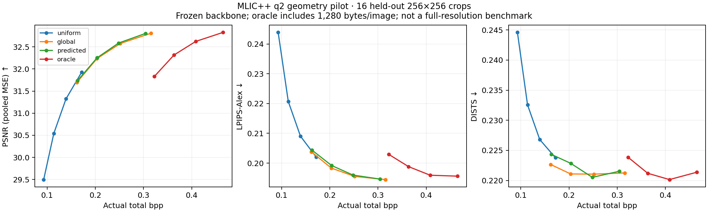

# MLIC++: pilot lượng tử hóa theo hình học decoder

**Kết luận:** Đã triển khai, train và đánh giá trên server. Mạng dự đoán học được độ nhạy của decoder, nhưng công thức lượng tử hóa đang thử **chưa cải thiện hiệu quả rate–distortion so với uniform** trong khoảng bitrate giao nhau. Chưa có cơ sở để mở rộng recipe này thành một đợt train lớn hoặc tuyên bố đóng góp khoa học.

Pilot hoàn tất ngày 05/11/2026 trên L40 GPU 0, trong **332,8 giây**; smoke trước đó mất 38,3 giây. Kiểm tra **256/256 bitstream** giải mã ở tiến trình mới khớp SHA pixel. Kiểm toán **160/160 crop** khớp ảnh nguồn đã xác minh SHA; train, validation và test không trùng nguồn. Peak VRAM toàn GPU ghi nhận là 2.608 MiB, gồm cả tác vụ nền.

## 1. Đã thay đổi gì trong model?

Backbone là MLIC++ MSE legacy q2 chính thức. Encoder, synthesis decoder, hyperprior, context model và latent residual prediction (LRP) đều đóng băng. Thay đổi nằm ở bước lượng tử hóa và đơn vị scale của Gaussian entropy model:

\[
k_i=\operatorname{round}((y_i-\mu_i)/\Delta_i),\qquad
\tilde y_i=\mu_i+\Delta_i k_i,\qquad
\tilde\sigma_i=\sigma_i/\Delta_i.
\]

LRP tiếp tục chạy sau bước này như codec gốc. Bước lượng tử hóa được dùng nhất quán ở encoder và decoder; kiểm tra trường hợp \(\Delta=1\) cho **payload giống hệt codec gốc trên cả 16 ảnh test**. Bộ điều khiển chạy từ hyperprior đã giải mã, không cần ảnh gốc ở decoder.

Teacher ước lượng đường chéo của \(J_{g_s}^{\top}J_{g_s}\), lấy trung bình theo vị trí cho từng kênh, bằng 4 vector Rademacher và vector–Jacobian product. Điểm tuyến tính hóa là latent đã giải mã bằng codec gốc. Teacher dùng RGB chưa clamp, không phải LPIPS hay preference của con người. Đây là độ nhạy của riêng synthesis decoder, chưa bao gồm toàn bộ ảnh hưởng của context và LRP khi thay quantizer.

Log bước tương đối được lấy từ \(-\tfrac12\log w_i\), rồi chiếu vào miền có trung bình bằng 0 và giới hạn \([-\log2,\log2]\). Ràng buộc này giữ thể tích cell lượng tử hóa; **không giữ bitrate**. Lý thuyết xấp xỉ này là kiến thức nền, không được trình bày như định lý mới.

| Nhánh | Cách xác định bước lượng tử hóa | Chi phí bổ sung trên từng ảnh |
|---|---|---|
| uniform | Cùng một bước cho mọi kênh | Header 12 byte |
| global | Độ nhạy trung bình tuyến tính từ tập train | Header 12 byte; thang cố định nằm trong model asset |
| predicted | MLP dự đoán từ trung bình và độ lệch chuẩn của hyperprior | Header 12 byte; không gửi thang riêng |
| oracle | Teacher của từng ảnh | Header 12 byte + 1.280 byte thang float32 |

Oracle là heuristic theo teacher có nhiễu, **không phải nghiệm tối ưu hay cận trên đã được chứng minh**. Các nhánh dùng factor chung `{0.8, 1.0, 1.25, 1.6}` đã chốt trước khi chạy. Không chọn lại factor theo test.

## 2. Train thử và dữ liệu

Mạng MLP có cấu trúc `1280 → 128 → 320`, **205.248 tham số trainable**. Đầu vào là thống kê hyperprior; đầu ra là log độ nhạy đã trừ trung bình. Đã train **1.000 bước**, Adam, lr 0,001, batch 16, seed 9041. Đây là **distillation log độ nhạy**, chưa phải train toàn bộ codec hoặc train end-to-end theo loss rate–distortion. Riêng vòng cập nhật MLP mất 3,35 giây; phần còn lại chủ yếu là tạo teacher và chạy codec.

- Train: 128 crop từ 64 ảnh nguồn.
- Validation: 16 crop từ 16 nguồn khác.
- Test: 16 crop 256 × 256 từ 16 nguồn mới, indices `[354:370]` trong danh sách DIV2K shuffle seed 1984.
- Backbone có thể đã được tiền huấn luyện trên DIV2K; phần trùng lặp này chưa được kiểm toán.

Ở bước 1.000, MSE dự đoán log độ nhạy trên validation là **0,127382**, so với **0,388690** của dự đoán log metric trung bình tập train. Loss train ở minibatch cuối là 0,003835. Đối chứng validation này dùng trung bình log metric; nhánh `global` trong codec dùng log của trung bình metric tuyến tính, theo công thức phân bổ đã chốt. Không đồng nhất hai đại lượng này.

Checkpoint `predictor.pt` có dung lượng **836.515 byte**, chứa MLP, thống kê chuẩn hóa và thang global. Đây là model asset dùng chung, không cộng vào bitrate từng ảnh; vẫn là phần phải có trong gói decoder.

## 3. Kết quả đo trực tiếp

Bpp dưới đây tính từ toàn bộ file GEO1, gồm stream hyperlatent, latent, header và side information nếu có. PSNR được tính từ **MSE gộp**, không phải trung bình PSNR từng ảnh. LPIPS-Alex và DISTS lấy trung bình theo ảnh.

| Nhánh | Factor | Bpp thực | PSNR gộp ↑ | LPIPS ↓ | DISTS ↓ |
|---|---:|---:|---:|---:|---:|
| uniform | 0,8 | 0,171844 | 31,9290 | 0,202049 | 0,223780 |
| uniform | 1,0 | 0,139252 | 31,3228 | 0,209049 | 0,226803 |
| uniform | 1,25 | 0,113983 | 30,5414 | 0,220700 | 0,232549 |
| uniform | 1,6 | 0,092987 | 29,4984 | 0,243889 | 0,244598 |
| global | 0,8 | 0,315796 | 32,8084 | 0,194473 | 0,221254 |
| global | 1,0 | 0,251709 | 32,5746 | 0,195537 | 0,221056 |
| global | 1,25 | 0,203369 | 32,2328 | 0,198322 | 0,221085 |
| global | 1,6 | 0,161804 | 31,6950 | 0,203806 | 0,222662 |
| predicted | 0,8 | 0,304321 | 32,8042 | 0,194636 | 0,221532 |
| predicted | 1,0 | 0,248383 | 32,5858 | 0,195978 | 0,220523 |
| predicted | 1,25 | 0,203766 | 32,2523 | 0,199203 | 0,222837 |
| predicted | 1,6 | 0,163055 | 31,7338 | 0,204373 | 0,224347 |
| oracle | 0,8 | 0,464966 | 32,8270 | 0,195622 | 0,221369 |
| oracle | 1,0 | 0,408386 | 32,6226 | 0,195931 | 0,220151 |
| oracle | 1,25 | 0,363312 | 32,3155 | 0,198834 | 0,221195 |
| oracle | 1,6 | 0,322357 | 31,8286 | 0,202944 | 0,223866 |

Uniform factor 1 có ảnh tái tạo giống MLIC++ q2 gốc. Codec gốc không có header GEO1 12 byte nên bpp tương ứng là **0,137787**. Không coi phần header thử nghiệm là chi phí vốn có của MLIC++.

### So sánh trong khoảng bitrate giao nhau

Nội suy tuyến tính MSE trên đường RD trung bình, lấy 21 điểm đều trong khoảng giao. Không ngoại suy, không gọi đây là BD-rate, và chưa có khoảng tin cậy cho thống kê nội suy này.

| So sánh | Khoảng bpp giao nhau | Thay đổi MSE trung bình tương đối |
|---|---|---:|
| global so với uniform | 0,161804–0,171844 | **+1,71%** |
| predicted so với uniform | 0,163055–0,171844 | **+1,29%** |
| predicted so với global | 0,163055–0,304321 | −0,61% |
| oracle so với uniform, tính đủ byte | Không có khoảng giao | Không kết luận |
| oracle so với uniform, bỏ 1.280 byte thang để chẩn đoán | 0,166107–0,171844 | +0,26% |

Dấu dương nghĩa là MSE cao hơn. Khoảng giao với uniform rất hẹp; các số này là mô tả pilot, chưa chứng minh khác biệt có ý nghĩa thống kê. Ngay cả việc bỏ chi phí thang oracle cũng chưa cho tín hiệu cải thiện trung bình rõ trong khoảng đã đo. Không dùng phép bỏ byte này để xếp hạng codec.

Ở factor 1, chênh lệch `predicted − global` có bootstrap 95% theo ảnh, 2.000 lần, seed 9041:

| Đại lượng | Chênh lệch trung bình | Khoảng tin cậy 95% |
|---|---:|---|
| Bpp | −0,003326 | [−0,011842; +0,006531] |
| MSE RGB, đơn vị pixel² | −0,092743 | [−0,735783; +0,462656] |
| LPIPS | +0,000441 | [−0,000593; +0,001401] |
| DISTS | −0,000533 | [−0,002341; +0,001142] |

Đây là đối chứng **cùng factor, không cùng bitrate**. Các khoảng chứa 0 không chứng minh hai phương pháp tương đương, cũng không đủ để tuyên bố conditioning có lợi.

## 4. Diễn giải và quyết định tiếp theo

Teacher có thể dự đoán được từ hyperprior, nhưng tối ưu độ nhạy dưới ràng buộc thể tích cell chưa đủ để cải thiện nén. Các nhánh hình học tăng mạnh bitrate khi giữ cùng factor. Vì vậy, chất lượng ảnh cao hơn tại factor 1 không phải bằng chứng thắng baseline.

Một giả thuyết cần kiểm tra tiếp là sự lệch giữa mục tiêu hình học cục bộ của riêng synthesis decoder và chi phí entropy/context/LRP của codec thực. Kết quả hiện tại **chưa xác định nguyên nhân**, chưa bác bỏ toàn bộ hướng lượng tử hóa theo hình học, và cũng chưa kiểm tra lattice có tương tác giữa các kênh.

Quyết định: giữ checkpoint và mã để làm đối chứng; **không mở rộng nguyên recipe này thành train dài**. Nếu tiếp tục hướng này, cần thiết kế mục tiêu có chi phí mã hóa thực hoặc proxy được kiểm chứng, kiểm tra ảnh hưởng của LRP/context, rồi mới cân nhắc transform theo block và train end-to-end. Không chỉnh recipe trên 16 ảnh test vừa dùng rồi coi chúng là test mới.

## 5. Giới hạn và khả năng tái lập

Đây là 16 crop, một seed, một checkpoint q2, bốn mức factor và teacher chỉ dùng 4 VJP ngẫu nhiên. Chưa có full-resolution CLIC, Q̂, human evaluation, latency trên L4, hay kiểm tra bit-exact giữa các dòng GPU. Chưa có đánh giá novelty đủ để khẳng định phương pháp mới. Không nhập số liệu này vào bảng benchmark 30 ảnh.

Decoder fresh chỉ đọc bitstream và model asset, không đọc cache/source. Thang oracle được truyền rõ trong file; predicted suy ra thang từ hyperprior đã giải mã. Đã kiểm SHA **283 artifact** sau khi tải về máy.

- [Protocol đã chốt](../plans/MLICpp_geometry_pilot_2026-11-05.md)
- [Mã chạy](../experiments/mlicpp/geometry_pilot.py), [quantizer và bitstream](../experiments/mlicpp/geometry_codec.py), [cấu hình](../experiments/mlicpp/geometry_q2.json)
- [Số liệu và phân tích đầy đủ](../results/2026-11-05_mlicpp_geometry/analysis.json), [metrics từng ảnh](../results/2026-11-05_mlicpp_geometry/metrics.json)
- [Checkpoint đã train](../results/2026-11-05_mlicpp_geometry/predictor.pt), [kiểm toán crop](../results/2026-11-05_mlicpp_geometry/source_audit.json), [fresh decode](../results/2026-11-05_mlicpp_geometry/fresh_decode.json)
- [Biểu đồ PDF](../results/2026-11-05_mlicpp_geometry/figures/rate-distortion.pdf)

Thư mục server: `/home/jovyan/clic2027-artifacts/mlicpp/geometry-20261105/div2k-q2-diagonal-geometry-distill1000-new16`. Mã thực thi và cấu hình được giữ trong `source_archive`; backbone upstream commit `4aa9d2a512eb9db382172058e6c278fb0d376e17`, checkpoint SHA-256 `5577dcccc7d154c07b9cc14f222606717cac12ac263f569cba11b012994e9fde`.
