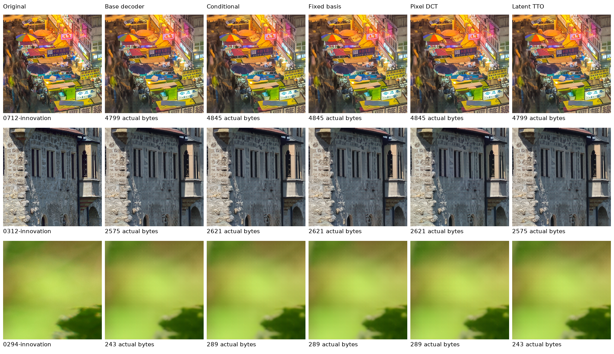

# MLIC++: huấn luyện, mã hóa và đánh giá packet hiệu chỉnh

**Đã hoàn tất trên server ngày 05/11/2026:** huấn luyện ba nhánh, tạo bitstream thật, đánh giá trên 32 crop từ ảnh nguồn mới và kiểm **160/160 đầu ra khớp pixel khi giải mã bằng tiến trình mới**.

**Kết luận chính:** packet hiệu chỉnh cải thiện LPIPS so với base với thêm 46 byte/ảnh, nhưng **conditional không vượt fixed control**. Conditional có LPIPS kém hơn fixed với khoảng tin cậy không chứa 0; DISTS chưa phân biệt rõ. Vì vậy, kết quả này **không ủng hộ việc nhận conditioning là đóng góp khoa học**. Giữ fixed như một phương án kỹ thuật để so sánh tiếp, chưa nhận là phương pháp mới hay bằng chứng đạt top CLIC/CVPR.

## 1. Câu hỏi và đối chứng

Phép thử theo [protocol khóa trước](../plans/MLICpp_innovation_pilot_2026-11-05.md): với cùng byte bổ sung, một basis hiệu chỉnh phụ thuộc feature đã giải mã có tốt hơn basis cố định hay không?

| Nhánh | Cách tái tạo |
| --- | --- |
| `base` | MLIC++ q2 với synthesis `reconstruction` đã fine-tune ở pilot trước |
| `conditional` | Thêm hiệu chỉnh vào feature trước synthesis tail; basis nhận feature của từng ảnh |
| `fixed` | Cùng mạng, số tham số và packet; basis nhận template feature trung bình train |
| `pixel` | Hiệu chỉnh RGB bằng tám basis DCT cố định trên mỗi ô; đối chứng residual thông thường |
| `latent_tto` | Tối ưu latent gốc 40 bước, serialize candidate và giữ stream có loss tốt hơn trong cùng trần byte |

Conditional và fixed có cùng **38.240 tham số**, khởi tạo, thứ tự train, optimizer và số bước. Source encoder của cả hai được nhìn nguồn và feature; khác biệt chính là đầu vào mạng tạo basis ở decoder. Fixed vẫn dùng synthesis tail phi tuyến với feature từng ảnh, không phải một decoder độc lập với ảnh. Pixel có cùng số coefficient và byte nhưng không tương đương năng lực decoder; không dùng nó để quy gain cho một yếu tố kiến trúc duy nhất.

Đây là conditional feature correction trên decoder **deterministic**. Phép thử chưa đo confidence/posterior, chưa kiểm cơ chế “prior tự tin nhưng sai”.

## 2. Thiết lập đã chạy

| Mục | Giá trị |
| --- | --- |
| Server | `nexai-sv20-dmh`, L40 GPU 0; FP32 deterministic, TF32 tắt, hai CPU threads |
| Backbone | MLIC++ upstream `4aa9d2a512eb9db382172058e6c278fb0d376e17`, legacy MSE q2 |
| Synthesis nền | [Full-synthesis reconstruction](MLICpp_full_synthesis_pilot_2026-11-05.md), checkpoint cuối bước 1.000; đóng băng trong pilot này |
| Train | 160 ảnh DIV2K, hai crop 256 × 256/ảnh: 320 mẫu |
| Development | 32 crop validation cũ; checkpoint cuối cố định, không chọn bằng metric test |
| Test mới | 32 ảnh nguồn DIV2K, một crop 256 × 256/ảnh; permutation seed 1984, chỉ số `[290:322]` |
| Tách nguồn | Không trùng 288 ảnh nguồn của các pilot trước và hai ảnh smoke `[288:290]` |
| Huấn luyện mỗi nhánh | 1.000 bước, batch 4, Adam LR 1e−4, seed 9041 |
| Loss | `10 MSE + LPIPS-Alex + 0,1 edge_rational`; DISTS không dùng để chọn coefficient |
| Code bổ sung | Rank 8, grid 2 × 2, 32 coefficient int8; bước lượng tử 1/64, amplitude 0,25 |
| Encoder search | Proposal + zero candidate + 40 bước Adam LR 0,03; chọn sau hard quantization |
| Latent TTO | 40 bước, LR 0,02, rate penalty 0,5; serialize mỗi 5 bước; original base là fallback |
| Thống kê | Bootstrap ghép cặp theo nguồn ảnh, 10.000 lần, seed 9041; CI 95% pointwise mang tính thăm dò |

Mỗi packet `INOV` chứa **14 byte header + 32 byte coefficient = 46 byte**, đã tính trong rate. Step và amplitude là model assets cố định, không bỏ sót scale theo ảnh. Overhead là **0,00561523 bpp** ở kích thước crop này, khoảng **2,58%** tổng byte base trên tập test. Trọng số decoder là tài sản dùng chung, không cộng như payload từng ảnh; chưa có gói model/submission hoàn chỉnh.

Đã kiểm CRC/SHA ảnh nguồn theo archive, đối chiếu crop trong cache với nguồn và kiểm hash base stream. Tách nguồn chỉ áp dụng trong dự án; **chưa kiểm trùng với dữ liệu pretrain của tác giả MLIC++**. [Kết quả audit](../results/2026-11-05_mlicpp_innovation/source_audit.json).

## 3. Kết quả từ bitstream thật

Rate tính bằng tổng byte stream chia tổng pixel. PSNR tính từ MSE gộp; các metric khác là trung bình theo ảnh. Mọi nhánh có cùng 32 nguồn, không loại ảnh khó hoặc ảnh fallback.

| Nhánh | Actual bpp ↓ | PSNR gộp ↑ | LPIPS-Alex ↓ | DISTS ↓ | MS-SSIM ↑ |
| --- | ---: | ---: | ---: | ---: | ---: |
| Base | 0,217682 | **29,1666** | 0,102039 | 0,140215 | **0,948822** |
| Conditional | 0,223297 | 29,1157 | 0,089418 | 0,136096 | 0,948494 |
| Fixed | 0,223297 | 29,0875 | **0,087125** | **0,135926** | 0,948449 |
| Pixel DCT | 0,223297 | 28,9510 | 0,098963 | 0,139786 | 0,946436 |
| Latent TTO | 0,217850 | 29,1465 | 0,101800 | 0,140342 | 0,948200 |

So với base, fixed giảm LPIPS **14,62%** và DISTS **3,06%**, đồng thời PSNR giảm **0,0791 dB**. Conditional giảm LPIPS **12,37%**, DISTS **2,94%** và PSNR giảm **0,0508 dB**. Đây là đánh đổi giữa các metric **kèm byte bổ sung**, chưa phải gain ở cùng rate với base.

### Đối chiếu chính: conditional − fixed

| Metric | Chênh lệch trung bình | CI 95% ghép cặp | Diễn giải |
| --- | ---: | --- | --- |
| LPIPS | +0,002294 | [+0,001384; +0,003419] | Conditional kém hơn fixed |
| DISTS | +0,000170 | [−0,001057; +0,001698] | Chưa phân biệt rõ |

Conditional có PSNR cao hơn fixed khoảng 0,0282 dB và sai số biên thấp hơn một chút. Vì vậy, không gọi conditional bị dominated trên mọi metric. Tuy nhiên, **giả thuyết chính về lợi ích perceptual của conditioning không được hỗ trợ trong công thức này**. Không chỉnh hyperparameter trên 32 ảnh test đã mở để đổi kết luận.

Conditional tốt hơn pixel control về LPIPS và DISTS trong pilot này. Điều đó chưa đủ để nhận conditioning có ích, vì fixed control mạnh hơn đã không bị vượt qua. [Toàn bộ CI và kiểm tra](../results/2026-11-05_mlicpp_innovation/analysis.json), [số liệu từng ảnh](../results/2026-11-05_mlicpp_innovation/test_metrics.json), [CSV tổng hợp](../results/2026-11-05_mlicpp_innovation/summary.csv).

### Giới hạn đối chứng latent TTO

TTO chỉ thay stream và pixel đầu ra ở **1/32 ảnh**; 31 ảnh còn lại giữ base. Do đó, kết quả chỉ mô tả recipe TTO đã chạy, **không chứng minh correction tốt hơn một encoder được tối ưu mạnh hoặc base-more-bits tối ưu**. Actual rate của TTO thấp hơn các packet correction; cùng trần byte không đồng nghĩa dùng cùng byte.

Với 29 ảnh hoàn tất trước recovery, phiên bản đầu không lưu số candidate attempted/feasible: các trường này được ghi `null`, không suy diễn thành 0. Ba ảnh recovery có tổng 24 lần thử serialize, không có candidate mới trong budget; hai candidate bị guard từ chối. Số bước tương đương không có nghĩa chi phí encoder tương đương giữa coefficient search và latent TTO. Chưa đo latency decoder L4.

## 4. Lỗi entropy coder và recovery

Run đầu hoàn tất train, infer và TTO 29/32 ảnh rồi treo ở ảnh `0599`, bước TTO 20. Tái hiện có kiểm soát chỉ ra stack trong `BufferedRansEncoder.encode_with_indexes`; symbol đạt −252.843.024 và bypass value đạt 505.682.917. Kiểm tra riêng binary CompressAI **1.2.0b3** đang cài: symbol thông thường kết thúc, một symbol âm rất lớn vượt timeout 8 giây. [Bằng chứng native binary](../results/2026-11-05_mlicpp_innovation/diagnostics/native-rans-check.json).

Đã giữ nguyên run lỗi và tạo recovery bằng **bản sao độc lập**. Chỉ kết thúc tiến trình TTO bị treo của thí nghiệm này; không can thiệp job khác. Recovery giữ 29 stream đã hoàn tất, chạy ba ảnh còn lại bằng worker riêng có timeout, kiểm finite và từ chối candidate có CDF frequency không hợp lệ hoặc bypass ≥ 2²⁸. Không đổi checkpoint, dữ liệu, loss, LR hay số bước. Đây là guard ở encoder candidate, chưa sửa thư viện C++ upstream. [Lineage](../results/2026-11-05_mlicpp_innovation/recovery_lineage.json).

Sau recovery, **160/160 hash uint8 khớp** khi giải mã từ stream bằng tiến trình mới, không dùng ảnh nguồn/feature cache trong decoder. Kiểm này xác nhận packet và đường giải mã trên cùng môi trường; không phải chứng nhận tương thích khác GPU/platform. [Fresh decode](../results/2026-11-05_mlicpp_innovation/fresh.json).

Bản code cho lần chạy sau đã chuyển stage TTO sang worker có guard/timeout. Smoke riêng trên hai nguồn không thuộc test chính đạt **10/10 fresh matches**, cả hai worker hoàn tất số bước yêu cầu. Bản code thực sự tạo kết quả chính vẫn được lưu theo SHA trong `source_archive`; không thay bằng bản sửa sau thí nghiệm.

## 5. Thời gian, checkpoint và tái lập

Huấn luyện conditional/fixed/pixel lần lượt mất **44,95 / 42,93 / 33,58 giây** trên cache feature đã chuẩn bị, không phải thời gian huấn luyện backbone từ đầu. Run đầu mất khoảng **1.188,60 giây đến lúc dừng**; recovery mất **136,93 giây**. Hai số này không bao gồm toàn bộ thời gian chẩn đoán giữa hai run và không phải benchmark tốc độ codec.

Thư mục server chứa kết quả hoàn tất:

```text
/home/jovyan/clic2027-artifacts/mlicpp/innovation-20261105/
  div2k-q2-conditional-fixed-pixel-new32-recovery/
```

Checkpoint ba nhánh đã tải về `results/2026-11-05_mlicpp_innovation/{conditional,fixed,pixel}/last.pt` và kiểm SHA-256 theo [manifest](../results/2026-11-05_mlicpp_innovation/checkpoints.sha256). File chứa model state, step và mode, không lưu optimizer state; file `.pt` không được theo dõi bằng Git. Decoder vẫn cần checkpoint MLIC++ và synthesis nền nêu trong config, không thể giải mã chỉ với head checkpoint.

Lệnh chạy mới trên server, dùng output chưa tồn tại:

```bash
CUDA_VISIBLE_DEVICES=0 bash experiments/mlicpp/run_innovation.sh \
  --stage run --config experiments/mlicpp/innovation_q2.json \
  --out /home/jovyan/clic2027-artifacts/mlicpp/innovation-20261105/new-run
```

Code hiện tại có guard bổ sung. Để kiểm đúng kết quả đã báo, dùng [config thực chạy](../results/2026-11-05_mlicpp_innovation/config.json), source snapshot theo [SHA](../results/2026-11-05_mlicpp_innovation/sources.sha256.json), lineage và stream đã lưu; không coi một lần chạy code mới là tái lập nguyên vẹn phiên bản cũ.

Phân tích lại bằng NumPy, không cần GPU:

```bash
python experiments/mlicpp/analyze_innovation.py \
  --root results/2026-11-05_mlicpp_innovation
```

## 6. Minh họa và kết luận nghiên cứu

Panel gồm ba ảnh đầu theo thứ tự manifest, không chọn theo gain. Nhãn ghi byte thật; ảnh minh họa không thay thế human evaluation.



Kết quả cho thấy một lượng thông tin nguồn nhỏ có thể cải thiện các perceptual distance khi truyền dưới dạng feature correction. Tuy nhiên, basis phụ thuộc ảnh không đem lại lợi ích như giả thuyết; fixed control tốt hơn về LPIPS và tương đương về DISTS trong độ bất định hiện có. Gain so base phù hợp với việc truyền thêm thông tin và tối ưu theo LPIPS, chưa xác định một cơ chế mới vượt residual coding.

**Quyết định sau pilot:** dừng claim về lợi ích conditioning ở recipe này. Giữ fixed làm engineering baseline cho đánh giá cùng tổng byte và nhiều rate. Hướng prior-conflict vẫn phải vượt phép thử riêng về confidence có ý nghĩa và giá trị ngoài residual/uncertainty controls; pilot này không cung cấp bằng chứng đó. Các chứng minh toy trước đây không bị bác bỏ, nhưng cũng không bảo đảm một mạng học hữu hạn sẽ thắng trên ảnh thật.

Giới hạn: một seed, một q2, chỉ 1.000 bước, 32 crop 256²; template fixed hiện gắn với kích thước feature của crop; chưa full-resolution, chưa rate–distortion curve hoặc base-more-bits mạnh. LPIPS có trong loss nên có nguy cơ metric overfitting; DISTS là kiểm bổ sung, chưa có Q̂ hay human evaluation. Chưa xác nhận prior confidence, tính mới so với prior art, đủ ba operating point CLIC, decoder L4 hoặc gói submission. **Không nhập số liệu crop này vào bảng benchmark 30 ảnh hoặc coi là chứng nhận an toàn challenge.**
