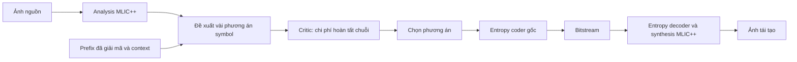

# MLIC++: rà soát tính mới và giả thuyết nghiên cứu tiếp theo

Ngày rà soát: **06/11/2026**. Phạm vi chính: learned image compression, lượng tử hóa latent và context tự hồi quy, tài liệu 2024–2026; truy ngược các công trình nền tảng khi cần. Đây là bản sàng lọc nghiên cứu, **không phải xác nhận novelty hay kết quả thực nghiệm mới**.

**Cập nhật sau rà soát:** đã thực hiện [pilot symbol–suffix trên server](MLICpp_lookahead_pilot_2026-11-06.md): 64/64 stream giải mã đúng, nhưng không đạt gate để train critic. Phần đề xuất và trạng thái tìm kiếm bên dưới được giữ như tại thời điểm trước pilot.

## 1. Quyết định

Không tiếp tục coi chỉnh gain, thêm ma trận lượng tử hóa, thêm context hoặc phản hồi sai số đơn thuần là đóng góp chính. Những thành phần này có prior art khá gần. Hai pilot nội bộ cũng chưa ủng hộ mở rộng hướng gain: [geometry](MLICpp_geometry_pilot_2026-11-05.md) chưa thắng uniform trong thiết lập đã thử; [hard RD](MLICpp_operational_quantizer_2026-11-06.md) không vượt ngưỡng cải thiện thăm dò đã đặt.

**Ưu tiên kiểm chứng một giả thuyết hẹp hơn: học quyết định lượng tử hóa có xét tác động đến toàn bộ phần mã hóa còn lại.** Tạm gọi là *lượng tử hóa có dự báo chi phí tiếp diễn*; chưa đặt tên model/paper chính thức. Ý tưởng là một lựa chọn symbol sớm có thể hơi bất lợi tại vị trí hiện tại nhưng giúp context dự đoán các nhóm phía sau tốt hơn, đồng thời tác động đến LRP và ảnh cuối cùng. Cần đo xem lợi ích này có đủ lớn và có học được với chi phí thấp hay không.

Đây vẫn là một dạng tối ưu mã rời rạc. Bellman, beam search, distillation và tối ưu latent đều không mới. Phần có khả năng thành đóng góp là **mô hình hóa, đo lường và khai thác hiệu quả tác động tiếp diễn trong codec có context phi tuyến**, cùng kết quả vượt đối chứng mạnh ở cùng ngân sách tính toán. Độ tin cậy về khoảng trống hiện ở mức **thấp–trung bình**.

## 2. Các công trình trực tiếp giới hạn tuyên bố của mình

Không chép số cải thiện từ abstract để xếp hạng các codec khác protocol. “Chưa xác minh code” không có nghĩa là tác giả không công bố code.

| Nhóm | Công trình và tác giả | Năm / nơi công bố đã kiểm tra | Cơ chế hoặc kết quả liên quan | Code và ý nghĩa với hướng này |
|---|---|---|---|---|
| Phản hồi sai số | Zhihai He, Sanjit K. Mitra — *Optimal Quantization Error Feedback Filters for Wavelet Image Compression* | ICIP 2000; [DBLP](https://dblp.org/pid/23/4027.html) | Đã nghiên cứu bộ lọc phản hồi sai số lượng tử trong nén ảnh. Chưa đọc được toàn văn trong đợt này. | Chưa xác minh code; đủ để loại tuyên bố “phát minh noise shaping cho nén ảnh”. |
| Tối ưu mã | Chenjian Gao, Tongda Xu, Dailan He, Hongwei Qin, Yan Wang — *Flexible Neural Image Compression via Code Editing* | [NeurIPS 2022](https://proceedings.neurips.cc/paper_files/paper/2022/file/4f3820576130a8f796ddbf204c841487-Paper-Conference.pdf) | Tối ưu latent bằng semi-amortized inference và adaptive quantization. | Chưa xác minh repo trong đợt này; phải là đối chứng cho mọi đề xuất tối ưu encoder. |
| Lượng tử hóa có phụ thuộc | Florian Borzechowski, Michael Schäfer, Heiko Schwarz, Jonathan Pfaff, Detlev Marpe, Thomas Wiegand — *Optimizing Learned Image Compression On Scalar and Entropy-Constraint Quantization* | [ICIP 2024, DBLP](https://dblp.org/db/conf/icip/icip2024.html); [bản arXiv đăng 2025](https://arxiv.org/html/2506.08662v1) | Retrain trên latent đã lượng tử hóa thật; xét cả scalar và TCQ, trong đó lựa chọn latent phụ thuộc nhau qua trellis với entropy và distortion. | Chưa xác minh code; không thể gọi “tối ưu nhiều symbol đồng thời theo RD” là mới. |
| Học context | Minghao Han, Shiyin Jiang, Shengxi Li, Xin Deng, Mai Xu, Ce Zhu, Shuhang Gu — *Causal Context Adjustment Loss for Learned Image Compression* | [NeurIPS 2024](https://papers.neurips.cc/paper_files/paper/2024/file/f074a994e062146561db9cdc63999efa-Paper-Conference.pdf) | Loss đưa thông tin hữu ích vào các nhóm sớm để dự đoán phần còn lại. | [Repo tác giả](https://github.com/CVL-UESTC/CCA) có hướng dẫn train/eval; chưa chạy tái lập. “Làm context tốt hơn” không phải khoảng trống. |
| Hình học lượng tử | Hao Xu, Xiaolin Wu, Xi Zhang — *Multirate Neural Image Compression with Adaptive Lattice Vector Quantization* | [CVPR 2025](https://openaccess.thecvf.com/content/CVPR2025/html/Xu_Multirate_Neural_Image_Compression_with_Adaptive_Lattice_Vector_Quantization_CVPR_2025_paper.html) | Lattice vector quantization thích nghi và multirate. | Chưa xác minh code; thay diagonal bằng block/lattice chưa đủ khác biệt. |
| Codec thực dụng | Kedar Tatwawadi, Parisa Rahimzadeh, Zhanghao Sun, Zhiqi Chen, Ziyun Yang, Sanjay Nair, Divija Hasteer, Oren Rippel — *What Matters in Practical Learned Image Compression* | [CVPR 2026](https://openaccess.thecvf.com/content/CVPR2026/html/Tatwawadi_What_Matters_in_Practical_Learned_Image_Compression_CVPR_2026_paper.html) | PICO khảo sát thiết kế codec theo chất lượng cảm nhận và runtime; phần phương pháp có quantization width dự đoán từ context. | Không xác nhận có bộ train hoàn chỉnh trong lần rà soát này. Adaptive width và runtime phải được so với thiết kế hiện đại. |

Hai dấu hiệu trùng khác cần giữ trong hồ sơ:

- [NIF, repository công khai](https://github.com/gabrielphilipus/NIF-Neural-Image-Format) tự mô tả DPCM noise shaping giữa latent slices. Đây là tuyên bố trong README, **chưa kiểm chứng code, kết quả hay thời điểm xuất hiện của cơ chế**. Tuy vậy, không nên tuyên bố mới chỉ từ tên “latent error feedback”.
- [Tree-VQ, arXiv:2609.03641](https://arxiv.org/abs/2609.03641), Xinkun Wang, Tianyi Xu, Qingyu Luo, Mingming Ma, Changzhe Jiao, Fu Li, Yi Niu, là preprint 2026. Bản v1 có tên *Tree-Structured Vector Quantization For Efficient And Progressive Image Compression* và beam routing; bản v2 ngày 06/10 mang tên *Tree-VQ: Progressive Image Compression from Pretrained Vector Quantizers*. Không trộn mô tả v1 thành kết luận về v2. Chỉ riêng việc dùng beam search ở encoder đã không thể làm novelty chính.

## 3. Ma trận phạm vi và khoảng trống ứng viên

Ký hiệu: **Có** = nội dung được nguồn mô tả; **?** = chưa đủ bằng chứng từ phần đã kiểm tra, không đồng nghĩa với không có.

| Vấn đề | Adaptive LVQ | CCA | TCQ / hard-quantized retraining | Code Editing | Đề xuất cần kiểm chứng |
|---|---|---|---|---|---|
| Thay cấu trúc lượng tử | Có | ? | Có | Có | Không bắt buộc ở pilot đầu |
| Đưa thông tin hữu ích vào context sớm | ? | Có | ? | ? | Đo tác động của từng quyết định symbol |
| Tối ưu mã theo RD | Có | Có khi train | Có | Có | Có; bản thân mục tiêu không mới |
| Học chi phí hoàn tất chuỗi có context, dùng hard rollout | ? | ? | ? | ? | Giả thuyết trọng tâm |
| Thắng latent search cùng thời gian encode | ? | ? | ? | Là đối chứng | Chưa có kết quả |

Các ô “?” là việc cần đọc tiếp, không phải bằng chứng khoảng trống.

| Hướng | Phần khác biệt cần có | Nguy cơ trùng / độ tin cậy | Quyết định |
|---|---|---|---|
| Dự báo chi phí tiếp diễn để chọn symbol | Critic học từ chuỗi hard encode/decode phản thực; xét cả tương lai entropy, LRP và distortion cuối; policy dùng ở encoder | Gần TCQ, Code Editing, inference optimization và CCA; **thấp–trung bình** | Ưu tiên phép thử cơ chế nhỏ |
| Phản hồi sai số có điều kiện theo decoder | Học tương quan sai số để giảm distortion, có ràng buộc rate thật | Noise shaping cổ điển và NIF rất gần; **thấp** | Chỉ dùng làm đối chứng hoặc cơ chế phụ |
| Biểu diễn trạng thái context phục vụ cả dự đoán rate và điều khiển lượng tử | Học trạng thái nén bảo toàn đủ thông tin để chọn mã; phân tích sai số do nén trạng thái | Chưa khảo sát đủ state-space/context-model literature; **thấp** | Hướng model dài hạn nếu phép thử đầu cho tín hiệu |

## 4. Mô hình đề xuất cụ thể

### 4.1. Quyết định ở encoder

Giữ hyperlatent đã mã hóa cố định trong pilot đầu. Tại bước t, trạng thái s_t gồm prefix đã giải mã, context/LRP cần thiết và thông tin nguồn chỉ có ở encoder. Một action a_t chọn một phương án symbol cho một nhóm nhỏ. Các phương án phải thuộc miền biểu diễn hợp lệ của coder.

Quy trình dự kiến:

Critic không nằm trong decoder. Decoder chỉ cần symbol đã truyền và model asset đã thống nhất. Không truyền ảnh nguồn, gradient hoặc trạng thái critic. Tính tương thích này phải được kiểm tra bằng giải mã trong tiến trình mới, không chỉ bằng forward tensor.

Teacher offline thử một số action, sau đó **chạy lại toàn bộ suffix theo cùng một continuation policy**. Lưu chênh lệch số byte của file hoàn chỉnh và distortion ảnh cuối. Train critic dự đoán chênh lệch chi phí so với action baseline tại cùng prefix; tiếp theo mới distill policy chọn action. Đây là thiết kế đề xuất, chưa có code hay training mới.

### 4.2. Bài toán toán học

Với chuỗi action a, đặt mục tiêu vận hành:

\[
J_x(a)=\frac{8|\operatorname{Encode}(a,\hat z)|}{HW}
       +\lambda D\bigl(x,\operatorname{Decode}(a,\hat z)\bigr).
\]

Không đồng nhất tổng âm log likelihood với kích thước file. Nếu dùng tổng đó trong training, cần đo riêng sai lệch do CDF rời rạc, coder, header và flush.

Cho Q_t^*(s,a) là chi phí tối ưu còn lại sau khi chọn a, trong **cây candidate hữu hạn đã định nghĩa**, với trạng thái đầy đủ và chi phí file cuối được tính chính xác. Policy chọn argmin của dự đoán \(\widehat Q_t\). Nếu trên mọi trạng thái/action có thể gặp:

\[
|\widehat Q_t(s,a)-Q_t^*(s,a)|\leq\epsilon_t,
\]

thì sai số lựa chọn tại một bước không quá \(2\epsilon_t\); cộng dồn theo T bước cho:

\[
J_x(\pi)-J_x(\pi^*_{\mathcal A})\leq2\sum_{t=1}^T\epsilon_t.
\]

Chứng minh một bước: gọi a* là minimizer thật và â là minimizer dự đoán. Khi đó Q*(â) ≤ Q̂(â)+ε ≤ Q̂(a*)+ε ≤ Q*(a*)+2ε. Áp dụng truy hồi theo horizon cho bất đẳng thức tổng. Đây là **lập luận chuẩn của approximate dynamic programming**, không phải định lý mới của paper.

Các giới hạn quan trọng:

- Bound chỉ so với optimum của candidate tree, không phải tất cả bitstream hay giới hạn Shannon.
- Critic train từ rollout của một policy cố định học Q của policy đó, **không tự động học Q***. Không được áp bound trên cho critic thực tế khi chưa kiểm soát sai số teacher.
- MSE validation của critic không chứng minh sai số uniform ε. Trạng thái do policy mới tạo ra có thể khác dữ liệu train.
- Trong coder thực, dùng tổng cost theo bước cần trạng thái đủ và accounting chính xác; nếu khó, giữ toàn bộ rate ở terminal để định nghĩa toán học vẫn đúng.

Phần lý thuyết đáng nghiên cứu hơn là bound có ích cho **sai số do xấp xỉ trạng thái context + teacher hữu hạn + candidate pruning**, với giả thiết kiểm tra được. Hiện chưa có chứng minh cho phần này. Không lấy bound 2Σε đơn giản làm đóng góp khoa học chính.

## 5. Phép thử đầu tiên và tiêu chí dừng

Mục tiêu đầu tiên là đo xem có quyết định lượng tử nào bị đánh giá sai khi bỏ qua tác động đến suffix. Không train một backbone lớn trước khi thấy tín hiệu này.

1. Khóa một tập development theo ảnh nguồn; không dùng lại 16 ảnh test geometry để chọn thiết kế. Khóa danh sách candidate, lambda, số rollout và ngân sách trước khi đo.
2. Với cùng prefix, thử symbol baseline và perturbation ±1 tại một số vị trí/nhóm được chọn theo quy tắc cố định. Recompute context, LRP và suffix hợp lệ; không tái sử dụng suffix với CDF cũ.
3. So sánh lựa chọn cục bộ với lựa chọn có rollout. Ghi riêng rate hiện tại, rate phần sau theo likelihood để chẩn đoán, **tổng byte thực** và distortion cuối để quyết định. Không gọi rate chẩn đoán là byte đóng góp chính xác của một symbol trong rANS.
4. Chỉ khi rollout có lợi mới tạo dữ liệu train critic. Đo ranking accuracy, regret so với teacher hữu hạn, latency và gain RD của policy; predictor MSE thấp chưa đủ.
5. Đối chứng bắt buộc: MLIC++ gốc; local hard-RD search; latent optimization kiểu Code Editing/SGA; cùng candidate và thời gian encode; critic bỏ future-rate; critic bỏ context; teacher rollout. Noise feedback đơn giản là đối chứng bổ sung.

**Ngưỡng thăm dò đề xuất, chưa phải kết quả:** rollout phải giảm J ít nhất 1% so với local search trên development và bootstrap theo ảnh có khoảng 95% nằm dưới 0; policy học được phải giữ ít nhất một nửa lợi ích đó ở ngân sách encode đã khóa. Đây là tiêu chí quản lý tài nguyên, không phải tiêu chuẩn accept của hội nghị. Nếu không đạt, dừng hướng này hoặc chỉ giữ thành kết quả âm.

Sau gate mới mở rộng nhiều rate, nhiều seed, ảnh đầy đủ và ít nhất một backbone khác. So đường RD chỉ trên miền rate giao nhau; báo CI theo ảnh và thời gian encode/decode. Chất lượng cảm nhận cần LPIPS, DISTS và nghiên cứu người đánh giá riêng; không suy từ PSNR sang preference. Với mục tiêu CLIC, còn phải kiểm tra luật và runtime của kỳ thi thực tế; nghiên cứu này chưa chứng minh đạt giới hạn challenge.

## 6. Thứ tự đọc tiếp

1. **TCQ / hard-quantized retraining**: làm rõ hàm distortion và trạng thái trellis, tìm điểm mà đề xuất đã bị bao hàm.
2. **Code Editing**: xây đối chứng latent optimization có cùng runtime.
3. **CCA**: phân biệt học representation hữu ích cho context với chọn symbol có xét hậu quả.
4. **PICO**: đánh giá khoảng cách về codec thực dụng và quantization có điều kiện.
5. **Adaptive LVQ**: tách lợi ích hình học cell khỏi lợi ích quyết định tuần tự.
6. **He–Mitra 2000**: đọc toàn văn trước khi dùng bất kỳ luận điểm nào về noise shaping.
7. **Tree-VQ v2**: đối chiếu phiên bản hiện tại, tránh lặp lại encoder-side search/progressive routing.

Code nền cho inference optimization cũng có [repo chính thức NeurIPS 2020](https://github.com/mandt-lab/improving-inference-for-neural-image-compression); đã xác nhận trang repo, chưa cài/chạy trong lượt này.

## 7. Phạm vi tìm kiếm và giới hạn

Đã dùng Paper Search CLI với Crossref và arXiv; lưu nguyên source ID, URL và trường errors ở [thư mục bằng chứng](research_mlicpp_2026-11-06). Hai truy vấn lưu thành công có errors rỗng: `noise shaping image compression` (Crossref, 8 kết quả) và `learned image compression quantization` (arXiv 8 + Crossref 8). Đây là danh sách bị giới hạn số lượng, không phải tổng số bài của lĩnh vực.

Đã tìm web với các nhóm diễn đạt `noise shaping`, `error feedback`, `error diffusion`, `feedback quantization`; và `cost-to-go`, `lookahead/look-ahead`, `Bellman`, `beam search`, `sequential decision`, `non-myopic`, `future rate`, `counterfactual`, kết hợp learned/neural image compression. Kết quả không có bài khớp trực tiếp không chứng minh bài đó không tồn tại.

Đã truy vấn kho CVPR 2025/2026, ICCV 2025 và ECCV 2024; đối chiếu thêm NeurIPS 2024 và ICIP 2024. Đây là venue mining có chọn lọc, **chưa rà hết mọi proceedings của ba hội nghị trong hai năm**. Đã kiểm tra preprint mới tháng 9–10/2026, nhưng chưa có chứng cứ phủ kín sáu tháng gần nhất.

CLI đang cài không hỗ trợ subcommand `tool get_citing_papers/get_referenced_papers` được skill mô tả. Đã thay bằng tra references của bài và tìm tên/cụm phương pháp trên web; forward chaining vẫn chưa đầy đủ. Không báo rằng citation graph đã được duyệt hết. Một số PDF trả lỗi truy cập; khi đó chỉ dùng metadata/abstract hoặc bản tác giả có thể đọc và ghi rõ giới hạn.

BibTeX đi kèm chỉ gồm các entry đã đối chiếu DBLP. Những nguồn khác dùng link chính thức trong báo cáo, chưa tự sinh BibTeX khi thiếu kiểm tra DBLP. Chưa chạy thêm thí nghiệm GPU, chưa sửa model và chưa có kết quả mới để bổ sung vào bảng benchmark 30 ảnh.
