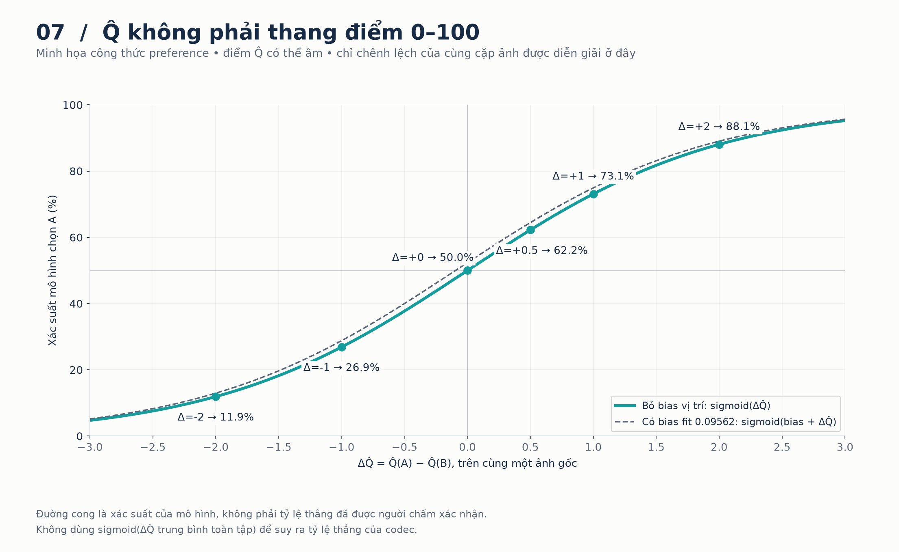
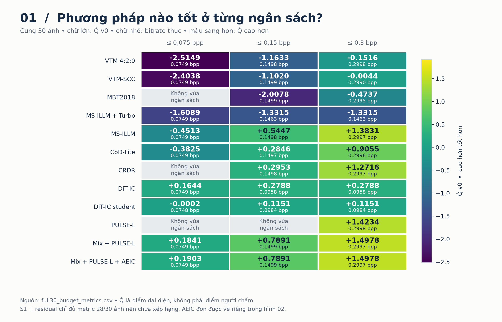
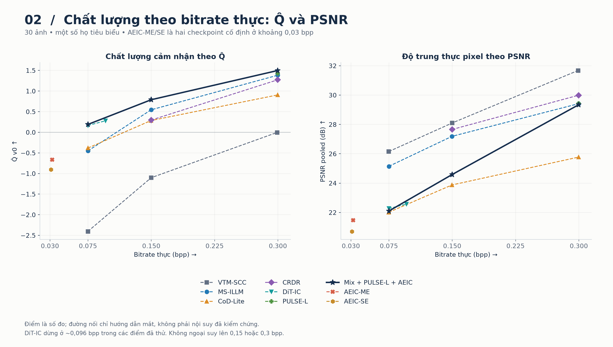
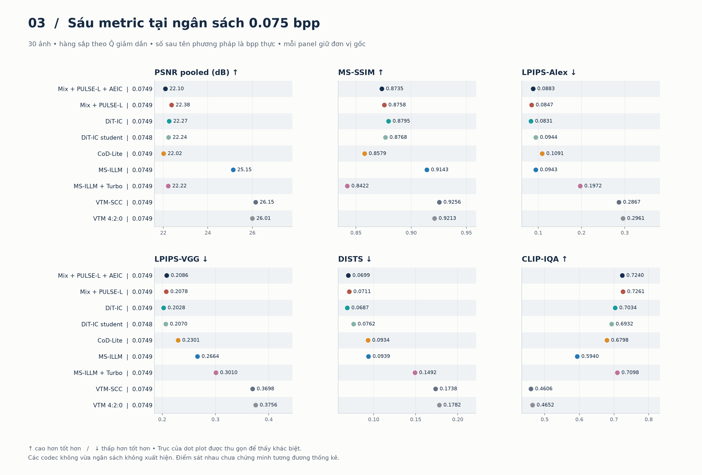
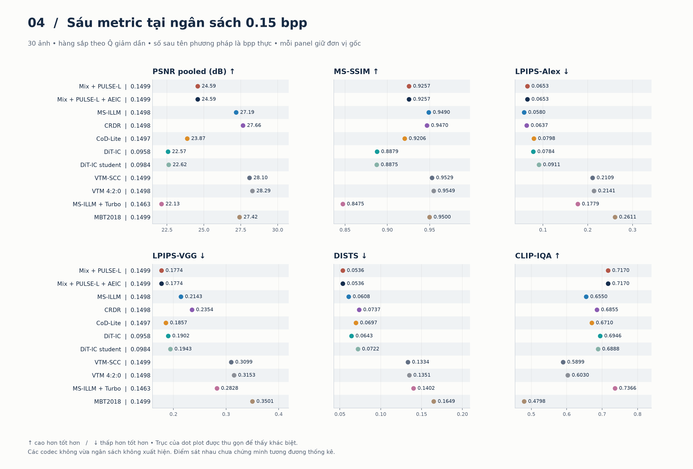
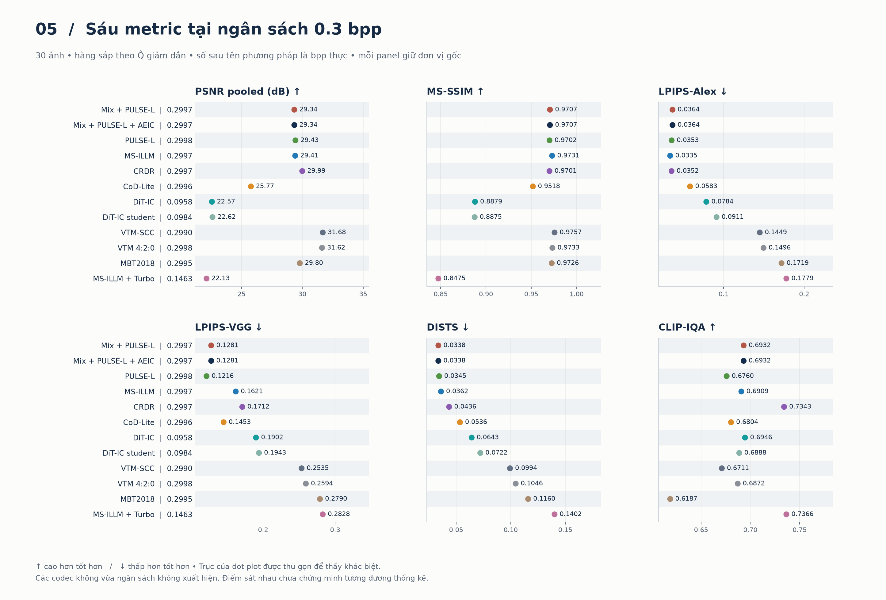
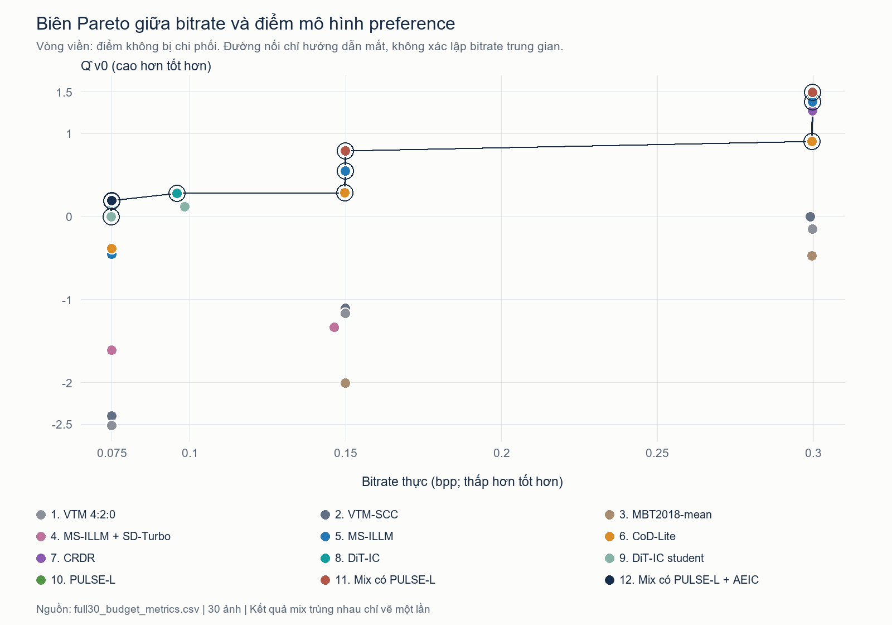
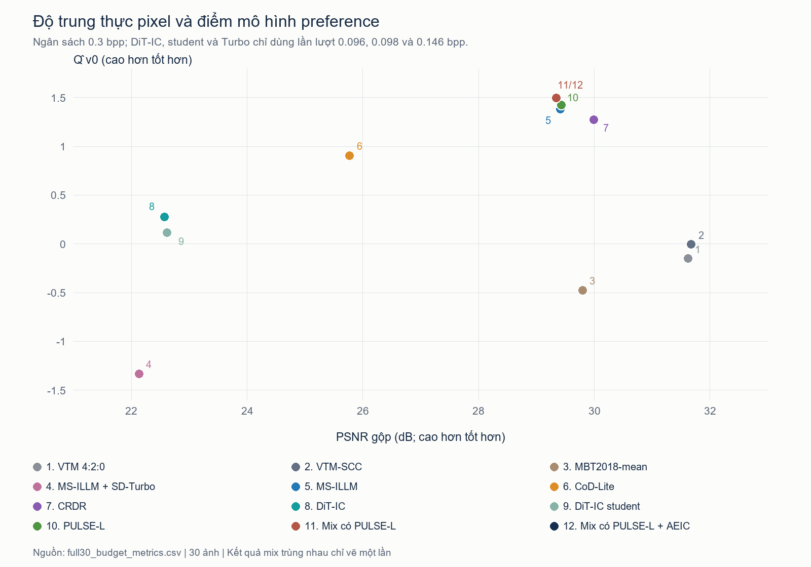
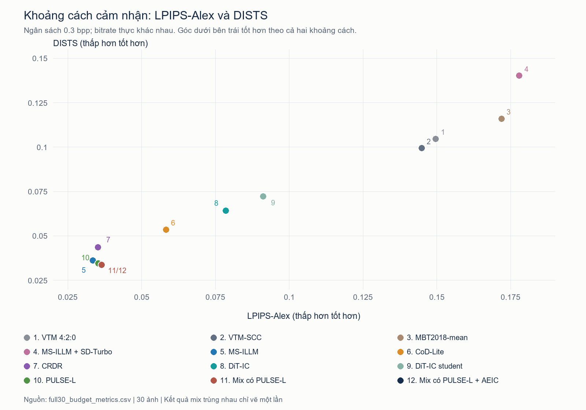
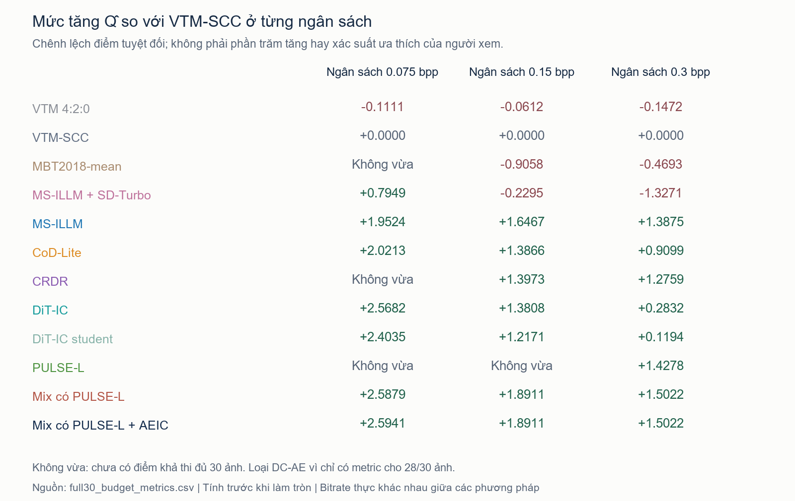

# So sánh các codec nén ảnh: bitrate, chất lượng và Q̂

> **Phạm vi:** So sánh các cấu hình đã thử trên cùng tập 30 ảnh. Q̂ là điểm do mô hình dự đoán mức ưa thích tạo ra; thứ hạng theo Q̂ chưa được xác nhận bằng đánh giá độc lập từ người xem.

**Nội dung**

1. [Các thước đo và cách đọc Q̂](#metrics-qhat)
2. [Kết quả trên 30 ảnh](#ket-qua)
3. [Biên Pareto giữa bitrate và Q̂](#bien-pareto)
4. [PSNR và Q̂](#psnr-qhat)
5. [LPIPS-Alex và DISTS](#lpips-dists)
6. [Mức tăng Q̂ so với VTM-SCC](#muc-tang-qhat)
7. [Thảo luận và kết luận](#thao-luan)
8. [Giới hạn của đánh giá](#gioi-han)

<a id="metrics-qhat"></a>

## 1. Các thước đo và cách đọc Q̂

Q̂ là điểm do mô hình dự đoán mức ưa thích tạo ra, được dùng để sàng lọc phương án nén và phân bổ byte. Q̂ không phải là codec.

Phần này thống nhất cách đọc tất cả bảng và hình trong báo cáo.

### 1.1. Các thước đo và quy ước tổng hợp

| Thước đo (metric) | Đơn vị / thang đo | Chiều cải thiện | Ý nghĩa và giới hạn |
| --- | --- | --- | --- |
| Bitrate — bpp | Bit trên một pixel; `8 × tổng byte / tổng pixel` | ↓ khi chất lượng tương đương | Tính từ kích thước luồng nén thực tế, không chỉ từ entropy ước lượng. Cần xem cùng các thước đo chất lượng. |
| PSNR | dB, không phải phần trăm | ↑ | Phản ánh sai số RGB; nhạy với sai lệch màu và vị trí, có thể cho điểm cao với ảnh bị làm mịn. Bảng dùng **PSNR gộp** từ MSE có trọng số theo số pixel. |
| MS-SSIM | Thường 0–1; 1 là giống hoàn toàn theo metric | ↑ | Đo độ tương đồng cấu trúc ở nhiều tỷ lệ; không bảo đảm giữ đúng chữ viết và nội dung ngữ nghĩa. |
| LPIPS-Alex | Khoảng cách đặc trưng AlexNet; 0 là khớp | ↓ | Không phải thang phần trăm và không nhất thiết có giá trị tối đa là 1. |
| LPIPS-VGG | Khoảng cách đặc trưng VGG; 0 là khớp | ↓ | Dùng mạng trích xuất đặc trưng khác LPIPS-Alex; cần trình bày riêng hai giá trị. |
| DISTS | Sai khác về cấu trúc và kết cấu; gần 0 tốt hơn | ↓ | Đánh giá độ tương đồng cảm nhận; vẫn có thể bỏ sót lỗi chữ hoặc kết cấu được tạo thêm, không có trong ảnh gốc. |
| CLIP-IQA | Điểm chất lượng ảnh không cần ảnh gốc, thường 0–1 | ↑ | Ảnh trông tự nhiên có thể được điểm cao dù không trung thực với ảnh gốc. |
| **Q̂ v0** | Không có thang 0–100 hay mốc “đạt” cố định | ↑ | Kết hợp sáu metric để dự đoán ảnh nào được ưa thích hơn trong một cặp. Giá trị âm là hợp lệ, không phải dấu hiệu mô hình bị lỗi. |
| Thời gian giải mã | Giây/ảnh hoặc giây/toàn bộ tập | ↓ | Phân biệt thời gian gọi API với toàn bộ quy trình gồm khởi động, nạp mô hình và đọc/ghi dữ liệu; giữ cùng phần cứng và điều kiện tải khi so sánh. |
| VRAM | MiB/GiB; ghi rõ theo tiến trình (PID) hay toàn GPU | ↓ khi chất lượng và tốc độ tương đương | Số đo toàn GPU có thể bao gồm tác vụ khác, nên không so trực tiếp với số đo của một tiến trình. |
| Độ khớp pixel khi giải mã | Số ảnh giải mã khớp pixel / tổng số | Khớp toàn bộ | Kiểm tra khả năng tái lập, không đo chất lượng. Khớp trên L40 chưa chứng minh sẽ khớp trên L4. |
| OCR CER | Tỷ lệ lỗi ký tự, có thể >1 khi chèn nhiều ký tự | ↓ | Đã có trong thử nghiệm nhận dạng chữ của dự án; chưa đo đồng nhất cho mọi codec. |
| FID/KID, WD3/WD5 | Các khoảng cách phân phối / đặc trưng | ↓ ở dạng khoảng cách gốc | Đã được sử dụng trong dự án nhưng chưa có cho tất cả phương pháp ở bảng chính; **không nằm trong Q̂ v0**. |

Các metric được tính và tổng hợp như sau:

- **PSNR:** tính trên ảnh RGB; PSNR toàn tập được suy ra từ MSE gộp có trọng số theo số pixel.
- **MS-SSIM:** tính trên toàn ảnh.
- **LPIPS và DISTS:** tính theo các ô ảnh (tile) 512×512, tổng hợp theo diện tích ô và bỏ các ô có cạnh nhỏ hơn 64.
- **Bitrate:** tính từ tổng số byte và tổng số pixel của toàn tập.
- **MS-SSIM, LPIPS, DISTS, CLIP-IQA và Q̂ toàn tập:** lấy trung bình cộng trên các ảnh, mỗi ảnh có trọng số như nhau.

### 1.2. Phân biệt Q̂ với chỉ số cấu hình chất lượng

**Q̂ khác với các nhãn `q0/q1/q2/q3/q4`.** Các nhãn `q…` chỉ cấu hình hoặc checkpoint chất lượng của từng codec, không dùng chung một thang đo giữa các mô hình. Q̂ được tính từ các metric của ảnh tái tạo theo công thức dưới đây.

### 1.3. Công thức tính Q̂ v0

Với ảnh gốc \(O\) và ảnh tái tạo \(X\), Q̂ v0 được tính **riêng cho từng ảnh**:

```text
Q̂(O, X) =
  -0.034319 × PSNR
  +1.346040 × [-log10(max(1 - MS-SSIM, 0.000001))]
  -2.096177 × LPIPS-Alex
  -2.379560 × LPIPS-VGG
  -13.931139 × DISTS
  +1.720847 × CLIP-IQA
```

Các hệ số trên đã được làm tròn để trình bày. Trọng số `weights` đã được chuyển về thang đo gốc khi xuất mô hình; **không chia thêm cho `scale`**.

Hệ số âm là kết quả ước lượng đồng thời trên các đặc trưng có tương quan. Không thể từ đó suy ra quy luật “PSNR càng thấp càng tốt” hoặc cho rằng chủ động làm giảm chất lượng ảnh sẽ tăng mức ưa thích.

> **Lưu ý:** Không thay trực tiếp các giá trị trung bình trong bảng vào công thức để tính lại Q̂ trung bình. Phép biến đổi MS-SSIM là phi tuyến; PSNR trong bảng là PSNR gộp, khác với trung bình PSNR từng ảnh. Quy trình tính Q̂ cho từng ảnh trước, rồi mới lấy trung bình.

### 1.4. Cách diễn giải chênh lệch Q̂

Mô hình dự đoán mức ưa thích được lưu trong dự án có dạng:

```text
P(A được chọn hơn B | cùng ảnh gốc) = sigmoid(0.095620 + Q̂(A) - Q̂(B))
sigmoid(z) = 1 / (1 + exp(-z))
```

Hệ số lệch 0,095620 phản ánh thiên lệch theo vị trí A/B trong dữ liệu dùng để ước lượng mô hình; **không cộng hệ số này vào Q̂ của từng codec**. Bảng dưới minh họa hàm logistic khi bỏ thành phần lệch vị trí:

| ΔQ̂ = Q̂(A) − Q̂(B) trên cùng ảnh | Xác suất mô hình dự đoán, giả sử độ lệch = 0 |
| ---: | ---: |
| 0 | 50,0% |
| +0,25 | 56,2% |
| +0,5 | 62,2% |
| +1 | 73,1% |
| +2 | 88,1% |

Đây là **xác suất do mô hình dự đoán**, chưa được kiểm chứng trên CLIC 2027. Trong mô hình, tăng chênh lệch Q̂ thêm 1 đơn vị làm tỷ số xác suất chọn A so với không chọn A (odds) tăng khoảng \(e ≈ 2,72\) lần. Q̂ = 1 không có nghĩa chất lượng “100%”; Q̂ = 0 cũng không biểu thị ảnh ngẫu nhiên hay mốc đạt chuẩn.



**Hình 1 — Diễn giải chênh lệch Q̂ của cùng một cặp ảnh.** Đường liền bỏ thành phần lệch vị trí; đường đứt dùng hệ số lệch của mô hình đã lưu. Trục phần trăm biểu diễn xác suất mô hình dự đoán, không phải điểm chất lượng quy đổi về thang 0–100.

<a id="ket-qua"></a>

## 2. Kết quả trên 30 ảnh

- Tất cả phương pháp được so sánh trên cùng danh sách 30 ảnh, với tổng cộng 86.245.376 pixel.
- Ba ngân sách byte lần lượt là 808.550 / 1.617.100 / 3.234.201.
- Nhãn `Không vừa` chỉ áp dụng cho các checkpoint đã thử; không có nghĩa kiến trúc đó không thể đạt bitrate thấp hơn sau khi huấn luyện lại.

### 2.1. Q̂ theo ba ngân sách

Mỗi ô ghi **Q̂ / bpp thực** dưới trần ngân sách của cột. `Không vừa` nghĩa là chưa có phương án từ các điểm đã đo có thể nén toàn tập trong giới hạn đó. Nếu một phương pháp dùng ít hơn ngân sách cho phép, kết quả được giữ ở bitrate thực đã đo, không nội suy lên trần ngân sách.

| Phương pháp | ≤0,075 bpp | ≤0,15 bpp | ≤0,3 bpp |
| --- | ---: | ---: | ---: |
| VTM 4:2:0 | -2.5149 / 0.0749 | -1.1633 / 0.1498 | -0.1516 / 0.2998 |
| VTM-SCC 4:4:4 | -2.4038 / 0.0749 | -1.1020 / 0.1499 | -0.0044 / 0.2990 |
| DC-AE + S1 + residual VTM | Thiếu metric (28/30 ảnh) | Thiếu metric (28/30 ảnh) | Thiếu metric (28/30 ảnh) |
| MBT2018-mean | Không vừa | -2.0078 / 0.1499 | -0.4737 / 0.2995 |
| MS-ILLM + SD-Turbo refiner | -1.6089 / 0.0749 | -1.3315 / 0.1463 | -1.3315 / 0.1463 |
| MS-ILLM | -0.4513 / 0.0749 | 0.5447 / 0.1498 | 1.3831 / 0.2997 |
| CoD-Lite | -0.3825 / 0.0749 | 0.2846 / 0.1497 | 0.9055 / 0.2996 |
| CRDR | Không vừa | 0.2953 / 0.1498 | 1.2716 / 0.2997 |
| DiT-IC | 0.1644 / 0.0749 | 0.2788 / 0.0958 | 0.2788 / 0.0958 |
| DiT-IC student | -0.0002 / 0.0748 | 0.1151 / 0.0984 | 0.1151 / 0.0984 |
| PULSE-L perceptual | Không vừa | Không vừa | 1.4234 / 0.2998 |
| Mix có PULSE-L | 0.1841 / 0.0749 | 0.7891 / 0.1499 | 1.4978 / 0.2997 |
| Mix có PULSE-L + AEIC | 0.1903 / 0.0749 | 0.7891 / 0.1499 | 1.4978 / 0.2997 |



**Hình 2 — Q̂ theo ngân sách.** Đọc theo cột để so sánh dưới cùng trần byte; đọc theo hàng để xem kết quả thay đổi khi tăng ngân sách. Mỗi ô ghi cả Q̂ và bitrate thực. Ví dụ, điểm cao nhất đã thử của DiT-IC chỉ dùng khoảng 0,096 bpp; hai cột ngân sách cao lặp lại điểm này, không phải hai checkpoint mới.

<!-- **Hình dự phòng — Hai tiêu chí chất lượng theo bitrate thực.** Q̂ và PSNR có thể dẫn đến thứ tự khác nhau. AEIC nằm ở khoảng 0,03 bpp, vì vậy không xem nó như một điểm đã đo tại 0,075 bpp. Đường nối chỉ giúp theo dõi các điểm có sẵn, không chứng minh chất lượng giữa các điểm.

 -->

### 2.2. Các metric tại ngân sách 0.075 bpp

| Phương pháp | bpp thực | PSNR gộp ↑ | MS-SSIM ↑ | LPIPS-Alex ↓ | LPIPS-VGG ↓ | DISTS ↓ | CLIP-IQA ↑ | Q̂ v0 ↑ |
| --- | ---: | ---: | ---: | ---: | ---: | ---: | ---: | ---: |
| VTM 4:2:0 | 0.07488 | 26.01 | 0.9213 | 0.2961 | 0.3756 | 0.1782 | 0.4652 | -2.5149 |
| VTM-SCC 4:4:4 | 0.07489 | 26.15 | 0.9256 | 0.2867 | 0.3698 | 0.1738 | 0.4606 | -2.4038 |
| MS-ILLM + SD-Turbo refiner | 0.07488 | 22.22 | 0.8422 | 0.1972 | 0.3010 | 0.1492 | 0.7098 | -1.6089 |
| MS-ILLM | 0.07494 | 25.15 | 0.9143 | 0.0943 | 0.2664 | 0.0939 | 0.5940 | -0.4513 |
| CoD-Lite | 0.07491 | 22.02 | 0.8579 | 0.1091 | 0.2301 | 0.0934 | 0.6798 | -0.3825 |
| DiT-IC | 0.07494 | 22.27 | 0.8795 | 0.0831 | 0.2028 | 0.0687 | 0.7034 | 0.1644 |
| DiT-IC student | 0.07478 | 22.24 | 0.8768 | 0.0944 | 0.2070 | 0.0762 | 0.6932 | -0.0002 |
| Mix có PULSE-L | 0.07492 | 22.38 | 0.8758 | 0.0847 | 0.2078 | 0.0711 | 0.7261 | 0.1841 |
| Mix có PULSE-L + AEIC | 0.07494 | 22.10 | 0.8735 | 0.0883 | 0.2086 | 0.0699 | 0.7240 | 0.1903 |



**Hình 3 — Sáu metric tại ngân sách 0.075 bpp.** Các phương pháp được sắp theo Q̂ giảm dần; số sau tên là bitrate thực.

Ở ngân sách thấp, Q̂ cao không đồng nghĩa PSNR, MS-SSIM và mọi khoảng cách cảm nhận đều tốt hơn. Hai hàng mix thể hiện rõ đánh đổi khi thêm AEIC.

### 2.3. Các metric tại ngân sách 0.15 bpp

| Phương pháp | bpp thực | PSNR gộp ↑ | MS-SSIM ↑ | LPIPS-Alex ↓ | LPIPS-VGG ↓ | DISTS ↓ | CLIP-IQA ↑ | Q̂ v0 ↑ |
| --- | ---: | ---: | ---: | ---: | ---: | ---: | ---: | ---: |
| VTM 4:2:0 | 0.14977 | 28.29 | 0.9549 | 0.2141 | 0.3153 | 0.1351 | 0.6030 | -1.1633 |
| VTM-SCC 4:4:4 | 0.14986 | 28.10 | 0.9529 | 0.2109 | 0.3099 | 0.1334 | 0.5899 | -1.1020 |
| MBT2018-mean | 0.14988 | 27.42 | 0.9500 | 0.2611 | 0.3501 | 0.1649 | 0.4798 | -2.0078 |
| MS-ILLM + SD-Turbo refiner | 0.14630 | 22.13 | 0.8475 | 0.1779 | 0.2828 | 0.1402 | 0.7366 | -1.3315 |
| MS-ILLM | 0.14979 | 27.19 | 0.9490 | 0.0580 | 0.2143 | 0.0608 | 0.6550 | 0.5447 |
| CoD-Lite | 0.14971 | 23.87 | 0.9206 | 0.0798 | 0.1857 | 0.0697 | 0.6710 | 0.2846 |
| CRDR | 0.14983 | 27.66 | 0.9470 | 0.0637 | 0.2354 | 0.0737 | 0.6855 | 0.2953 |
| DiT-IC | 0.09577 | 22.57 | 0.8879 | 0.0784 | 0.1902 | 0.0643 | 0.6946 | 0.2788 |
| DiT-IC student | 0.09843 | 22.62 | 0.8875 | 0.0911 | 0.1943 | 0.0722 | 0.6888 | 0.1151 |
| Mix có PULSE-L | 0.14991 | 24.59 | 0.9257 | 0.0653 | 0.1774 | 0.0536 | 0.7170 | 0.7891 |
| Mix có PULSE-L + AEIC | 0.14991 | 24.59 | 0.9257 | 0.0653 | 0.1774 | 0.0536 | 0.7170 | 0.7891 |



**Hình 4 — Sáu metric tại ngân sách 0.15 bpp.** DiT-IC và student vẫn dùng các điểm đo dưới 0,1 bpp; hai phương án mix có kết quả trùng nhau.

DiT-IC và student dùng dưới 0,1 bpp, nên chưa thể xem là các điểm đo tại bitrate 0,15 bpp. Hai phương án mix có kết quả giống nhau vì AEIC không được chọn.

### 2.4. Các metric tại ngân sách 0.3 bpp

| Phương pháp | bpp thực | PSNR gộp ↑ | MS-SSIM ↑ | LPIPS-Alex ↓ | LPIPS-VGG ↓ | DISTS ↓ | CLIP-IQA ↑ | Q̂ v0 ↑ |
| --- | ---: | ---: | ---: | ---: | ---: | ---: | ---: | ---: |
| VTM 4:2:0 | 0.29980 | 31.62 | 0.9733 | 0.1496 | 0.2594 | 0.1046 | 0.6872 | -0.1516 |
| VTM-SCC 4:4:4 | 0.29900 | 31.68 | 0.9757 | 0.1449 | 0.2535 | 0.0994 | 0.6711 | -0.0044 |
| MBT2018-mean | 0.29945 | 29.80 | 0.9726 | 0.1719 | 0.2790 | 0.1160 | 0.6187 | -0.4737 |
| MS-ILLM + SD-Turbo refiner | 0.14630 | 22.13 | 0.8475 | 0.1779 | 0.2828 | 0.1402 | 0.7366 | -1.3315 |
| MS-ILLM | 0.29967 | 29.41 | 0.9731 | 0.0335 | 0.1621 | 0.0362 | 0.6909 | 1.3831 |
| CoD-Lite | 0.29959 | 25.77 | 0.9518 | 0.0583 | 0.1453 | 0.0536 | 0.6804 | 0.9055 |
| CRDR | 0.29968 | 29.99 | 0.9701 | 0.0352 | 0.1712 | 0.0436 | 0.7343 | 1.2716 |
| DiT-IC | 0.09577 | 22.57 | 0.8879 | 0.0784 | 0.1902 | 0.0643 | 0.6946 | 0.2788 |
| DiT-IC student | 0.09843 | 22.62 | 0.8875 | 0.0911 | 0.1943 | 0.0722 | 0.6888 | 0.1151 |
| PULSE-L perceptual | 0.29977 | 29.43 | 0.9702 | 0.0353 | 0.1216 | 0.0345 | 0.6760 | 1.4234 |
| Mix có PULSE-L | 0.29973 | 29.34 | 0.9707 | 0.0364 | 0.1281 | 0.0338 | 0.6932 | 1.4978 |
| Mix có PULSE-L + AEIC | 0.29973 | 29.34 | 0.9707 | 0.0364 | 0.1281 | 0.0338 | 0.6932 | 1.4978 |



**Hình 5 — Sáu metric tại ngân sách 0.3 bpp.** VTM-SCC dẫn đầu về PSNR và MS-SSIM; các phương pháp đứng đầu theo những metric khác có thể khác nhau.

Gần trần ngân sách này, VTM-SCC đạt PSNR và MS-SSIM cao nhất; PULSE-L có Q̂ cao nhất trong các codec đơn đã thử.

**Cách đọc ba hình metric:** Trong mỗi hình, sáu biểu đồ thành phần giữ cùng thứ tự hàng, sắp theo Q̂ giảm dần. Số sau tên phương pháp là bpp thực; các trục dùng giá trị metric gốc. Ký hiệu ↑ nghĩa là cao hơn tốt hơn, ↓ nghĩa là thấp hơn tốt hơn. Không so trực tiếp khoảng cách giữa các biểu đồ vì chúng dùng các thang đo khác nhau. Đường bitrate–chất lượng chỉ nối các điểm đã đo để giúp theo dõi, không ngoại suy kết quả cho checkpoint mới.

Nguồn: [CSV 30 ảnh](../results/2026-10-20_metrics_comparison/full30_budget_metrics.csv), [script tính lại](../results/2026-10-20_metrics_comparison/build_comparison.py), [hash dữ liệu](../results/2026-10-20_metrics_comparison/sources.sha256.json).

<a id="bien-pareto"></a>

## 3. Biên Pareto giữa bitrate và Q̂

Phân tích sử dụng số liệu chưa làm tròn trong [CSV 30 ảnh](../results/2026-10-20_metrics_comparison/full30_budget_metrics.csv), không chạy lại các codec. Mỗi điểm trên đồ thị là một phương án phân bổ byte đã đo trên toàn tập. Với các phương pháp mix, codec được chọn riêng cho từng ảnh; vì vậy, mix là phương án phối hợp nhiều codec. Chỉ các cấu hình có đủ metric trên cả 30 ảnh mới được đưa vào phân tích.

### 3.1. Tiêu chí xác định biên Pareto

Điểm vận hành A **chi phối** B nếu A dùng không nhiều byte hơn và đạt Q̂ trung bình không thấp hơn B, đồng thời tốt hơn ở ít nhất một tiêu chí. **Biên Pareto** gồm các điểm không bị bất kỳ điểm nào khác chi phối.

Mọi điểm đều được đo trên cùng 86.245.376 pixel, nên so sánh tổng byte tương đương với so sánh bpp thực. Quan hệ chi phối được xác định từ số liệu chưa làm tròn trên cả ba ngân sách. Điểm lặp lại ở nhiều trần ngân sách và kết quả mix trùng nhau chỉ được ghi một lần trong bảng biên Pareto. Hai điểm có cùng bitrate và Q̂ không chi phối lẫn nhau.



**Hình 6 — Biên Pareto giữa bitrate và Q̂ của các điểm đã đo.** Vòng viền đánh dấu những điểm không bị chi phối. Đường nối giúp theo dõi các điểm, không chứng minh có thể đạt các phương án phân bổ trung gian. Những điểm có bitrate rất gần nhau có thể chồng lên nhau trên hình; cần dựa vào số byte chính xác trong bảng để xác định điểm thuộc biên.

### 3.2. Các điểm thuộc biên và các điểm bị chi phối

| Phương pháp / phương án không bị chi phối | Tổng byte | bpp thực | Q̂ v0 ↑ |
| --- | ---: | ---: | ---: |
| DiT-IC student | 806,144 | 0.07477679 | -0.0002 |
| Mix có PULSE-L | 807,641 | 0.07491565 | 0.1841 |
| Mix có PULSE-L + AEIC | 807,855 | 0.07493550 | 0.1903 |
| DiT-IC | 1,032,508 | 0.09577399 | 0.2788 |
| CoD-Lite | 1,613,944 | 0.14970718 | 0.2846 |
| MS-ILLM | 1,614,876 | 0.14979363 | 0.5447 |
| Mix có PULSE-L / Mix có PULSE-L + AEIC | 1,616,109 | 0.14990800 | 0.7891 |
| CoD-Lite | 3,229,816 | 0.29959320 | 0.9055 |
| MS-ILLM | 3,230,672 | 0.29967260 | 1.3831 |
| Mix có PULSE-L / Mix có PULSE-L + AEIC | 3,231,292 | 0.29973011 | 1.4978 |

Khi chỉ xét bitrate và Q̂, tất cả điểm đã đo của VTM 4:2:0, VTM-SCC, MBT2018-mean, MS-ILLM + SD-Turbo, CRDR và PULSE-L đều bị chi phối. Bảng dưới chỉ rõ phương án tốt hơn trong từng trường hợp.

| Điểm vận hành bị chi phối | Phương án dùng ít byte hơn và đạt Q̂ cao hơn |
| --- | --- |
| VTM 4:2:0 và VTM-SCC, cả ba ngân sách | DiT-IC student tại 0.07477679 bpp dùng ít byte hơn và có Q̂ cao hơn mọi điểm được báo cáo của hai phương pháp tham chiếu. |
| MBT2018-mean, cả hai ngân sách khả thi | DiT-IC tại 0.09577399 bpp có Q̂ cao hơn và dùng ít byte hơn. |
| MS-ILLM + SD-Turbo, mọi ngân sách | DiT-IC student tại 0.07477679 bpp có Q̂ cao hơn và dùng ít byte hơn. |
| CRDR, các điểm ở ngân sách 0.15 và 0.3 | MS-ILLM ở ngân sách tương ứng có Q̂ cao hơn và dùng ít byte hơn. |
| PULSE-L, điểm ở ngân sách 0.3 | Mix có PULSE-L tăng Q̂ từ 1.4234 lên 1.4978, đồng thời giảm kích thước luồng nén 428 byte. |
| MS-ILLM, CoD-Lite và DiT-IC, các điểm ở ngân sách 0.075 | Mix có PULSE-L chi phối MS-ILLM và DiT-IC; DiT-IC student chi phối CoD-Lite. |
| DiT-IC student, điểm lặp ở ngân sách 0.15/0.3 | DiT-IC tại 0.09577399 bpp đạt Q̂ 0.2788, so với 0.1151 tại 0.09842763 bpp của student. |

### 3.3. Phương án nào hiệu quả nhất?

Dưới các trần ngân sách đã thử, Q̂ cao nhất thuộc về:

- **Ngân sách 0.075 bpp:** Mix có PULSE-L + AEIC, đạt 0.1903.
- **Ngân sách 0.15 bpp:** hai phương án mix đồng hạng, đạt 0.7891.
- **Ngân sách 0.3 bpp:** hai phương án mix đồng hạng, đạt 1.4978.

Nếu chỉ xét codec đơn, DiT-IC có Q̂ cao nhất dưới 0.075 bpp, MS-ILLM dưới 0.15 bpp, còn PULSE-L dưới 0.3 bpp. PULSE-L vẫn đứng đầu nhóm codec đơn ở ngân sách lớn nhất, dù bị chi phối khi đưa các phương án mix vào so sánh.

Không có một điểm hiệu quả nhất cho mọi yêu cầu: cần xác định giới hạn byte hoặc chất lượng mục tiêu trước khi lựa chọn. CoD-Lite và MS-ILLM vẫn có các điểm trên biên gần 0.15 và 0.3 bpp vì dùng ít byte hơn mix một chút. Tại ngân sách lớn nhất, MS-ILLM chỉ tiết kiệm 620 byte so với mix. Các điểm này thuộc biên theo đúng số liệu hiện có, nhưng chênh lệch nhỏ chưa chứng minh lợi thế ổn định của kiến trúc.

> **Phạm vi kết luận:** Quan hệ chi phối ở đây chỉ xét bitrate và Q̂. Một điểm bị chi phối vẫn có thể tốt hơn về PSNR, thời gian chạy, bộ nhớ hoặc mức ưa thích thực tế của người xem.

<a id="psnr-qhat"></a>

## 4. PSNR và Q̂: độ trung thực pixel và mức ưa thích dự đoán



**Hình 7 — PSNR gộp và Q̂ trung bình dưới trần ngân sách 0.3 bpp.** Trên cả hai trục, giá trị cao hơn là tốt hơn theo tiêu chí tương ứng. DiT-IC, student và bộ tinh chỉnh SD-Turbo lần lượt chỉ dùng khoảng 0.096, 0.098 và 0.146 bpp, nên hình này chưa phải so sánh cùng bitrate cho các phương pháp đó. Hai kết quả mix trùng nhau.

Ở gần 0.3 bpp, VTM-SCC đạt PSNR gộp cao nhất (31.68 dB) và MS-SSIM cao nhất (0.9757), nhưng Q̂ là -0.0044. MS-ILLM đạt 29.41 dB và Q̂ 1.3831; PULSE-L đạt 29.43 dB và Q̂ 1.4234; mix đạt 29.34 dB và Q̂ 1.4978. So với VTM-SCC, ba phương pháp này lần lượt giảm khoảng 2.26, 2.24 và 2.33 dB, đồng thời tăng điểm mô hình dự đoán mức ưa thích. Thứ hạng quan sát được vì vậy phụ thuộc đáng kể vào tiêu chí đánh giá.

Sự khác biệt về thứ hạng cũng xuất hiện gần 0.075 bpp: VTM-SCC đạt 26.15 dB và Q̂ -2.4038, trong khi DiT-IC đạt 22.27 dB và Q̂ 0.1644 ở bitrate thực gần tương đương. Tuy nhiên, chỉ giảm PSNR không bảo đảm Q̂ tốt hơn: bộ tinh chỉnh SD-Turbo chỉ đạt 22.13 dB và Q̂ -1.3315 tại bitrate cao nhất đã đo. Kết quả cho thấy sự khác biệt thực nghiệm giữa độ trung thực pixel và mức ưa thích do Q̂ dự đoán, chứ không cho thấy giảm độ trung thực luôn mang lại lợi ích. Các số liệu này cũng chưa xác lập một cận lý thuyết về quan hệ bitrate–độ méo–cảm nhận.

Q̂ kết hợp các metric có tương quan với nhau, trong đó có PSNR từng ảnh, nên không phải bằng chứng độc lập về chất lượng cảm nhận. Hệ số PSNR âm trong mô hình đã ước lượng không cho phép suy ra quan hệ nhân quả. Hơn nữa, PSNR trên hình được gộp theo pixel, còn Q̂ được tính riêng từng ảnh rồi lấy trung bình; xu hướng trên biểu đồ phân tán không tách được đóng góp của từng đặc trưng. Cần đánh giá độc lập từ người xem để xác định chênh lệch thứ hạng có phản ánh mức ưa thích thực tế hay không.

<a id="lpips-dists"></a>

## 5. LPIPS-Alex và DISTS: chất lượng cảm nhận



**Hình 8 — Hai khoảng cách cảm nhận có tham chiếu ảnh gốc.** Các điểm gần góc dưới bên trái có khoảng cách nhỏ hơn theo cả hai metric. Số ghi cạnh mỗi điểm tương ứng với phương pháp trong chú giải. Kết quả dùng quy trình tổng hợp theo ô ảnh đã nêu; các phương pháp có cùng trần ngân sách nhưng khác bitrate thực. Hai kết quả mix trùng nhau.

Gần 0.3 bpp, MS-ILLM, PULSE-L và mix đều cải thiện cả hai khoảng cách so với VTM-SCC (LPIPS-Alex 0.1449; DISTS 0.0994). MS-ILLM đạt 0.0335 và 0.0362, tương ứng giảm 76.9% và 63.6%. PULSE-L đạt 0.0353 và 0.0345, giảm 75.6% và 65.3%; mix đạt 0.0364 và 0.0338, giảm 74.8% và 66.0%. Đây là tỷ lệ giảm giá trị metric được tính trước khi làm tròn, không phải phần trăm cải thiện chất lượng cảm nhận.

**Hai metric cho thứ hạng khác nhau.** MS-ILLM có LPIPS-Alex thấp nhất trong các kết quả ở ngân sách 0.3, còn hai phương án mix có DISTS thấp nhất. So với MS-ILLM, PULSE-L có DISTS thấp hơn nhưng LPIPS-Alex cao hơn một chút. So với PULSE-L, mix tiếp tục giảm DISTS nhưng tăng LPIPS-Alex. Ngay trong nhóm thước đo độ méo dựa trên đặc trưng, các phương pháp vẫn có những đánh đổi khác nhau; không phương pháp nào đồng thời đạt giá trị thấp nhất ở cả hai khoảng cách.

Sự khác biệt về thứ hạng đã xuất hiện gần 0.15 bpp: MS-ILLM đạt LPIPS-Alex 0.0580 so với 0.0653 của mix, nhưng mix đạt DISTS 0.0536 so với 0.0608 của MS-ILLM. Gần 0.075 bpp, DiT-IC cải thiện cả hai khoảng cách so với mix không có AEIC (0.0831/0.0687 so với 0.0847/0.0711), nhưng Q̂ thấp hơn (0.1644 so với 0.1841). Vì vậy, Q̂ phản ánh toàn bộ tổ hợp đặc trưng với trọng số đã ước lượng, thay vì chỉ một trong hai khoảng cách. Sự đồng thuận giữa Q̂ và các khoảng cách này cũng phần nào có sẵn trong mô hình, bởi LPIPS-Alex và DISTS là đầu vào của Q̂; đây không phải kiểm chứng độc lập.

<a id="muc-tang-qhat"></a>

## 6. Mức tăng Q̂ so với VTM-SCC

Với phương pháp `c` dưới trần ngân sách `B`, chênh lệch điểm tuyệt đối được tính như sau:

```text
ΔQ̂(c, B) = Q̂ trung bình(c, B) − Q̂ trung bình(VTM-SCC, B).
```

Các chênh lệch dưới đây được tính từ giá trị trung bình chưa làm tròn. Q̂ của VTM-SCC lần lượt là -2.4038, -1.1020 và -0.0044 tại ba ngân sách. Đây là so sánh dưới cùng trần ngân sách; bitrate thực của các phương pháp vẫn có thể khác nhau.

| Phương pháp / phân bổ | ΔQ̂ tại ≤0.075 bpp | ΔQ̂ tại ≤0.15 bpp | ΔQ̂ tại ≤0.3 bpp |
| --- | ---: | ---: | ---: |
| VTM 4:2:0 | -0.1111 | -0.0612 | -0.1472 |
| VTM-SCC 4:4:4 | +0.0000 | +0.0000 | +0.0000 |
| DC-AE + S1 + residual VTM | Thiếu metric (28/30) | Thiếu metric (28/30) | Thiếu metric (28/30) |
| MBT2018-mean | Không vừa | -0.9058 | -0.4693 |
| MS-ILLM + SD-Turbo refiner | +0.7949 | -0.2295 | -1.3271 |
| MS-ILLM | +1.9524 | +1.6467 | +1.3875 |
| CoD-Lite | +2.0213 | +1.3866 | +0.9099 |
| CRDR | Không vừa | +1.3973 | +1.2759 |
| DiT-IC | +2.5682 | +1.3808 | +0.2832 |
| DiT-IC student | +2.4035 | +1.2171 | +0.1194 |
| PULSE-L perceptual | Không vừa | Không vừa | +1.4278 |
| Mix có PULSE-L | +2.5879 | +1.8911 | +1.5022 |
| Mix có PULSE-L + AEIC | +2.5941 | +1.8911 | +1.5022 |

`Không vừa` nghĩa là chưa có điểm khả thi trên đủ 30 ảnh trong các cấu hình đã thử, không phải mức tăng bằng không. Hàng DC-AE thiếu dữ liệu được loại khỏi xếp hạng định lượng.



**Hình 9 — Chênh lệch Q̂ tuyệt đối so với VTM-SCC.** Giá trị dương biểu thị điểm trung bình cao hơn dưới cùng trần ngân sách. Không chia cho điểm tham chiếu vì Q̂ không có mốc 0 mang ý nghĩa chất lượng cố định, còn điểm tham chiếu âm hoặc gần 0. Biểu diễn mức tăng Q̂ theo phần trăm vì vậy có thể gây hiểu nhầm.

Mix có PULSE-L + AEIC tăng lần lượt 2.5941, 1.8911 và 1.5022 đơn vị Q̂ so với VTM-SCC tại ba ngân sách. Ở ngân sách lớn nhất, mix hơn PULSE-L 0.0744 và hơn MS-ILLM 0.1147. Khi bổ sung AEIC vào tập codec ứng viên, điểm mix chỉ tăng +0.0062 tại ngân sách thấp nhất và thay đổi 0.0000 tại hai ngân sách lớn hơn, nơi AEIC không được chọn. Kết quả này chỉ mô tả phương án phân bổ đã thử; chưa thể kết luận AEIC không mang lại lợi ích ở cấu hình khác.

DiT-IC và student lặp lại cùng điểm vận hành trong hai cột ngân sách lớn hơn. Lợi thế so với VTM-SCC thu hẹp ở trần lớn nhất vì VTM-SCC được cải thiện, trong khi bitrate và Q̂ của hai phương pháp này giữ nguyên. Chất lượng ảnh tái tạo của chúng không giảm. Kết quả SD-Turbo cũng được lặp lại ở hai trần lớn hơn.

> **Lưu ý:** Áp dụng hàm sigmoid lên chênh lệch Q̂ trung bình toàn tập không cho ra trung bình xác suất ưa thích theo từng cặp ảnh. Bảng trên chỉ báo cáo chênh lệch điểm.

<a id="thao-luan"></a>

## 7. Thảo luận và kết luận

Đánh giá trên 30 ảnh cho thấy thứ hạng theo độ trung thực pixel khác với thứ hạng theo Q̂. Gần 0.3 bpp, VTM-SCC đạt PSNR và MS-SSIM cao nhất trong các phương pháp đã đánh giá, còn MS-ILLM, PULSE-L và mix có độ méo dựa trên đặc trưng thấp hơn đáng kể và Q̂ cao hơn. Vì vậy, cần báo cáo đồng thời độ trung thực, khoảng cách cảm nhận và điểm dự đoán mức ưa thích. Chỉ dùng một metric sẽ bỏ qua những khác biệt quan trọng giữa các mục tiêu tái tạo.

Phương án chọn codec riêng cho từng ảnh đạt Q̂ cao nhất dưới mỗi trần byte đã thử. Mix có PULSE-L + AEIC đạt Q̂ 0.1903 ở ngân sách thấp nhất; cả hai mix đạt 0.7891 và 1.4978 tại hai ngân sách lớn hơn. Ở ngân sách lớn nhất, mix cao hơn PULSE-L — codec đơn có Q̂ cao nhất — 0.0744 đơn vị, đồng thời dùng ít byte hơn một chút. Lợi ích này chỉ được xác lập theo mục tiêu Q̂ v0; chưa chứng minh người xem thực sự thích kết quả hơn hoặc mọi metric đều được cải thiện. MS-ILLM vẫn có LPIPS-Alex thấp hơn mix.

Biên Pareto cho thấy tối đa hóa Q̂ dưới một trần byte và giảm bitrate để đạt một mức chất lượng cho trước là hai bài toán khác nhau. DiT-IC có một điểm đáng chú ý ở bitrate thấp, trong khi CoD-Lite và MS-ILLM vẫn có các điểm không bị chi phối ở bitrate cao hơn. Việc một điểm có thuộc biên hay không có thể phụ thuộc vào chênh lệch kích thước luồng nén rất nhỏ; do đó, cần thêm phép đo tại các bitrate tương đương. Các điểm bị chi phối vẫn có thể đáng cân nhắc nếu xét thêm độ trung thực hoặc chi phí triển khai.

Theo mục tiêu Q̂ hiện tại, mix là ứng viên nên được ưu tiên đánh giá tiếp; VTM-SCC là phương pháp tham chiếu mạnh về độ trung thực ở khoảng 0.3 bpp. Để khẳng định ưu thế rộng hơn, cần một tập ảnh kiểm thử độc lập lớn hơn, nhiều điểm bitrate hơn và đánh giá từ người xem. Các bước tiếp theo là bổ sung metric còn thiếu, đo thêm các điểm có bitrate tương đương và tổ chức so sánh theo cặp để xác định ảnh tái tạo nào được ưa thích hơn.

<a id="gioi-han"></a>

## 8. Giới hạn của đánh giá

1. **Tập ảnh còn nhỏ.** So sánh đầy đủ chỉ gồm 30 ảnh, chưa đủ để khái quát kết quả cho nhiều loại nội dung. Giá trị trung bình có thể che khuất lỗi trên từng ảnh. Báo cáo chưa có khoảng tin cậy hay kiểm định ý nghĩa thống kê theo cặp; các chênh lệch nhỏ, bao gồm mức tăng +0.0062 của mix có AEIC, chưa được xác nhận về mặt thống kê.

2. **Chưa đủ metric và điểm đo.** DC-AE + S1 + residual VTM chỉ có metric cho 28/30 ảnh nên không được đưa vào biên Pareto và xếp hạng mức tăng. Một số codec chưa có điểm đã thử đáp ứng ngân sách thấp. FID/KID, WD3/WD5, độ chính xác OCR và các số đo triển khai chưa được thu thập đồng nhất cho mọi phương pháp trong bảng chính. Không thể thay dữ liệu thiếu bằng 0 hoặc kết luận kiến trúc không thể đáp ứng ngân sách đó.

3. **Bitrate thực chưa đồng nhất.** Cùng trần ngân sách không có nghĩa kích thước luồng nén bằng nhau. Các điểm cao nhất hiện có của DiT-IC, student và bộ tinh chỉnh SD-Turbo vẫn nằm dưới các trần ngân sách lớn; những hàng lặp lại không phải phép đo mới. Ngay cả các phương pháp gần trần cũng chênh nhau hàng trăm hoặc hàng nghìn byte. Biên Pareto chỉ áp dụng cho các điểm đã đo; dữ liệu chưa đủ để nội suy kết quả cùng bitrate, tính mức tiết kiệm BD-rate hay kết luận về toàn bộ đường bitrate–chất lượng của codec.

4. **Q̂ chưa được kiểm chứng độc lập bằng đánh giá từ người xem.** Q̂ v0 được tính từ mô hình dự đoán mức ưa thích, không phải điểm đánh giá trực tiếp của người xem. Các metric đang phân tích cũng là đầu vào của mô hình, nên sự đồng thuận giữa chúng và Q̂ không phải bằng chứng độc lập. Thứ hạng của các ảnh tái tạo trong báo cáo chưa được người xem xác nhận. Điểm Q̂ và chênh lệch điểm không thể được hiểu là phần trăm chất lượng hay tỷ lệ thắng đo từ người xem. Việc dùng cùng một mô hình để chọn và đánh giá mix cũng có thể ưu tiên các phương án phù hợp với cách gán trọng số của mô hình đó.

5. **Cách tổng hợp và phạm vi đánh giá hiệu quả.** PSNR gộp đặt trọng số theo số pixel, còn các điểm chất lượng khác lấy trung bình theo ảnh; khác biệt này cần được tính đến khi diễn giải. LPIPS và DISTS dùng quy trình chia ô ảnh đã nêu, không bảo đảm nội dung ngữ nghĩa hay chữ viết được giữ đúng. Biên Pareto chưa xét thời gian giải mã, bộ nhớ, độ phức tạp và khả năng tái lập trên các phần cứng khác nhau. Vì vậy, kết quả chỉ phản ánh hiệu quả bitrate–Q̂ trong bộ số liệu hiện tại, chưa phản ánh hiệu quả triển khai tổng thể.

**Nguồn và cách tái tạo:** Dùng [make_supplement.py](figures/metrics_2026-10-20/make_supplement.py) để tạo lại các hình bổ sung, danh sách điểm thuộc biên và bảng mức tăng. Mã băm SHA-256 của CSV cùng các hàng thuộc biên được lưu trong [supplement_manifest.json](figures/metrics_2026-10-20/supplement_manifest.json). Phần này chỉ phân tích số đo đã lưu; quy trình tiền xử lý metric và thực thi codec chưa được kiểm tra lại trong lần bổ sung này.
